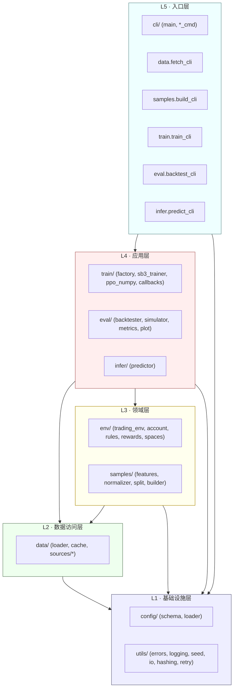
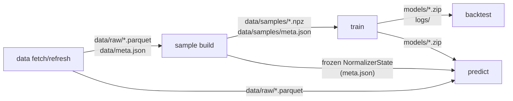
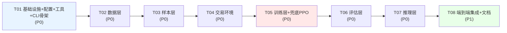

# ARCHITECTURE：A 股强化学习交易工程（stock_ai）

> 版本：v1.0 ｜ 作者：高见远（Architect）｜ 日期：2025
> 上游输入：`docs/PRD.md`（许清楚 PM）
> 目标：把「数据获取 → 样本构建 → RL 训练 → 回测评估 → 未知数据预测」做成一条**可复现、可分工、每个环节独立可运行**的 A 股量化交易工程流水线。

---

## 0. 核心设计声明（先读这一节）

| 声明 | 内容 |
|---|---|
| **6 条 CLI 完全独立** | `data fetch` / `data refresh` / `sample build` / `train` / `backtest` / `predict` 各自可单独执行，**只通过文件契约通信**（parquet / npz / zip / json），**绝不通过内存对象传递**。`backtest` 只需要一个 `.zip` 模型 + `test.npz`，哪怕 `train` 是昨天在另一台机器跑的也能跑。 |
| **双入口** | 每个命令同时支持 `python -m stock_ai <cmd>` 和 `python -m stock_ai.<module> <args>`（如 `python -m stock_ai.data.fetch_cli --symbols 600519`）。 |
| **RL ≠ 价格预测** | 学的是 MDP：状态 → 动作（买/卖/持有）→ 奖励。奖励 = 组合收益率 − 回撤惩罚 − 换手成本 − 杠杆惩罚。 |
| **无前视偏差** | walk-forward 按时间切分、禁止打乱、训练/验证/测试窗口不重叠、边界加 embargo；归一化统计量**只在训练窗口 fit 并冻结**。 |
| **A 股规则内建** | T+1、涨跌停不可成交、停牌、佣金双边 0.025%、印花税卖出 0.05%、滑点 0.1%。 |
| **可复现** | 全局 seed（Python/NumPy/torch/SB3）+ 数据快照 `data_hash`；同参数必得同结果。 |
| **算法主 + 备 + 兜底** | 主算法 PPO（离散 3 动作）；备选 SAC/DQN；**纯 NumPy PPO 兜底**（应对 SB3/torch 在 Py3.13 装不上）。 |

---

## 1. 实现方案与框架选型

### 1.1 核心技术挑战

| # | 挑战 | 应对策略 |
|---|---|---|
| C1 | **SB3 / Gymnasium / torch 在 Python 3.13 + Windows 的兼容性脆弱** | 给出锁定版本组合 + 运行时 backend 探测 + 纯 NumPy PPO 兜底（见 1.2） |
| C2 | **前视偏差（look-ahead bias）** 是量化 RL 最致命错误 | 归一化统计量只在训练窗口 fit；walk-forward 切分 + embargo；特征只用 t 及之前数据；`check_env` 单测防泄漏 |
| C3 | **A 股交易机制复杂**（T+1/涨跌停/停牌/税费） | 全部内建到 `TradingEnv`，用可单测的纯函数计算成本（`RewardCalculator`、`apply_costs`） |
| C4 | **数据源不稳定**（AKShare 接口易变） | 多源 fallback 链 + 指数退避重试 + parquet 缓存兜底 |
| C5 | **奖励函数不能是纯 PnL**（否则学出高杠杆/高换手） | 结构化奖励：`r = ret − λ₁·drawdown − λ₂·turnover − λ₃·leverage`，参数配置化 |
| C6 | **Windows 路径 / 编码坑** | 全链路 `pathlib.Path` + 显式 `encoding="utf-8"`；parquet 文件名清洗非法字符 |
| C7 | **命令间解耦但需共享特征定义** | 特征定义与归一化状态写入 `data/samples/meta.json`，`predict` 复用冻结状态，绝不重新 fit |

### 1.2 框架与版本组合决策表（重点）

**环境实况（已探测）**：
- 解释器：`C:\Users\jerrykong\.workbuddy\binaries\python\versions\3.13.12\python.exe` → 实际 **Python 3.13.14**
- venv：`C:\Users\jerrykong\.workbuddy\binaries\python\envs\default`
- venv 现有包：`numpy 2.5.3`、`scipy 1.18.1`、`pillow 12.3.0`、`imageio-ffmpeg 0.6.0`、`pip 26.1.2`
- **未安装**：pandas / pyarrow / akshare / torch / stable-baselines3 / gymnasium / matplotlib / click / pyyaml

**版本组合决策（Primary 方案，按此锁定 requirements.txt）**：

| 包 | 锁定版本 | 选它的理由 | 风险 |
|---|---|---|---|
| Python | 3.13.14（已装，不可变） | 用户环境固定 | — |
| numpy | `>=2.1,<2.6`（现 2.5.3 保留） | SB3 2.5.0+ 明确支持 NumPy 2.0；现装 2.5.3 | 若 torch 报 numpy ABI 冲突 → 降到 `2.2.3` |
| pandas | `>=2.2,<3.0` | SB3 2.9 起 pandas 变可选，本项目自用 | 2.3 对 numpy2 有回归，`>=2.2` 稳妥 |
| pyarrow | `>=17,<22` | parquet 落盘，cp313 wheel 齐全 | 无 |
| **torch** | **`>=2.6,<2.8`（CPU）** | **关键决策**：cp313 win_amd64 wheel 自 2.5(实验)/2.6(稳定)/2.7(完整)；2.8 要求更新，保守取 2.6–2.7 | 若 pip 解析失败 → `--index-url https://download.pytorch.org/whl/cpu` 装 CPU 版 |
| **gymnasium** | **`==1.1.1`** | 与 SB3 兼容区间；SB3 对 gymnasium 是**上限约束**（2.7.x/2.8.0 声明 gymnasium≤某版本），钉死 1.1.1 避免被解析器拉到不兼容版 | 若 SB3 要求更窄 → 按 SB3 元数据下调 |
| **stable-baselines3** | **`>=2.6,<2.9`** | 2.8.0 才正式支持 Py3.13；2.9 要求 torch>=2.8（与上面冲突）。取 `2.8.0` 为靶心 | 装不上则走 fallback |
| sb3-contrib | 可选 `>=2.6` | 需要 MaskablePPO（涨跌停动作屏蔽）时用 | 非必需 |
| matplotlib | `>=3.9` | 权益曲线/训练曲线 | 无 |
| click | `>=8.1` | CLI 框架（比 argparse 更适合子命令树） | 无 |
| pyyaml | `>=6.0` | 配置文件 | 无 |
| akshare | `>=1.14`（不锁死） | 主数据源，接口频繁变动不宜硬锁 | 接口易变 → 已在 C4 处理 |
| requests | `>=2.32` | 腾讯/东财 fallback + 重试 | 无 |
| tqdm | `>=4.66` | 进度条 | 无 |
| pytest | `>=8.0`（dev） | 单测 | 无 |
| tensorboard | `>=2.16`（可选） | SB3 训练日志 | 可选，不阻塞 |

**推荐安装顺序**（必须遵守，避免解析器把 torch 拉成不兼容版）：
```powershell
$PY = "C:\Users\jerrykong\.workbuddy\binaries\python\envs\default\Scripts\python.exe"
& $PY -m pip install --upgrade pip
# 1) 先装 torch CPU 版（固定索引，避免拉到 CUDA/不兼容版）
& $PY -m pip install "torch>=2.6,<2.8" --index-url https://download.pytorch.org/whl/cpu
# 2) 再装 gymnasium（钉死版本）
& $PY -m pip install "gymnasium==1.1.1"
# 3) 再装 SB3
& $PY -m pip install "stable-baselines3>=2.6,<2.9"
# 4) 其余
& $PY -m pip install "pandas>=2.2,<3.0" "pyarrow>=17,<22" akshare requests matplotlib click pyyaml tqdm
# 5) 自检
& $PY -m stock_ai doctor
```

### 1.3 降级方案（决策建议 — 强烈推荐采纳）

> **建议：从一开始就实现 `NumpyPPOTrainer`，而不是"等 SB3 装不上再说"。**

| 层级 | 方案 | 触发条件 | 说明 |
|---|---|---|---|
| L0（首选） | **SB3 PPO** | `import stable_baselines3` 成功且版本在支持区间 | 生产质量、成熟调参、TensorBoard、社区背书 |
| L1（备选算法） | SB3 **DQN**（离散）或 **SAC**（连续仓位） | 用户 `--algo dqn/sac` | `--algo` 参数切换；SAC 用 `ContinuousActionWrapper` 把 [0,1] 仓位映射为买/卖 |
| L2（**兜底**） | **自研纯 NumPy PPO** | SB3 或 torch 导入失败 / `check_env` 通过但 SB3 构造异常 | 单文件 ~400 行，仅依赖 numpy；用同一 `TradingEnv`、同一 `.zip`(实为 npz+json) 接口、同一 `TrainResult` 契约 |
| L3（保命） | **规则基线策略**（买持 / 固定仓位） | 全部失败 | `backtest --model baseline`，保证回测/预测链路仍可端到端跑通 |

**为什么必须在 T01 就做兜底检测**：`TrainerFactory.backend_available()` 在训练前探测；`doctor` 命令显式报告后端可用性。这样**架构上 SB3 是"可选加速器"而非"硬依赖"**，工程不会因一个第三方包的版本冲突而整体瘫痪。

**兜底 PPO 设计要点**（保持与 SB3 输出物契约一致）：
- 同一 `Enrollment` Protocol：`learn / predict / save / load`
- `save()` 写出 `<name>.zip`（内部为 `npz(weights) + json(hparams)`，用 zipfile 打包），使 `backtest`/`predict` 的 `--model` 参数格式统一
- 用 GAE + clipped surrogate + 离散 softmax 头，隐藏层 [64,64]，`tanh` 激活
- 固定 seed → 权重初始化/采样全可复现

### 1.4 架构模式

- **分层架构（Layered）+ 依赖倒置**：`cli → train/eval/infer → env/samples → data → utils/config`，下层绝不 import 上层。
- **Ports & Adapters（端口-适配器）**：`DataSource`（端口）/ `AkShareSource|TencentSource|EastMoneySource`（适配器）；`Enrollment`（端口）/ `SB3Trainer|NumpyPPOTrainer`（适配器）。
- **配置对象（Configuration Object）**：`AppConfig` 贯穿全链路，CLI 参数覆盖 YAML。
- **纯函数核心**：成本计算、指标计算、特征变换均为无副作用纯函数，**便于单测**。

---

## 2. 项目目录结构

```
E:\project\stock_ai\
├── pyproject.toml                      # 项目元数据 + 依赖声明 + 入口脚本 stockai
├── requirements.txt                    # 锁版依赖（见 §9）
├── requirements-dev.txt                # pytest / ruff / mypy
├── README.md                           # 快速开始
├── .gitignore                          # 忽略 data/raw, models/, logs/, reports/, __pycache__
│
├── configs/
│   ├── default.yaml                    # 默认全量配置（见 §6）
│   ├── fast_dev.yaml                   # 小样本快速调试（1 股、1 年、5k 步）
│   └── symbols_hs300.yaml              # 股票池示例（可被 --symbols 覆盖）
│
├── docs/
│   ├── PRD.md                          # （已有）
│   ├── ARCHITECTURE.md                 # 本文档
│   ├── sequence-diagram.mermaid        # §5 时序图源文件
│   └── class-diagram.mermaid           # §4 类图源文件
│
├── scripts/
│   ├── setup_env.ps1                   # 一键建 venv + 按序安装依赖
│   └── run_pipeline.ps1                # 串联 6 条命令的示例脚本
│
├── src/
│   └── stock_ai/
│       ├── __init__.py                 # 版本号 __version__
│       ├── __main__.py                 # 入口：python -m stock_ai -> cli.main()
│       │
│       ├── config/
│       │   ├── __init__.py
│       │   ├── schema.py               # AppConfig / DataConfig / SampleConfig / EnvConfig / TrainConfig / PathConfig（dataclass）
│       │   └── loader.py               # ConfigLoader：YAML 载入 → 解析路径 → CLI 覆盖合并 → ensure_dirs()
│       │
│       ├── utils/
│       │   ├── __init__.py
│       │   ├── errors.py               # StockAIError 及子类（DataSourceError/ConfigError/ArtifactError/NotTradableError）
│       │   ├── logging.py              # LoggerFactory：统一控制台(UTF-8)+文件双通道
│       │   ├── seed.py                 # set_global_seed(seed)：Python/NumPy/torch 全对齐
│       │   ├── io.py                   # read/write parquet、npz、json、yaml；UTF-8；路径清洗；时间戳 YYYYMMDD_HHMMSS
│       │   ├── hashing.py              # sha256_file / hash_dataframes → data_hash
│       │   └── retry.py                # retry_with_backoff 装饰器
│       │
│       ├── data/
│       │   ├── __init__.py
│       │   ├── schema.py               # OHLCV 列名/ dtype 常量、SymbolInfo dataclass、列校验
│       │   ├── sources/
│       │   │   ├── __init__.py
│       │   │   ├── base.py             # DataSource 抽象基类（端口）
│       │   │   ├── akshare_source.py   # AKShare 适配器（主源）
│       │   │   ├── tencent_source.py   # 腾讯行情适配器（fallback）
│       │   │   └── eastmoney_source.py # 东方财富适配器（fallback）
│       │   ├── cache.py                # DataCache：parquet 读写、meta.json 管理、缺口检测
│       │   ├── loader.py               # StockDataLoader：多源 fallback、增量合并、fetch/refresh/info
│       │   └── fetch_cli.py            # 独立入口：python -m stock_ai.data.fetch_cli
│       │
│       ├── samples/
│       │   ├── __init__.py
│       │   ├── features.py             # FeatureEngineer：指标(MA/动量/波动率/量比) + fit/transform，防泄漏
│       │   ├── normalizer.py           # NormalizerState：训练统计量冻结、序列化
│       │   ├── split.py                # walk-forward 时间切分 + embargo（纯函数）
│       │   ├── builder.py              # SampleBuilder：拼 obs 矩阵、滑窗、计算 data_hash、落盘 npz+meta
│       │   ├── schema.py               # SampleSplit / SampleBundle dataclass
│       │   └── build_cli.py            # 独立入口：python -m stock_ai.samples.build_cli
│       │
│       ├── env/
│       │   ├── __init__.py
│       │   ├── trading_env.py          # TradingEnv(gymnasium.Env)：reset/step/render/spaces
│       │   ├── account.py              # EnvState dataclass + 持仓/现金/盈亏账面计算
│       │   ├── rules.py                # A 股规则纯函数：T+1、涨跌停、停牌、cost(notional,side)
│       │   ├── rewards.py              # RewardCalculator：ret − λ₁·dd − λ₂·turnover − λ₃·leverage
│       │   └── spaces.py               # observation_space / action_space 构造（Box/Discrete/Discrete(n)）
│       │
│       ├── train/
│       │   ├── __init__.py
│       │   ├── base.py                 # Enrollment Protocol + TrainResult dataclass
│       │   ├── policy.py               # NumpyActorCritic：纯 numpy MLP + forward/act/save/load
│       │   ├── ppo_numpy.py            # NumpyPPOTrainer：GAE + clipped surrogate 兜底实现
│       │   ├── sb3_trainer.py          # SB3Trainer：SB3 PPO/SAC/DQN 封装（含 SAC 连续仓位包装）
│       │   ├── factory.py              # TrainerFactory：backend 探测 + 选择 SB3/Numpy
│       │   ├── callbacks.py            # 保存 best model、写曲线、日志回调
│       │   └── train_cli.py            # 独立入口：python -m stock_ai.train.train_cli
│       │
│       ├── eval/
│       │   ├── __init__.py
│       │   ├── simulator.py            # PortfolioSimulator：按动作序列模拟组合，复用 env 成本规则
│       │   ├── metrics.py              # MetricsCalculator：年化/回撤/夏普/胜率/换手（纯函数）
│       │   ├── backtester.py           # Backtester：跑 test 样本、对比 buy&hold 基线
│       │   ├── plot.py                 # EquityPlotter：权益曲线 PNG、训练曲线 PNG（matplotlib Agg）
│       │   ├── schema.py               # BacktestResult dataclass
│       │   └── backtest_cli.py         # 独立入口：python -m stock_ai.eval.backtest_cli
│       │
│       ├── infer/
│       │   ├── __init__.py
│       │   ├── predictor.py            # Predictor：加载模型 + 冻结归一化状态，逐日 stateful 推理
│       │   ├── schema.py               # PredictionRow dataclass（date/symbol/action/target_position/signal）
│       │   └── predict_cli.py          # 独立入口：python -m stock_ai.infer.predict_cli
│       │
│       └── cli/
│           ├── __init__.py
│           ├── main.py                 # click Group：注册 data/sample/train/backtest/predict/doctor
│           ├── data_cmd.py             # `data fetch|refresh|info` 子命令
│           ├── sample_cmd.py           # `sample build` 子命令
│           ├── train_cmd.py            # `train` 子命令
│           ├── backtest_cmd.py         # `backtest` 子命令
│           ├── predict_cmd.py          # `predict` 子命令
│           └── doctor_cmd.py           # `doctor` 环境自检（P2）
│
├── tests/
│   ├── conftest.py                     # 共享 fixture（临时目录、小样本 df、fake 数据源）
│   ├── test_rules.py                   # T+1/涨跌停/停牌/成本 纯函数单测（重点）
│   ├── test_rewards.py                 # 奖励函数数值正确性
│   ├── test_features.py                # 无泄漏验证：fit 只用 train，transform 不越界
│   ├── test_split.py                   # walk-forward 不重叠 + embargo
│   ├── test_env_checker.py             # gymnasium.check_env(TradingEnv) 必须通过
│   ├── test_metrics.py                 # 指标计算对照已知答案
│   ├── test_hashing.py                 # 同数据同 hash、异数据异 hash
│   └── test_cli_smoke.py               # 6 条命令 --help + fast_dev 端到端冒烟
│
├── data/                               # 运行时产物（gitignore）
│   ├── raw/<symbol>.parquet
│   ├── meta.json
│   └── samples/{train,val,test}.npz + meta.json
├── models/                             # <algo>_<ts>.zip + <algo>_<ts>.json(sidecar)
├── logs/<run>/                         # tensorboard/ + curve.png + train.log
└── reports/                            # backtest_<ts>.json / equity_<ts>.png / predict_<ts>.{csv,json}
```

**包管理方式**：采用 `src/` 布局 + 可编辑安装（`pip install -e .`），保证 `python -m stock_ai` 与 `python -m stock_ai.data.fetch_cli` 均可解析。

---

## 3. 模块分层与依赖方向



### 依赖规则（HARD RULES）

| 规则 | 说明 |
|---|---|
| ✅ 允许 | 上层 → 下层（L5→L1）；同层内通过**显式接口**调用（如 `eval` 用 `train.base.Enrollment`） |
| ❌ 禁止 | **下层 import 上层**：`data/` 不得 import `train/`；`env/` 不得 import `cli/` |
| ❌ 禁止 | `env/` 依赖 `train/`（环境必须独立于算法，否则无法单测/被 backtest 复用） |
| ❌ 禁止 | `samples/` 依赖 `env/`（样本只产出数组，不知道环境存在） |
| ❌ 禁止 | 任何模块直接 `import torch` / `import stable_baselines3` **除** `train/sb3_trainer.py` 与 `train/policy.py`（延迟导入，便于兜底） |
| ⚠️ 注意 | `eval/` 与 `infer/` **只依赖 `train/base.py` 的 Protocol**，不依赖具体 SB3 类 → 模型后端可插拔 |
| ⚠️ 注意 | `cli/` 是**唯一**允许读用户参数并组装 `AppConfig` 的地方；模块内部只接受 config 对象 |

**跨模块通信契约 = 文件**（这是解耦的关键）：



---

## 4. 核心数据结构与接口

> 完整类图见 `docs/class-diagram.mermaid`。以下为关键类的 Python 签名（Engineer 按此实现）。

### 4.1 配置对象

```python
# stock_ai/config/schema.py
from dataclasses import dataclass, field, asdict
from pathlib import Path
from typing import Any

@dataclass
class DataConfig:
    symbols: list[str] = field(default_factory=list)
    start: str = "20180101"          # YYYYMMDD
    end: str = "20241231"
    source: str = "akshare"           # akshare|tencent|eastmoney
    cache_dir: Path = Path("data/raw")
    adjust: str = "none"              # 不复权（默认）
    retry_times: int = 3
    retry_backoff: float = 1.5        # 指数退避基数(秒)
    timeout: float = 15.0

@dataclass
class SampleConfig:
    window: int = 20                   # 历史窗口 N 步
    features: list[str] = field(default_factory=lambda: [
        "open","high","low","close","volume",
        "ma5","ma10","ma20","momentum","volatility","volume_ratio"])
    train_start: str = "20180101"
    train_end: str = "20211231"
    test_start: str = "20220101"
    test_end: str = "20241231"
    embargo_days: int = 5              # 训练/测试边界隔离
    normalize: bool = True             # 统计量仅 train 窗口 fit

@dataclass
class EnvConfig:
    initial_cash: float = 1_000_000.0
    commission_rate: float = 0.00025   # 佣金 0.025% 双边
    stamp_tax_rate: float = 0.0005     # 印花税 0.05% 仅卖出
    slippage_rate: float = 0.001       # 滑点 0.1%
    min_commission: float = 5.0        # 最低佣金 5 元
    reward_type: str = "drawdown_penalty"   # gross|drawdown_penalty|sharpe
    lambda_drawdown: float = 0.1
    lambda_turnover: float = 0.001
    lambda_leverage: float = 0.01
    max_position: float = 1.0          # 最大仓位比例(v1 单标的=1.0)
    lot_size: int = 100                # A 股 100 股整手

@dataclass
class TrainConfig:
    algo: str = "ppo"                  # ppo|sac|dqn
    timesteps: int = 200_000
    learning_rate: float = 3e-4
    gamma: float = 0.99
    gae_lambda: float = 0.95
    clip_range: float = 0.2
    n_steps: int = 2048
    batch_size: int = 64
    n_epochs: int = 10
    ent_coef: float = 0.0
    train_split: float = 1.0           # npz 内已切分，此处仅微调
    val_split: float = 0.0
    torch_threads: int = 1             # Windows 下防止线程爆炸
    backend: str = "auto"              # auto|sb3|numpy
    out_dir: Path = Path("models")

@dataclass
class PathConfig:
    root: Path = Path(".")
    raw: Path = Path("data/raw")
    samples: Path = Path("data/samples")
    models: Path = Path("models")
    logs: Path = Path("logs")
    reports: Path = Path("reports")

@dataclass
class AppConfig:
    data: DataConfig = field(default_factory=DataConfig)
    sample: SampleConfig = field(default_factory=SampleConfig)
    env: EnvConfig = field(default_factory=EnvConfig)
    train: TrainConfig = field(default_factory=TrainConfig)
    paths: PathConfig = field(default_factory=PathConfig)
    random_seed: int = 42
    log_level: str = "INFO"

    @classmethod
    def from_yaml(cls, path: Path) -> "AppConfig": ...
    @classmethod
    def from_dict(cls, d: dict[str, Any]) -> "AppConfig": ...
    def merge_cli_overrides(self, overrides: dict[str, Any]) -> "AppConfig": ...
    def to_dict(self) -> dict[str, Any]: ...
    def ensure_dirs(self) -> None: ...
```

### 4.2 数据层

```python
# stock_ai/data/schema.py
COLUMNS: list[str] = ["date","open","high","low","close","volume","amount","adj_factor"]
DTYPES:  dict[str,str] = {"date":"datetime64[ns]", "open":"float64", "high":"float64",
                          "low":"float64", "close":"float64", "volume":"float64",
                          "amount":"float64", "adj_factor":"float64"}

@dataclass
class SymbolInfo:
    symbol: str; start: str; end: str; rows: int; source: str
    updated_at: str; missing_days: int

def validate_frame(df: "pd.DataFrame") -> "pd.DataFrame": ...   # 列/ dtype/ 升序/ 去重，异常抛 DataSourceError

# stock_ai/data/sources/base.py
class DataSource(ABC):
    name: str
    @abstractmethod
    def fetch(self, symbol: str, start: str, end: str) -> "pd.DataFrame": ...
    def probe(self, symbol: str) -> bool: ...

# stock_ai/data/cache.py
class DataCache:
    def __init__(self, cache_dir: Path) -> None: ...
    def path_of(self, symbol: str) -> Path: ...
    def exists(self, symbol: str) -> bool: ...
    def read(self, symbol: str) -> "pd.DataFrame": ...
    def write(self, symbol: str, df: "pd.DataFrame") -> Path: ...
    def read_meta(self) -> dict: ...
    def write_meta(self, meta: dict) -> None: ...
    def find_gaps(self, df: "pd.DataFrame") -> list[str]: ...

# stock_ai/data/loader.py
class StockDataLoader:
    def __init__(self, config: DataConfig, logger: "Logger") -> None: ...
    def fetch_symbol(self, symbol: str, start: str, end: str) -> "pd.DataFrame":
        """按 config.source 顺序 + 自动 fallback 链尝试；全部失败抛 DataSourceError。"""
    def fetch_all(self) -> dict[str, "pd.DataFrame"]: ...
    def refresh_symbol(self, symbol: str) -> "pd.DataFrame":
        """读缓存 -> 取 max(date) -> 拉增量 -> merge_incremental 去重排序 -> 落盘。"""
    def load_cached(self, symbol: str) -> "pd.DataFrame": ...
    def info(self) -> list[SymbolInfo]: ...
    @staticmethod
    def merge_incremental(old: "pd.DataFrame", new: "pd.DataFrame") -> "pd.DataFrame": ...
```

### 4.3 样本层

```python
# stock_ai/samples/normalizer.py
@dataclass
class NormalizerState:
    mean: "np.ndarray"; std: "np.ndarray"; columns: list[str]; data_hash: str
    def to_dict(self) -> dict: ...
    @classmethod
    def from_dict(cls, d: dict) -> "NormalizerState": ...

# stock_ai/samples/features.py
class FeatureEngineer:
    def __init__(self, feature_names: list[str]) -> None: ...
    def build_indicators(self, df: "pd.DataFrame", names: list[str]) -> "pd.DataFrame":
        """纯函数：MA(5/10/20)、momentum(N日收益率)、volatility(滚动std)、volume_ratio(量比)。
           只用 t 及之前的数据；返回列名与 names 对齐。"""
    def fit(self, df: "pd.DataFrame") -> NormalizerState:
        """仅用传入 df（调用方保证是训练窗口）计算 mean/std；绝不看测试数据。"""
    def transform(self, df: "pd.DataFrame", state: NormalizerState) -> "np.ndarray": ...
    def make_obs_matrix(self, feat: "pd.DataFrame", state: NormalizerState,
                        window: int) -> "np.ndarray":
        """滑窗拼接：返回 (T, window, n_features)。"""

# stock_ai/samples/split.py
def walk_forward_split(dates: "np.ndarray", train_range: tuple[str,str],
                       test_range: tuple[str,str], embargo_days: int
                       ) -> tuple["np.ndarray","np.ndarray"]:
    """纯函数：按时间顺序返回 (train_idx, test_idx)，二者不重叠且中间留 embargo_days。"""

# stock_ai/samples/schema.py
@dataclass
class SampleSplit:
    obs: "np.ndarray"          # (T, window, n_features)
    dates: "np.ndarray"        # (T,) YYYYMMDD str
    symbols: "np.ndarray"      # (T,)
    prices: "np.ndarray"       # (T,) 用于回测结算的 close
    requested_start: str; requested_end: str
    n_steps: int; n_features: int

@dataclass
class SampleBundle:
    train: SampleSplit; val: SampleSplit; test: SampleSplit
    normalizer: NormalizerState
    feature_names: list[str]; window: int; seed: int; data_hash: str
    def save_meta(self, path: Path) -> None: ...

# stock_ai/samples/builder.py
class SampleBuilder:
    def __init__(self, config: SampleConfig, logger: "Logger") -> None: ...
    def build_all(self, loader: StockDataLoader) -> SampleBundle: ...
    def build_split(self, dfs: dict[str,"pd.DataFrame"], state: NormalizerState,
                    start: str, end: str) -> SampleSplit: ...
    @staticmethod
    def compute_data_hash(paths: list[Path]) -> str: ...
    def save(self, bundle: SampleBundle, out_dir: Path) -> None:
        """写出 train.npz / val.npz / test.npz / meta.json（含 data_hash, features, window, seed, ranges, normalizer）。"""
```

**`data/samples/meta.json` JSON Schema**：

```json
{
  "$schema": "http://json-schema.org/draft-07/schema#",
  "title": "SampleMeta",
  "type": "object",
  "required": ["data_hash","seed","window","feature_names","train_range","test_range","normalizer"],
  "properties": {
    "data_hash":      {"type": "string", "description": "raw parquet 内容 sha256，用于复现校验"},
    "seed":           {"type": "integer"},
    "window":         {"type": "integer", "minimum": 1},
    "symbols":        {"type": "array", "items": {"type": "string"}},
    "feature_names":  {"type": "array", "items": {"type": "string"}},
    "train_range":    {"type": "object", "properties": {"start": {"type":"string"},"end": {"type":"string"}}, "required": ["start","end"]},
    "test_range":     {"type": "object", "properties": {"start": {"type":"string"},"end": {"type":"string"}}, "required": ["start","end"]},
    "embargo_days":   {"type": "integer"},
    "rows":           {"type": "object", "properties": {"train":{"type":"integer"},"val":{"type":"integer"},"test":{"type":"integer"}}},
    "normalizer": {
      "type": "object",
      "required": ["mean","std","columns"],
      "properties": {
        "mean":    {"type": "array", "items": {"type": "number"}},
        "std":     {"type": "array", "items": {"type": "number"}},
        "columns": {"type": "array", "items": {"type": "string"}}
      }
    },
    "created_at": {"type": "string", "description": "ISO8601"}
  }
}
```

### 4.4 环境层

```python
# stock_ai/env/account.py
@dataclass
class EnvState:
    cash: float
    shares: int
    cost_basis: float          # 持仓均价
    prev_close: float
    portfolio_value: float = 0.0
    @property
    def position_ratio(self) -> float: ...
    @property
    def cash_ratio(self) -> float: ...
    @property
    def unrealized_pnl(self) -> float: ...

# stock_ai/env/rules.py  —— 全部纯函数，单测重点
def is_limit_up(prev_close: float, high: float, limit: float = 0.10) -> bool: ...
def is_limit_down(prev_close: float, low: float, limit: float = 0.10) -> bool: ...
def is_halted(volume: float, prev_volume: float) -> bool: ...
def can_buy(state: EnvState, price: float, prev_close: float,
            halted: bool, t1_blocked: bool) -> bool: ...
def can_sell(state: EnvState, price: float, prev_close: float,
             halted: bool, held_days: int) -> bool: ...
def apply_slippage(price: float, side: str, slippage: float) -> float: ...
def trade_cost(notional: float, side: str, commission_rate: float,
               stamp_tax_rate: float, min_commission: float) -> float:
    """buy: max(notional*commission, min_comm)
       sell: max(notional*commission, min_comm) + notional*stamp_tax"""

# stock_ai/env/rewards.py
class RewardCalculator:
    def __init__(self, cfg: EnvConfig) -> None: ...
    def compute(self, prev_value: float, value: float, turnover: float,
                position_ratio: float) -> float:
        """ret = (value-prev_value)/prev_value
           r = ret - λ₁*drawdown - λ₂*turnover - λ₃*|position_ratio|  (reward_type 切换)"""

# stock_ai/env/spaces.py
def build_observation_space(n_features: int, window: int) -> "gym.Space": ...
def build_action_space(mode: str) -> "gym.Space":
    """mode='discrete' -> Discrete(3)  # 0=hold,1=buy,2=sell
       mode='continuous'-> Box(0,1,(1,),float32)  # SAC 目标仓位"""

# stock_ai/env/trading_env.py
class TradingEnv(gym.Env):
    metadata = {"render_modes": ["human", "rgb_array"], "render_fps": 4}
    def __init__(self, sample: SampleSplit, env_cfg: EnvConfig, reward_cfg: RewardCalculator,
                 seed: int = 42, action_mode: str = "discrete") -> None: ...
    def reset(self, seed: int | None = None,
              options: dict | None = None) -> tuple["np.ndarray", dict]: ...
    def step(self, action: int | "np.ndarray") -> tuple["np.ndarray", float, bool, bool, dict]:
        """info 必须含：portfolio_value, cash, shares, turnover, position_ratio, date, trade_ok"""
    def render(self, mode: str = "human") -> "np.ndarray | None": ...
    def close(self) -> None: ...
    def _compute_reward(self, prev_value: float, value: float, turnover: float) -> float: ...
    def _exec_action(self, action) -> None: ...
    def _is_tradable(self, idx: int, direction: int) -> bool: ...
```

> **验收门槛**：`stable_baselines3.common.env_checker.check_env(TradingEnv(...))` 必须通过；测试中若 SB3 不可用，则用 `gymnasium.utils.env_checker.check_env` 兜底。

### 4.5 训练层（可插拔后端）

```python
# stock_ai/train/base.py
@dataclass
class TrainResult:
    run_dir: Path; model_path: Path; algo: str; backend: str
    total_timesteps: int; best_mean_reward: float; elapsed_sec: float; curve_path: Path

@runtime_checkable
class Enrollment(Protocol):
    algo_name: str
    def learn(self, total_timesteps: int, seed: int | None = None) -> None: ...
    def predict(self, obs: "np.ndarray", deterministic: bool = True
                ) -> tuple["np.ndarray", Any]: ...
    def save(self, path: Path) -> None: ...
    @classmethod
    def load(cls, path: Path, env: "TradingEnv | None" = None) -> "Enrollment": ...

# stock_ai/train/policy.py
class NumpyActorCritic:
    def __init__(self, obs_dim: int, n_actions: int, hidden: tuple[int,...] = (64,64),
                 seed: int = 42) -> None: ...
    def forward(self, obs: "np.ndarray") -> tuple["np.ndarray","np.ndarray"]: ...  # logits, value
    def act(self, obs: "np.ndarray", deterministic: bool = False
            ) -> tuple[int, float, float]: ...                                     # action, logp, value
    def save(self, path: Path) -> None: ...
    @classmethod
    def load(cls, path: Path) -> "NumpyActorCritic": ...

# stock_ai/train/ppo_numpy.py  —— 兜底实现（约 400 行，仅依赖 numpy）
class NumpyPPOTrainer:
    algo_name: str = "ppo_numpy"
    def __init__(self, env: "TradingEnv", cfg: TrainConfig, seed: int = 42) -> None: ...
    def learn(self, total_timesteps: int, seed: int | None = None) -> None:
        """rollout(n_steps) -> GAE(γ,λ) -> 多 epoch clipped surrogate + value loss + entropy。"""
    def predict(self, obs, deterministic=True) -> tuple[int, None]: ...
    def save(self, path: Path) -> None:
        """写出 path.zip：内含 weights.npz + hparams.json（与 SB3 .zip 同名不同内部，靠 sidecar json 区分 backend）。"""
    @classmethod
    def load(cls, path: Path, env=None) -> "NumpyPPOTrainer": ...

# stock_ai/train/sb3_trainer.py  —— 延迟 import，仅此文件允许 import torch/sb3
class SB3Trainer:
    SUPPORTED = {"ppo": "PPO", "sac": "SAC", "dqn": "DQN"}
    def __init__(self, env: "TradingEnv", cfg: TrainConfig, algo: str, seed: int = 42) -> None: ...
    def learn(self, total_timesteps: int, seed: int | None = None) -> None: ...
    def predict(self, obs, deterministic=True) -> tuple["np.ndarray", None]: ...
    def save(self, path: Path) -> None: ...
    @classmethod
    def load(cls, path: Path, env=None) -> "SB3Trainer": ...

# stock_ai/train/factory.py
class TrainerFactory:
    @staticmethod
    def backend_available(name: str) -> bool:
        """name in {sb3, torch, numpy}；用 importlib.util.find_spec 探测，不抛异常。"""
    @staticmethod
    def create(cfg: TrainConfig, env: "TradingEnv", preference: str = "auto") -> Enrollment:
        """auto: sb3 可用 -> SB3Trainer；否则 -> NumpyPPOTrainer。preference 可强制 numpy。"""
```

### 4.6 评估层

```python
# stock_ai/eval/metrics.py  —— 全纯函数
def total_return(equity: "np.ndarray") -> float: ...
def annual_return(equity: "np.ndarray", dates: "np.ndarray", periods: int = 252) -> float: ...
def max_drawdown(equity: "np.ndarray") -> float: ...
def sharpe(returns: "np.ndarray", rf: float = 0.0, periods: int = 252) -> float: ...
def win_rate(trades: list[dict]) -> float: ...
def turnover(trades: list[dict], equity: "np.ndarray") -> float: ...
def compute_all(equity, dates, trades) -> dict: ...   # 返回 PRD §6 全部字段

# stock_ai/eval/simulator.py
class PortfolioSimulator:
    def __init__(self, env_cfg: EnvConfig) -> None: ...
    def run(self, actions: "np.ndarray", prices: "np.ndarray",
            dates: "np.ndarray") -> tuple["np.ndarray", list[dict]]: ...

# stock_ai/eval/schema.py
@dataclass
class BacktestResult:
    metrics: dict; equity_curve: "np.ndarray"; dates: "np.ndarray"
    trades: list[dict]; baseline_equity: "np.ndarray"
    backend: str; algo: str; model_path: str; data_hash: str
    def to_json(self, path: Path) -> None: ...

# stock_ai/eval/backtester.py
class Backtester:
    def __init__(self, model: Enrollment, env_cfg: EnvConfig,
                 samples: SampleSplit, mode: str = "discrete") -> None: ...
    def run(self) -> BacktestResult: ...
    def compare_with_baseline(self) -> dict: ...   # buy&hold

# stock_ai/eval/plot.py
class EquityPlotter:
    def plot(self, result: BacktestResult, out_path: Path, title: str = "") -> Path: ...
    def plot_training_curve(self, series: dict[str, list[float]], out_path: Path) -> Path: ...
```

**`reports/backtest_<ts>.json` 结构**：
```json
{
  "meta": {"ts":"20250101_120000","backend":"sb3","algo":"ppo",
           "model_path":"models/ppo_20250101_110000.zip","data_hash":"<sha256>",
           "test_range":{"start":"20220101","end":"20241231"},
           "env":{"initial_cash":1000000,"commission_rate":0.00025,
                  "stamp_tax_rate":0.0005,"slippage_rate":0.001}},
  "metrics": {"annual_return":0.0,"total_return":0.0,"max_drawdown":0.0,"sharpe":0.0,
              "win_rate":0.0,"turnover":0.0,"num_trades":0,
              "benchmark_return":0.0},
  "equity_curve": [1000000.0, "..."]
}
```

### 4.7 推理层

```python
# stock_ai/infer/schema.py
@dataclass
class PredictionRow:
    date: str; symbol: str; action: str        # 买/卖/持有
    target_position: float; signal: float; price: float; prob: float | None

# stock_ai/infer/predictor.py
class Predictor:
    def __init__(self, model: Enrollment, env_cfg: EnvConfig,
                 normalizer: NormalizerState, feature_names: list[str],
                 window: int, mode: str = "discrete") -> None: ...
    def predict_from_frames(self, frames: dict[str,"pd.DataFrame"], symbol: str
                            ) -> list[PredictionRow]: ...
    def predict_range(self, symbols: list[str], start: str, end: str,
                      loader: "StockDataLoader") -> list[PredictionRow]: ...
    def to_csv(self, rows: list[PredictionRow], out: Path) -> Path: ...
    def to_json(self, rows: list[PredictionRow], out: Path) -> Path: ...
```

### 4.8 跨切面

```python
# stock_ai/utils/errors.py
class StockAIError(Exception):
    def __init__(self, message: str, *, context: dict | None = None) -> None: ...
class DataSourceError(StockAIError): ...
class NotTradableError(StockAIError): ...
class ConfigError(StockAIError): ...
class ArtifactError(StockAIError): ...      # 文件契约缺失/损坏

# stock_ai/utils/seed.py
def set_global_seed(seed: int) -> None:
    """random / numpy / (可选) torch 全部对齐；torch 用延迟 import。"""

# stock_ai/utils/logging.py
class LoggerFactory:
    @staticmethod
    def setup(name: str, log_dir: Path | None = None, level: str = "INFO") -> "Logger": ...
    @staticmethod
    def get(name: str) -> "Logger": ...

# stock_ai/utils/io.py
def read_parquet(path: Path) -> "pd.DataFrame": ...
def write_parquet(df: "pd.DataFrame", path: Path) -> Path: ...
def write_npz(path: Path, **arrays: "np.ndarray") -> Path: ...
def read_npz(path: Path) -> dict[str, "np.ndarray"]: ...
def read_json(path: Path) -> dict: ...
def write_json(obj: dict, path: Path, indent: int = 2) -> Path: ...
def timestamp() -> str: ...                    # YYYYMMDD_HHMMSS
def sanitize_filename(name: str) -> str: ...   # Windows 非法字符处理
def ensure_utf8_console() -> None: ...         # code page / PYTHONIOENCODING 兼容
```

---

## 5. 程序调用流程

> 完整时序图见 `docs/sequence-diagram.mermaid`（覆盖 6 条命令各自调用链）。要点回顾：

| 命令 | 关键调用链 | 文件契约（输入 → 输出） |
|---|---|---|
| `data fetch` | `ConfigLoader.load` → `StockDataLoader.fetch_all` → `DataCache.exists` → `DataSource.fetch`（失败重试→fallback）→ `DataCache.write` | 无 → `data/raw/*.parquet` + `data/meta.json` |
| `data refresh` | `load` → `DataLoader.refresh_symbol` → `Cache.read`（取 max date）→ `DataSource.fetch(增量)` → `merge_incremental` → `Cache.write` | `data/raw/*.parquet` → 更新后同路径 + 缺口告警 |
| `sample build` | `load` → `DataLoader.load_cached` → `FeatureEngineer.build_indicators/fit/transform` → `walk_forward_split` → `SampleBuilder.save` | `data/raw/*.parquet` → `data/samples/{train,val,test}.npz` + `meta.json` |
| `train` | `load` → `read_npz` → `TradingEnv` → `check_env` → `TrainerFactory.create`（探测 SB3，否则 NumpyPPO）→ `learn` → `save` | `train.npz` → `models/<algo>_<ts>.zip` + sidecar json + `logs/<run>/` |
| `backtest` | `load` → `read_npz(test)` → `Enrollment.load` → `Backtester.run`（`predict`/`step` 循环）→ `MetricsCalculator.compute_all` → `to_json` + `EquityPlotter.plot` | `models/*.zip` + `test.npz` → `reports/backtest_<ts>.json` + `equity_<ts>.png` |
| `predict` | `load` → `read meta.json`（冻结 `NormalizerState`）→ `Enrollment.load` → `Predictor.predict_from_frames`（逐日 stateful）→ `to_csv/to_json` | `models/*.zip` + `meta.json` + `data/raw` → `reports/predict_<ts>.{csv,json}` |

**关键约束**：所有 `read_*` 遇到文件缺失/损坏必须抛 `ArtifactError` 并给出**明确的“请先执行 XX 命令”提示**，而非静默失败。

---

## 6. 配置文件设计（`configs/default.yaml`）

```yaml
# ===== 全局 =====
random_seed: 42
log_level: INFO

# ===== 数据层 =====
data:
  symbols: []                      # 空则回退到 configs/symbols_hs300.yaml
  start: "20180101"
  end: "20241231"
  source: akshare                  # akshare | tencent | eastmoney
  cache_dir: data/raw
  adjust: none                    # 不复权（默认）
  retry_times: 3
  retry_backoff: 1.5
  timeout: 15.0

# ===== 样本层 =====
sample:
  window: 20
  features:
    - open
    - high
    - low
    - close
    - volume
    - ma5
    - ma10
    - ma20
    - momentum
    - volatility
    - volume_ratio
  train_start: "20180101"
  train_end:   "20211231"
  test_start:  "20220101"
  test_end:    "20241231"
  embargo_days: 5
  normalize: true

# ===== 环境层（A 股规则）=====
env:
  initial_cash: 1000000.0
  commission_rate: 0.00025         # 佣金 0.025% 双边
  stamp_tax_rate: 0.0005           # 印花税 0.05% 卖出
  slippage_rate: 0.001             # 滑点 0.1%
  min_commission: 5.0
  reward_type: drawdown_penalty    # gross | drawdown_penalty | sharpe
  lambda_drawdown: 0.1
  lambda_turnover: 0.001
  lambda_leverage: 0.01
  max_position: 1.0
  lot_size: 100

# ===== 训练层 =====
train:
  algo: ppo                        # ppo | sac | dqn
  timesteps: 200000
  learning_rate: 0.0003
  gamma: 0.99
  gae_lambda: 0.95
  clip_range: 0.2
  n_steps: 2048
  batch_size: 64
  n_epochs: 10
  ent_coef: 0.0
  torch_threads: 1
  backend: auto                    # auto | sb3 | numpy
  out_dir: models

# ===== 路径 =====
paths:
  root: .
  raw: data/raw
  samples: data/samples
  models: models
  logs: logs
  reports: reports
```

**命令行覆盖规则**：`--symbols/--start/--end/--seed/--algo/--timesteps/--window/--features` 等参数由 `AppConfig.merge_cli_overrides()` 覆盖对应字段，**CLI 优先级 > YAML > 代码默认值**。

---

## 7. 任务列表（实现顺序，逐任务可交付）

> 共 **8 个任务**（PRD 极简，但本项目模块间存在真实依赖链；每个任务都 ≥3 个文件）。
> 依赖图见 §7.2。P0 = 阻塞主链路；P1 = 增强。

| 任务ID | 任务名 | 涉及文件（相对路径） | 依赖 | 验收标准 | 复杂度 |
|---|---|---|---|---|---|
| **T01** | **项目基础设施 + 配置 + 工具 + CLI 骨架** | `pyproject.toml` · `requirements.txt` · `requirements-dev.txt` · `configs/default.yaml` · `configs/fast_dev.yaml` · `configs/symbols_hs300.yaml` · `src/stock_ai/__init__.py` · `src/stock_ai/__main__.py` · `src/stock_ai/config/schema.py` · `src/stock_ai/config/loader.py` · `src/stock_ai/utils/{errors,logging,seed,io,hashing,retry}.py` · `src/stock_ai/cli/main.py` · `src/stock_ai/cli/doctor_cmd.py` · `.gitignore` | — | ① `pip install -e .` 成功；② `python -m stock_ai --help` 列出 6 类子命令（可为占位）；③ `AppConfig.from_yaml("configs/default.yaml")` 全字段正确；④ `logger` 控制台+文件双输出且中文不乱码；⑤ `set_global_seed(42)` 两次调用 numpy 随机序列一致；⑥ `timestamp()` 返回 `YYYYMMDD_HHMMSS` | M |
| **T02** | **数据层（多源 fallback + 缓存 + 增量刷新）** | `src/stock_ai/data/schema.py` · `src/stock_ai/data/sources/{__init__,base,akshare_source,tencent_source,eastmoney_source}.py` · `src/stock_ai/data/cache.py` · `src/stock_ai/data/loader.py` · `src/stock_ai/data/fetch_cli.py` · `src/stock_ai/cli/data_cmd.py` · `tests/conftest.py` · `tests/test_data_loader.py` | T01 | ① `python -m stock_ai data fetch --symbols 600519 --start 20230101 --end 20231231` 落盘 `data/raw/600519.parquet`；② 二次执行零网络请求（缓存命中）；③ 主源抛异常时自动 fallback 到第二源（用 monkeypatch 模拟）；④ `data refresh` 只拉增量且 `merge_incremental` 去重+升序；⑤ `data info` 输出行数/区间/缺口；⑥ 无网络时读缓存不崩 | L |
| **T03** | **样本层（特征工程 + 防泄漏归一化 + walk-forward）** | `src/stock_ai/samples/schema.py` · `src/stock_ai/samples/normalizer.py` · `src/stock_ai/samples/features.py` · `src/stock_ai/samples/split.py` · `src/stock_ai/samples/builder.py` · `src/stock_ai/samples/build_cli.py` · `src/stock_ai/cli/sample_cmd.py` · `tests/test_features.py` · `tests/test_split.py` · `tests/test_hashing.py` | T02 | ① `python -m stock_ai sample build --symbols 600519 --window 20` 产出 `train/val/test.npz` + `meta.json`；② 相同输入+seed 两次 `data_hash` **完全一致**；③ 单测证明 `fit` 只用训练窗口（改动测试区间不改变 `mean/std`）；④ `walk_forward_split` 断言 train/test 索引零重叠且中间 ≥`embargo_days`；⑤ 特征矩阵无 NaN/Inf | L |
| **T04** | **A 股交易环境（Gymnasium）** | `src/stock_ai/env/spaces.py` · `src/stock_ai/env/account.py` · `src/stock_ai/env/rules.py` · `src/stock_ai/env/rewards.py` · `src/stock_ai/env/trading_env.py` · `tests/test_rules.py` · `tests/test_rewards.py` · `tests/test_env_checker.py` | T03 | ① `check_env(TradingEnv(...))` 通过（SB3 可用时用 SB3 checker）；② T+1 单测：当日买入当日卖出被拒；③ 涨停日买入被拒、跌停日卖出被拒；④ 停牌日不可成交；⑤ 成本单测：卖出佣金+印花税数值精确匹配手算；⑥ 滑点方向正确（买价上浮/卖价下浮）；⑦ 奖励 = ret − λ₁dd − λ₂turnover − λ₃lev，数值可验证；⑧ `step` 的 `info` 含 `portfolio_value/cash/shares/turnover/position_ratio` | L |
| **T05** | **训练层（SB3 封装 + 纯 NumPy PPO 兜底 + 后端工厂）** | `src/stock_ai/train/base.py` · `src/stock_ai/train/policy.py` · `src/stock_ai/train/ppo_numpy.py` · `src/stock_ai/train/sb3_trainer.py` · `src/stock_ai/train/factory.py` · `src/stock_ai/train/callbacks.py` · `src/stock_ai/train/train_cli.py` · `src/stock_ai/cli/train_cmd.py` · `tests/test_numpy_ppo.py` · `tests/test_trainer_factory.py` | T04 | ① `python -m stock_ai train --algo ppo --samples data/samples/train.npz --timesteps 5000` 产出 `models/ppo_<ts>.zip` + sidecar json + `logs/<run>/curve.png`；② SB3 不可用时 **自动** 走 `NumpyPPOTrainer` 且命令仍成功；③ `--algo sac` 在 SB3 可用时构造 SAC（连续仓位包装）；④ 相同 seed 两次训练 `best_mean_reward` 一致（容差 1e-6）；⑤ `TrainerFactory.backend_available("sb3")` 在无 SB3 环境返回 False 而非抛异常；⑥ `NumpyPPOTrainer.save/load` 往返后 `predict` 结果一致 | L |
| **T06** | **评估层（回测 + 指标 + 权益曲线 + 基线对比）** | `src/stock_ai/eval/schema.py` · `src/stock_ai/eval/metrics.py` · `src/stock_ai/eval/simulator.py` · `src/stock_ai/eval/backtester.py` · `src/stock_ai/eval/plot.py` · `src/stock_ai/eval/backtest_cli.py` · `src/stock_ai/cli/backtest_cmd.py` · `tests/test_metrics.py` · `tests/test_backtester.py` | T05 | ① `python -m stock_ai backtest --model models/ppo_x.zip --samples data/samples/test.npz` 产出 `reports/backtest_<ts>.json` + `equity_<ts>.png`；② metrics 含 PRD §6 全部字段；③ 指标单测对照手算小数组（如 `max_drawdown` 已知答案）；④ 基线 `benchmark_return`（buy&hold）与策略曲线同图；⑤ `--model` 同时支持 SB3 zip 与 NumPy zip；⑥ 模型文件不存在时抛 `ArtifactError` 且提示"请先 train" | M |
| **T07** | **推理层（未知区间预测，复用冻结归一化状态）** | `src/stock_ai/infer/schema.py` · `src/stock_ai/infer/predictor.py` · `src/stock_ai/infer/predict_cli.py` · `src/stock_ai/cli/predict_cmd.py` · `tests/test_predictor.py` | T06 | ① `python -m stock_ai predict --model models/ppo_x.zip --symbols 600519 --start 20250101 --end 20250301` 产出 `predict_<ts>.csv` + `.json`；② CSV 列 = `date,symbol,action,target_position,signal,price`；③ `action` ∈ {买,卖,持有}；④ **复用 `data/samples/meta.json` 的冻结 `NormalizerState`，绝不重新 fit**（单测断言）；⑤ 逐日 stateful：持仓状态跨交易日延续（T+1 生效）；⑥ 无模型文件抛 `ArtifactError` | M |
| **T08** | **端到端集成 + 打包 + 文档收尾（P1）** | `scripts/setup_env.ps1` · `scripts/run_pipeline.ps1` · `README.md` · `tests/test_cli_smoke.py` · `pyproject.toml`（entry_points 补 `stockai` 脚本） · `src/stock_ai/cli/main.py`（子命令注册收尾） | T07 | ① `scripts/setup_env.ps1` 在干净 venv 一次跑通依赖安装；② `run_pipeline.ps1` 串联 6 条命令全绿（用 `fast_dev.yaml` 小样本）；③ `stockai --help` 与 `python -m stock_ai --help` 行为一致；④ 每条命令 `--help` 可用；⑤ README 含快速开始 + 命令手册 + 复现说明；⑥ `pytest` 全绿 | M |

### 7.1 任务划分理由（为何是 8 个）

- PRD 极简（189 行）但**模块依赖是硬链**：`规则纯函数 → 环境 → 训练 → 回测 → 推理`。若强行压成 5 个任务，会导致 T-env 和 T-train 挤在一个任务里，单任务涉及 15+ 文件、验收标准无法逐条验证 —— 违背"每个任务可独立验收"。
- 因此这里采用**按依赖层切分**的 8 任务方案，每个任务都是**自上而下可独立验收的垂直切片**，且每个任务 ≥3 文件（满足最小粒度）。若 team-lead 需要严格 5 任务上限，合并建议：**T01+T02 → 「基础设施+数据层」**、**T03+T04 → 「样本+环境」**（此时 3 个任务的验收标准偏多，风险是单任务过大）。**我的建议：保留 8 个任务**，因为架构型的硬依赖链不适合过度合并。

### 7.2 任务依赖图



**关键路径**：T01 → T02 → T03 → T04 → T05 → T06 → T07 → T08（全链路串行，因为依赖是真实的：没有环境无法训练，没有模型无法回测）。

**可并行点**（若有多名工程师）：T02 完成后，**T03/T04 可并行**（样本层与环境层互不依赖，只共享 T01 的 config/utils 与 T02 的 parquet 契约）；T05 的 `policy.py`（纯 numpy 网络）可在 T04 完成前先行开发并用随机数据自测。

---

## 8. 共享知识（跨文件约定）

| # | 约定 | 内容 |
|---|---|---|
| K1 | **日期格式** | 对外字符串统一 `YYYYMMDD`（如 `"20230101"`）；parquet 内 `date` 列为 `datetime64[ns]`。**不混用** `YYYY-MM-DD`。 |
| K2 | **时间戳（文件名）** | 统一 `YYYYMMDD_HHMMSS`（如 `ppo_20250101_120000.zip`）。由 `utils.io.timestamp()` 产出。 |
| K3 | **parquet 列名与 dtype** | 严格 `["date","open","high","low","close","volume","amount","adj_factor"]`；dtype 见 `data.schema.DTYPES`；`date` 升序、去重、无缺口（缺口需在 meta 标记）。**任何写入前必须过 `validate_frame()`**。 |
| K4 | **种子** | 所有随机性只从 `AppConfig.random_seed` 读取；CLI `--seed` 覆盖之。入口处必须调 `set_global_seed(cfg.random_seed)`（Python/NumPy/torch 全对齐）。**禁止模块内自行 `np.random.seed()`**。 |
| K5 | **日志** | 统一 `logger = LoggerFactory.get(__name__)`；**禁止 `print()`**（CLI 最终用户输出除外）。格式：`[%(asctime)s] %(levelname)-7s %(name)s | %(message)s`。日志文件 UTF-8。 |
| K6 | **异常基类** | 所有业务异常继承 `StockAIError`；子类：`DataSourceError`（数据源）、`ConfigError`（配置）、`ArtifactError`（文件契约缺失/损坏）、`NotTradableError`（不可成交，**仅环境内部用，不外抛**）。CLI 顶层捕获 `StockAIError` → 打印友好信息 + `exit(1)`。 |
| K7 | **npz 键名** | 固定：`obs` `dates` `symbols` `prices` `requested_start` `requested_end` `n_steps` `n_features`。名称大小写敏感，跨模块不得改名。 |
| K8 | **特征顺序** | `meta.json.feature_names` 是**唯一权威**，特征矩阵列顺序必须与之严格一致。`predict` 端按此顺序对齐，**不得自行推断**。 |
| K9 | **归一化状态** | `NormalizerState`（mean/std/columns）在 `sample build` 时**仅用训练窗口 fit 并冻结**，写入 `meta.json`；`train/backtest/predict` 一律复用，**任何环节禁止重新 fit**（防前视偏差核心）。 |
| K10 | **信息字典键** | `TradingEnv.step()["info"]` 必须含：`portfolio_value`、`cash`、`shares`、`turnover`、`position_ratio`、`date`、`trade_ok`、`blocked_reason`。回测依赖这些键。 |
| K11 | **模型 sidecar** | 每个 `models/<algo>_<ts>.zip` 必配 `models/<algo>_<ts>.json`：`{"algo","backend","seed","data_hash","train_range","feature_names","window","env_cfg","train_cfg"}`。`backtest/predict` 用 sidecar 校验特征/环境一致性，不一致时**告警并拒绝**。 |
| K12 | **Windows 路径** | 全部 `pathlib.Path`；拼接用 `/` 运算符；`Path` 写入文件时用 `str(p)`。字符串路径禁止硬编码反斜杠。文件读写显式 `encoding="utf-8"`。 |
| K13 | **控制台编码** | 入口 `cli.main` 首先调 `ensure_utf8_console()`；`PYTHONIOENCODING=utf-8` 在 `__main__.py` 中兜底设置。 |
| K14 | **纯函数** | `env/rules.py`、`env/rewards.py`、`eval/metrics.py`、`samples/split.py` 内函数**必须无副作用**（不读全局、不写文件），以便单测。 |
| K15 | **matplotlib 后端** | `plot.py` 顶部 `matplotlib.use("Agg")`，禁止弹窗（Windows 无头环境友好）。中文字体设置 `SimHei`/`Microsoft YaHei` + `axes.unicode_minus=False`。 |
| K16 | **data_hash** | `sha256`，输入为**所有参与构建的 raw parquet 文件字节**（排序后依次 update）。`sample build` 写 meta，`train` 写进 sidecar，`backtest` 回填报告 —— 形成完整复现链。 |

---

## 9. 依赖包列表（`requirements.txt`）

```txt
# ===== 核心计算 =====
numpy>=2.1,<2.6          # 环境已有 2.5.3；SB3>=2.5 支持 NumPy 2.x
pandas>=2.2,<3.0
scipy>=1.14

# ===== 数据源 =====
akshare>=1.14.0          # 主数据源（不锁死，接口频繁变动）
requests>=2.32.0         # 腾讯/东财 fallback + 重试
pyarrow>=17.0,<22.0      # parquet 引擎

# ===== 强化学习 =====
torch>=2.6,<2.8          # cp313 win_amd64 稳定 wheel 区间（CPU 版）
gymnasium==1.1.1         # 钉死版本，避免解析器越界（SB3 对 gymnasium 是上限约束）
stable-baselines3>=2.6,<2.9   # 2.8.0 起正式支持 Py3.13；2.9 要求 torch>=2.8（冲突）
# sb3-contrib>=2.6.0     # 可选：MaskablePPO（涨跌停动作屏蔽）

# ===== CLI / 配置 =====
click>=8.1.0
pyyaml>=6.0.0

# ===== 可视化 =====
matplotlib>=3.9.0

# ===== 进度与日志 =====
tqdm>=4.66.0
# tensorboard>=2.16.0    # 可选：SB3 训练曲线可视化
```

`requirements-dev.txt`：
```txt
pytest>=8.0.0
pytest-cov>=5.0.0
ruff>=0.5.0
mypy>=1.10.0
```

**安装命令（按序，避免 torch 被解析成错误版本）**：
```powershell
$PY = "C:\Users\jerrykong\.workbuddy\binaries\python\envs\default\Scripts\python.exe"
# 1) torch 先装 + 固定 CPU 索引
& $PY -m pip install "torch>=2.6,<2.8" --index-url https://download.pytorch.org/whl/cpu
# 2) 其余按 requirements.txt
& $PY -m pip install -r requirements.txt
# 3) 项目可编辑安装
& $PY -m pip install -e .
# 4) 自检
& $PY -m stock_ai doctor
```

> ⚠️ 若第 1 步因网络/平台失败：**项目仍可运行**（走 `NumpyPPOTrainer` 兜底），仅 `--algo sac/dqn` 不可用。

---

## 10. 待明确事项

| # | 事项 | 我的默认假设（不阻塞开发） | 需谁确认 |
|---|---|---|---|
| U1 | **SB3/torch 在目标 venv 能否装成功** | 假设能装；已设计 `NumpyPPOTrainer` 兜底，无论成败项目可用 | Engineer 在 T01 实测后回报 |
| U2 | **`gymnasium==1.1.1` 与所装 SB3 的精确兼容区间** | 假设兼容；若 SB3 元数据要求更窄区间，按报错下调 | Engineer 在 T01 实测 |
| U3 | **numpy 2.5.3 是否与 torch 2.6/2.7 ABI 兼容** | 假设兼容；若不兼容，降 numpy 至 `2.2.3`（AMD/官方均有 cp313 wheel） | Engineer 在 T01 实测 |
| U4 | **股票池默认范围** | 空列表 → 读 `configs/symbols_hs300.yaml`（示例给 3-5 只，非全 300） | 用户 Jerry |
| U5 | **SAC 的连续仓位如何映射为 A 股整手交易** | 假设 `target_position ∈ [0,1]` 乘以可用资金 → 向下取整到 100 股整手 | 用户 Jerry（v1 可先只做 PPO） |
| U6 | **单标的 vs 组合** | v1 单标的独立训练（PRD Q6 默认）；组合列为后续增强 | 用户 Jerry |
| U7 | **`data/raw` 是否需要 sqlite 兜底** | 假设 parquet 足够（PRD 两者皆可）；如需 sqlite 追加 `data/store.py` | 用户 Jerry |
| U8 | **回测是否含涨跌停不可成交的模拟** | 假设**含**（复用 `env/rules.py`），与训练环境一致 | 已假设，如有异议请提出 |
| U9 | **AKShare 是否需代理/镜像** | 假设直连；若被墙则需用户提供 `HTTPS_PROXY` | 用户 Jerry |
| U10 | **中文字体（matplotlib）在 Windows 是否可用** | 假设 `Microsoft YaHei` 存在（Win 10/11 默认有） | Engineer 在 T06 验证 |

---

*本架构文档与 `docs/sequence-diagram.mermaid`、`docs/class-diagram.mermaid` 配套，供 Engineer 直接落地实现。*
