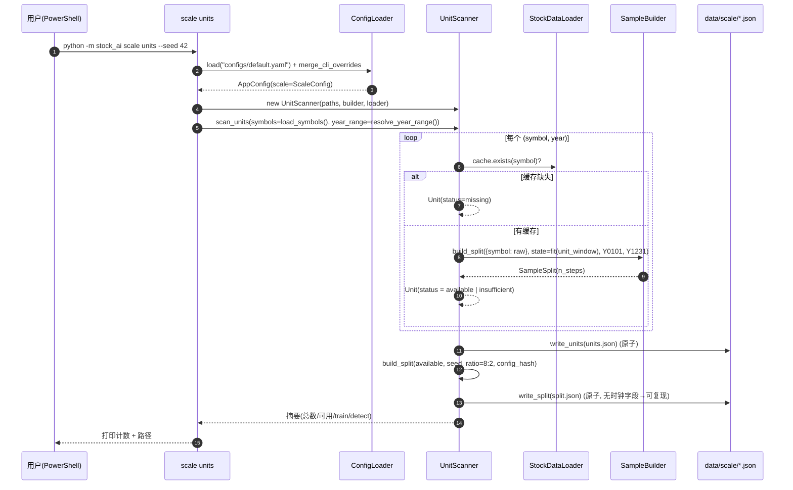
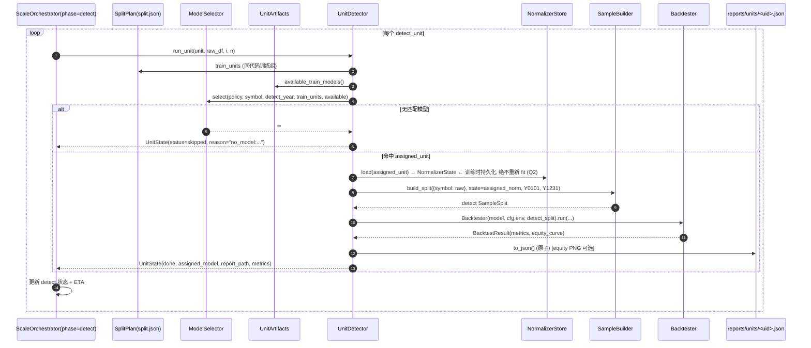
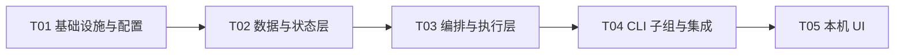

# 架构设计：大规模训练编排 + 检测编排 + 本机 UI（增量）

> 版本：v1.0 ｜ 作者：高见远（Architect）｜ 类型：**现有工程增量架构**（不破坏既有 6 条 CLI 与 221 项测试）
> 上游输入：`docs/PRD_SCALE_TRAINING.md`（v1.0）＋ 主理人对 PRD §8 全部 12 项待确认问题的**最终裁决**
> 关联：`docs/ARCHITECTURE.md`、`docs/class-diagram.mermaid`、`docs/sequence-diagram.mermaid`
> 产出物：本文档 ＋ `docs/scale-class-diagram.mermaid` ＋ `docs/scale-sequence-diagram.mermaid`

---

## 0. 裁决落地速览（主理人已拍板，本设计直接采用）

| # | 裁决要点 | 落地位置 |
|---|---|---|
| Q1 | 年份区间**动态**、可配 `scale.years`，默认 20 个连续自然年 | `symbols.py::resolve_year_range()` |
| Q2 | **每单元自拟合**归一化，且**必须持久化 + 检测侧复用** | `sampler.py` / `normalizer_store.py` / `unit_detector.py` |
| Q3 | 8:2（train:detect），单元内尾部按 `sample.val_ratio` 切 val，不单列 val 目录 | `units.py::UnitScanner`、`sampler.py` |
| Q4 | 单元级默认 `timesteps=20000 / algo=ppo / backend=auto`，可配 | `configs/default.yaml` `scale.train.*` |
| Q5 | 检测口径首版 = **backtest**（产出可比指标） | `unit_detector.py` → `Backtester` |
| Q6 | `model_policy` 默认 `nearest_past`（同代码 ≤ 检测年最大；回退 max_year；再无 → skipped） | `model_policy.py` |
| Q7 | 沪深300 **静态近似名单**，目标 ~300、≥250，不还原历史成分 | `configs/symbols_hs300_full.yaml` |
| Q8 | UI = **stdlib `http.server` + 单页 HTML/JS**，`127.0.0.1:8765`，无登录 | `scale/ui/server.py`、`scale/ui/static/index.html` |
| Q9 | **严格串行**，`workers` 配置位保留、默认 1 | `orchestrator.py` |
| Q10 | 数据源复用 `_FALLBACK_CHAIN`，允许 `--source` 覆盖，缺 akshare 时优雅回退 | `scale_cmd.py` → `StockDataLoader` |
| Q11 | 「完成」= **状态文件 + 产物文件双重校验** | `artifacts.py`、`orchestrator.py::_recover()` |
| Q12 | 中断 = **立即中断并回滚 `pending`**，不留半成品 | `orchestrator.py`、`state.py` |

---

# Part A：系统设计

## 1. 实现方案与框架选型

### 1.1 核心技术难点

| # | 难点 | 本质 | 应对策略 |
|---|---|---|---|
| D1 | **训练/推理归一化口径一致性（Q2 追加要求）** | 单元自拟合 `NormalizerState`，检测侧若重新 fit 会造成训练/推理分布漂移，指标无效 | 训练时将状态的 `mean/std/columns/data_hash` **持久化**到 `models/units/<unit>.norm.json`；检测加载 assigned model 时**读取同一份状态**做 `transform`，**绝不重新 fit**（复用 `FeatureEngineer.transform`，K9 不变量） |
| D2 | **断点续训正确性** | 已 `done` 单元重启后必须跳过且不覆盖；`running` 悬挂需回滚 | 「双重校验」判定 done；启动时崩溃恢复扫描；状态文件**原子写盘** |
| D3 | **可中断性** | 单单元 `learn()` 是紧凑循环，难以中途打断 | ① `control.json` 在**单元边界**轮询（Windows 稳、不需线程/信号）；② `Ctrl+C` 立即中断并回滚当前单元为 `pending` |
| D4 | **可复现** | 同种子两次 `split.json` 必须字节一致（AC3） | `split.json` **不含任何时钟字段**；排序输出 + 固定算法 + 固定种子 |
| D5 | **零回归** | 不得破坏 6 条 CLI 与 221 测试 | 全部为**叠加**：新增 `scale` 包与 `scale` CLI 子组；既有文件仅做**最小追加**（新增配置段、注册子组、脚本分派） |
| D6 | **Windows 稳定性** | 无 fork、中文编码、路径分隔 | 单进程串行；`ensure_utf8_console` + `PYTHONIOENCODING`；`pathlib` 全程；`os.replace` 原子写 |
| D7 | **数据可得性** | 本机可能无 akshare、无网络 | 复用 `_FALLBACK_CHAIN=("akshare","tencent","eastmoney")`，最终 synthetic 兜底；缺源不崩、单元级隔离 |

### 1.2 框架与依赖选型

**结论：整条新增链路零新增第三方依赖。**

| 需求 | 选型 | 理由 |
|---|---|---|
| 长期任务编排 | **纯 Python 单进程串行**（stdlib + 既有 `TradingEnv/TrainerFactory/Backtester`） | 复用既有训练/回测栈；无 `fork` 依赖，Windows 稳；可断点续训 |
| 控制/状态协议 | **文件契约**（`control.json` / `state/*.json`，原子写） | 跨进程（CLI↔UI↔子进程）天然解耦；中断可恢复；无 IPC/信号复杂度 |
| 本机 UI | **stdlib `http.server.ThreadingHTTPServer` + 单页 HTML/JS（原生 fetch）** | Q8 裁决；零 Node/React 工具链；无登录、仅 `127.0.0.1` |
| 图表 | 既有 `EquityPlotter`（matplotlib Agg，K15） | 复用，无新增 |
| 数据/训练/回测 | 既有 `StockDataLoader` / `SampleBuilder` / `TrainerFactory` / `TradingEnv` / `Backtester` | 硬约束「必须复用」 |
| 序列化 | 既有 `utils/io.py`（json/npz/parquet）+ 新增 `scale/atomic.py`（原子写） | `os.replace` 保证状态不损坏 |

**架构模式**：`Ports & Adapters`（沿用既有风格）＋ **单一编排骨架 + 双阶段策略**。
`ScaleOrchestrator` 是**唯一**的「遍历单元 → 控制轮询 → 崩溃恢复 → 落状态 → 算 ETA」骨架，`train`/`detect` 通过注入 `UnitRunner`（`UnitTrainer` / `UnitDetector`）区分，避免两套状态机分叉。

### 1.3 UI 具体形态与进程模型

```
浏览器(127.0.0.1:8765) ──HTTP──▶ ScaleUI(ThreadingHTTPServer, 单进程)
                                   ├─ GET  /                       → 单页 index.html
                                   ├─ GET  /api/status?phase=..     → 读 state/{phase}.json + split.json 摘要
                                   ├─ GET  /api/units?phase&status&q&page → 读 state 单元明细（服务端过滤/分页）
                                   ├─ GET  /api/data               → 读 data/raw/meta.json + 统计 parquet（数据观察）
                                   ├─ GET  /api/logs?phase&tail=200 → 读 logs/scale/{phase}_*.log 尾部
                                   ├─ GET  /api/plot?unit_id&kind=curve|equity → 回读 PNG 文件（曲线/资金曲线）
                                   ├─ POST /api/control {phase,action∈start|pause|resume|stop}
                                   └─ GET  /api/control/status?phase → 进程态 + 是否在跑
```

**进程模型（关键，满足 UI-8「禁止自动重启」）**：

- UI 进程内维护 `procs: dict[phase, Popen]`。
- `start` → `subprocess.Popen([sys.executable, "-m", "stock_ai", "scale", phase], cwd=ROOT, env={PYTHONIOENCODING:utf-8})`，`creationflags=CREATE_NEW_PROCESS_GROUP`（Windows）。**仅此一次**，不由 UI 复活。
- `pause/resume/stop` → 写 `control.json`（`{phase, cmd, requested_at}`），由编排器在单元边界消费。
- **不注册** Windows 服务 / 计划任务 / 守护进程；UI 退出即结束 UI 进程，子进程不再被拉起。

---

## 2. 文件列表及相对路径

### 2.1 新增文件

| 文件 | 职责 |
|---|---|
| `src/stock_ai/scale/__init__.py` | 子包导出（`ScaleConfig` 相关、`ScaleError`、版本常量） |
| `src/stock_ai/scale/errors.py` | `ScaleError(StockAIError)`：编排层专用异常（继承既有族，`main()` 友好提示 + exit(1) 自动生效） |
| `src/stock_ai/scale/atomic.py` | `atomic_write_json()` / `atomic_write_text()`（临时文件 + `os.replace`） |
| `src/stock_ai/scale/paths.py` | `ScalePaths`：由 `AppConfig.paths.root` 派生全部 `data/scale`、`models/units`、`reports/units`、`logs/scale` 路径与 `ensure()` |
| `src/stock_ai/scale/symbols.py` | `load_symbols()`（读 `scale.symbols_file`）、`resolve_year_range()`（Q1）、`config_hash()` |
| `src/stock_ai/scale/units.py` | `Unit`、`SplitPlan`、`UnitScanner`（生成 `units.json` + `split.json`） |
| `src/stock_ai/scale/state.py` | `UnitState`、`ScaleState`、`StateStore`（原子 load/save + 崩溃恢复扫描） |
| `src/stock_ai/scale/control.py` | `ControlSignal`、`ControlStore`（`control.json` 读写/消费/清理） |
| `src/stock_ai/scale/artifacts.py` | `UnitArtifacts`：单元产物路径 + **双重校验**（模型 zip / sidecar / norm / report 是否存在且非空） |
| `src/stock_ai/scale/normalizer_store.py` | `save_normalizer()` / `load_normalizer()`（`models/units/<unit>.norm.json`，Q2 追加要求） |
| `src/stock_ai/scale/sampler.py` | `UnitSampler`：封装 `SampleBuilder`，在单元窗口上 fit 状态 + 构建单元 train/val `SampleSplit` |
| `src/stock_ai/scale/model_policy.py` | `ModelSelector.select()`（`nearest_past/nearest/max_year/none`，Q6） |
| `src/stock_ai/scale/unit_trainer.py` | `UnitTrainer`（`UnitRunner` 实现）：fit→持久化 norm→构造 env→`TrainerFactory`→`learn`→存 zip/sidecar/curve |
| `src/stock_ai/scale/unit_detector.py` | `UnitDetector`（`UnitRunner` 实现）：选模型→加载 assigned norm→`build_split`→`Backtester`→写 report |
| `src/stock_ai/scale/orchestrator.py` | `ScaleOrchestrator`（共享骨架）＋ `UnitRunner` Protocol ＋ ETA/进度 |
| `src/stock_ai/scale/ui/__init__.py` | UI 子包导出 |
| `src/stock_ai/scale/ui/server.py` | `ScaleRequestHandler`（路由表）＋ `ScaleUI`（启动/子进程管理） |
| `src/stock_ai/scale/ui/static/index.html` | 单页（Tab：概览/单元/检测/数据/日志），原生 JS `fetch` |
| `src/stock_ai/cli/scale_cmd.py` | `@click.group("scale")` + `fetch/units/train/detect/status/ui` |
| `configs/symbols_hs300_full.yaml` | 静态近似沪深300 名单（`symbols: [...]`，≥250，目标 ~300） |
| `tests/test_scale_config.py` | 配置段解析/覆盖/路径解析用例 |
| `tests/test_scale_units.py` | 单元生成 + split 可复现（字节一致）+ 8:2 用例 |
| `tests/test_scale_state.py` | 状态原子写 + 崩溃恢复 + 双重校验用例 |
| `tests/test_scale_train_detect.py` | 单单元训练产物 + norm 持久化 + 检测复用 norm + 模型策略用例 |
| `tests/test_scale_cli.py` | `scale --help` / 6 条既有 CLI `--help` 不变 / 端到端冒烟 |
| `tests/test_scale_ui.py` | Handler 路由（status/units/control）+ 无自启断言 |

### 2.2 修改文件（**最小改动点**）

| 文件 | 最小改动 |
|---|---|
| `src/stock_ai/config/schema.py` | 新增 `ScaleTrainConfig`、`ScaleDetectConfig`、`ScaleConfig` 三个 dataclass；`AppConfig` 增 `scale: ScaleConfig = field(default_factory=ScaleConfig)`；`from_dict()` 增一行 `scale = ScaleConfig(**_pick(plain.get("scale", {}), ScaleConfig))` 并传入构造。**不动既有字段与默认值** |
| `src/stock_ai/config/loader.py` | `resolve_paths()` 末尾追加：把 `cfg.scale.symbols_file` 解析为相对 `root` 的绝对路径（仅 1 个 `_abs` 调用） |
| `src/stock_ai/cli/main.py` | `_register_commands()` 增 `from stock_ai.cli.scale_cmd import scale` + `cli.add_command(scale)`（2 行）。**不改 `main()` 的异常/退出码契约** |
| `configs/default.yaml` | 追加 `scale:` 段（见 §7.6）；`data:` 段建议将 `source` 保持 `akshare`（缺源自动回退），不删任何既有键 |
| `run.ps1` (+ `run.sh`) | 帮助文本 + `switch` 增 6 个分支（`scale-fetch/units/train/detect/status/ui`）。**不改既有分支** |

> 说明：`utils/io.py` **不改**——原子写盘单独放 `scale/atomic.py`，以免动到被 221 项测试覆盖的公共 IO。

---

## 3. 数据结构与接口

> 完整 Mermaid 见 `docs/scale-class-diagram.mermaid`（下方为同源渲染）。

```mermaid
classDiagram
    direction LR

    class ScaleError {
        <<exception>>
        +message: str
        +context: dict
    }

    class ScaleTrainConfig {
        +timesteps: int = 20000
        +algo: str = "ppo"
        +backend: str = "auto"
    }
    class ScaleDetectConfig {
        +model_policy: str = "nearest_past"
        +mode: str = "backtest"
    }
    class ScaleConfig {
        +years: list[int] | None = null
        +symbols_file: Path = configs/symbols_hs300_full.yaml
        +split_ratio: dict = {train:0.8, detect:0.2}
        +workers: int = 1
        +poll_sec: float = 2.0
        +train: ScaleTrainConfig
        +detect: ScaleDetectConfig
    }

    class ScalePaths {
        +root: Path
        +scale_dir: Path
        +units_json: Path
        +split_json: Path
        +state_dir: Path
        +models_dir: Path
        +reports_dir: Path
        +logs_dir: Path
        +ensure() None
        +state_of(phase) Path
        +control_json() Path
        +model_zip(uid) Path
        +sidecar(uid) Path
        +norm(uid) Path
        +curve(uid) Path
        +report(uid) Path
        +report_png(uid) Path
        +log_of(phase, ts) Path
    }

    class Unit {
        +unit_id: str
        +symbol: str
        +year: int
        +start: str
        +end: str
        +to_dict() dict
        +from_dict(d) Unit
        +parse(unit_id) Unit
        +static make(symbol, year) Unit
    }

    class SplitPlan {
        +schema_version: int = 1
        +random_seed: int
        +ratio: dict
        +symbols_source: str
        +symbols_count: int
        +year_range: list[int]
        +units_total: int
        +units_available: int
        +train_units: list[str]
        +detect_units: list[str]
        +algorithm: str
        +config_hash: str
        +to_dict() dict
        +from_dict(d) SplitPlan
        +stage_units(phase) list[str]
    }

    class UnitState {
        +status: str
        +started_at: str
        +finished_at: str
        +duration_sec: float
        +model_path: str
        +assigned_model: str
        +report_path: str
        +metrics: dict
        +seed: int
        +data_hash: str
        +error: str
        +reason: str
        +to_dict() dict
        +from_dict(d) UnitState
    }

    class ScaleState {
        +schema_version: int = 1
        +phase: str
        +process_state: str
        +pid: int
        +created_at: str
        +updated_at: str
        +seed: int
        +backend: str
        +config_hash: str
        +total: int
        +counts: dict
        +current_unit: str
        +started_at: str
        +elapsed_sec: float
        +avg_unit_sec: float
        +eta_sec: float
        +units: dict~str,UnitState~
        +recompute_counts() dict
        +to_dict() dict
        +from_dict(d) ScaleState
    }

    class StateStore {
        +paths: ScalePaths
        +load(phase) ScaleState
        +save(state) None
        +recover(state, verify) dict
    }

    class ControlSignal {
        +phase: str
        +cmd: str
        +requested_at: str
        +to_dict() dict
        +from_dict(d) ControlSignal
    }

    class ControlStore {
        +path: Path
        +poll(phase) str
        +write(phase, cmd) None
        +clear() None
    }

    class UnitArtifacts {
        +paths: ScalePaths
        +model_zip(uid) Path
        +sidecar(uid) Path
        +norm(uid) Path
        +curve(uid) Path
        +report(uid) Path
        +is_model_done(uid) bool
        +is_report_done(uid) bool
        +is_done(phase, uid) bool
        +available_train_models() set~str~
    }

    class NormalizerStore {
        +paths: ScalePaths
        +save(uid, state) Path
        +load(uid) NormalizerState
        +exists(uid) bool
    }

    class UnitSampler {
        +builder: SampleBuilder
        +sample(unit, raw_df, val_ratio) UnitSample
    }
    class UnitSample {
        +train: SampleSplit
        +val: SampleSplit
        +state: NormalizerState
        +n_steps: int
        +data_hash: str
    }

    class UnitScanner {
        +paths: ScalePaths
        +builder: SampleBuilder
        +loader: StockDataLoader
        +scan_units(symbols, year_range) list~Unit~
        +write_units(units) Path
        +build_split(units, seed, ratio, cfg_hash) SplitPlan
        +write_split(plan) Path
    }

    class ModelSelector {
        +select(policy, symbol, detect_year, train_units, available) str
    }

    class UnitRunner {
        <<interface>>
        +run_unit(unit, raw_df, index, total) UnitState
    }

    class UnitTrainer {
        +cfg
        +paths
        +sampler
        +normalizers
        +artifacts
        +run_unit(unit, raw_df, i, n) UnitState
    }

    class UnitDetector {
        +cfg
        +paths
        +sampler
        +normalizers
        +artifacts
        +split: SplitPlan
        +run_unit(unit, raw_df, i, n) UnitState
    }

    class ScaleOrchestrator {
        +cfg: AppConfig
        +paths: ScalePaths
        +phase: str
        +store: StateStore
        +control: ControlStore
        +runner: UnitRunner
        +run() int
        +_recover(state) None
        +_loop(state) None
        +_handle_control(state) str
    }

    class ScaleUI {
        +cfg: AppConfig
        +paths: ScalePaths
        +host: str = 127.0.0.1
        +port: int = 8765
        +procs: dict
        +serve(open_browser) None
    }
    class ScaleRequestHandler {
        +routes: dict
        +do_GET() None
        +do_POST() None
    }

    %% ---------- 组合 ----------
    ScaleConfig *-- ScaleTrainConfig
    ScaleConfig *-- ScaleDetectConfig
    ScaleState *-- "many" UnitState
    SplitPlan *-- Unit
    UnitSample *-- NormalizerState
    UnitSample *-- SampleSplit

    %% ---------- 依赖 ----------
    StateStore --> ScalePaths
    ControlStore --> ScalePaths
    UnitArtifacts --> ScalePaths
    NormalizerStore --> ScalePaths
    UnitScanner --> UnitArtifacts
    UnitScanner --> UnitSampler
    UnitSampler --> SampleBuilder
    UnitTrainer ..|> UnitRunner
    UnitDetector ..|> UnitRunner
    UnitDetector --> ModelSelector
    UnitTrainer --> NormalizerStore
    UnitDetector --> NormalizerStore
    ScaleOrchestrator --> StateStore
    ScaleOrchestrator --> ControlStore
    ScaleOrchestrator --> UnitRunner
    ScaleUI --> ScaleRequestHandler
    ScaleUI --> ScalePaths
    ScaleUI ..> ScaleState : reads
    ScaleRequestHandler ..> ScaleState
    ScaleRequestHandler ..> SplitPlan
    ScaleError --|> StockAIError : extends (既有族)
    ScaleConfig ..> AppConfig : new field
```

### 3.1 关键接口签名（伪代码/签名，非实现）

```python
# scale/atomic.py
def atomic_write_json(obj: dict, path: Path, indent: int = 2) -> Path: ...
def atomic_write_text(text: str, path: Path, encoding: str = "utf-8") -> Path: ...

# scale/symbols.py
def load_symbols(symbols_file: Path) -> list[str]: ...
def resolve_year_range(years: list[int] | None, today: date | None = None) -> tuple[int, int]: ...
def config_hash(payload: dict) -> str: ...   # sha256:... 前缀

# scale/units.py
@dataclass
class Unit:
    unit_id: str; symbol: str; year: int; start: str; end: str
    @staticmethod
    def make(symbol: str, year: int) -> "Unit": ...
    @staticmethod
    def parse(unit_id: str) -> "Unit": ...

class UnitScanner:
    def scan_units(self, symbols: list[str], year_range: tuple[int, int]) -> list[Unit]: ...
    def write_units(self, units: list[Unit], status: dict[str, str], steps: dict[str, int]) -> Path: ...
    def build_split(self, available: list[Unit], seed: int,
                    ratio: dict, chash: str, symbols_source: str,
                    year_range: tuple[int, int], total: int) -> SplitPlan: ...

# scale/state.py
class StateStore:
    def load(self, phase: str) -> ScaleState: ...
    def save(self, state: ScaleState) -> None: ...                       # atomic_write_json
    def recover(self, state: ScaleState, verify: Callable[[str], bool]) -> dict: ...  # done<->pending 校正

# scale/control.py
class ControlStore:
    def poll(self, phase: str) -> str: ...   # "" | "pause" | "resume" | "stop"
    def write(self, phase: str, cmd: str) -> None: ...
    def clear(self) -> None: ...

# scale/model_policy.py
class ModelSelector:
    @staticmethod
    def select(policy: str, symbol: str, detect_year: int,
               train_units: list[str], available: set[str]) -> str: ...  # unit_id or ""

# scale/sampler.py
class UnitSampler:
    def __init__(self, builder: SampleBuilder) -> None: ...
    def sample(self, unit: Unit, raw_df: pd.DataFrame, val_ratio: float) -> UnitSample: ...

# scale/orchestrator.py
@runtime_checkable
class UnitRunner(Protocol):
    def run_unit(self, unit: Unit, raw_df: "pd.DataFrame", index: int, total: int) -> UnitState: ...

class ScaleOrchestrator:
    def __init__(self, cfg: AppConfig, phase: str, runner: UnitRunner,
                 paths: ScalePaths, logger: "Any", seed: int) -> None: ...
    def run(self) -> int: ...
```

**`run_unit` 契约（UnitRunner 输出）**：
- 成功 → `UnitState(status="done", duration_sec=..., data_hash=..., model_path/report_path=..., metrics=...)`
- 缺前置 → `UnitState(status="skipped", reason=...)`
- 异常 → **不抛出**（orchestrator 捕获亦可），记 `UnitState(status="failed", error="...")`
- orchestrator 对 `KeyboardInterrupt` **不吞**：回滚当前单元为 `pending` 后优雅退出。

---

## 4. 程序调用流程

> 完整 Mermaid 见 `docs/scale-sequence-diagram.mermaid`（下方为同源渲染）。

### (a) `scale units` —— 生成单元与划分



### (b) `scale train` —— 逐单元训练 + 中断 + 续跑

```mermaid
sequenceDiagram
    autonumber
    participant U as 用户
    participant CL as scale train
    participant OR as ScaleOrchestrator
    participant SS as StateStore(train.json)
    participant CS as ControlStore(control.json)
    participant UT as UnitTrainer
    participant NS as NormalizerStore
    participant TF as TrainerFactory/TradingEnv
    participant AR as UnitArtifacts

    U->>CL: python -m stock_ai scale train
    CL->>OR: new ScaleOrchestrator(phase="train", runner=UnitTrainer)
    OR->>SS: load("train")  (不存在→初始化, total=len(train_units))
    OR->>OR: _recover(): running→校验产物→done/pending (崩溃恢复扫描)
    OR->>SS: save(process_state=running, pid)
    loop 每个 train_unit (严格串行)
        OR->>CS: poll("train")  ← 单元边界轮询
        alt cmd == "pause"
            OR->>SS: save(process_state=paused)  ; 等待 resume(轮询)
        else cmd == "stop"
            OR->>SS: save(process_state=stopped) ; break
        end
        alt AR.is_done("train", uid) == True   (状态+产物双校验)
            OR->>OR: 跳过（绝不覆盖）
        else 需训练
            OR->>SS: mark_running(uid) + save
            OR->>UT: run_unit(unit, raw_df, i, total)
            UT->>UT: sampler.sample(unit) → fit NormalizerState(单元窗口)
            UT->>NS: save(uid, state) → models/units/<uid>.norm.json
            UT->>TF: TradingEnv(train_split) + TrainerFactory.create()
            TF-->>UT: trainer.learn(timesteps)
            UT->>UT: trainer.save(models/units/<uid>.zip) + sidecar + curve.png
            UT-->>OR: UnitState(done, duration, data_hash)
            OR->>SS: mark_done(uid) + recompute_counts/ETA + save
        end
        Note over OR,SS: 异常→mark_failed(uid, error)，整批继续（单元级隔离）
    end
    OR->>SS: save(process_state=finished|stopped) + elapsed/eta
    OR-->>CL: exit code
    Note over U,OR: 中断：Ctrl+C → KeyboardInterrupt → 当前单元回滚 pending → 优雅退出; 重启 → 跳过 done
```

### (c) `scale detect` —— 选模型 + 回测（复用训练时 NormalizerState）



### (d) UI 启动 / 暂停 / 继续 / 停止 控制链路

```mermaid
sequenceDiagram
    autonumber
    participant U as 用户(浏览器)
    participant H as ScaleRequestHandler
    participant SU as ScaleUI
    participant CS as ControlStore(control.json)
    participant OR as scale train 子进程
    participant SS as StateStore

    U->>H: GET /  → 单页 index.html
    U->>H: 点击「启动训练」POST /api/control {phase:train, action:start}
    H->>SU: start(phase=train)
    SU->>OR: subprocess.Popen(python -m stock_ai scale train)  (仅一次, 不自启)
    SU-->>U: {ok, pid}
    loop 每 poll_sec
        H->>SS: GET /api/status?phase=train → 读 state 文件
        SS-->>U: counts/ETA/current_unit/process_state (刷新 <2s)
    end
    U->>H: 点击「暂停」POST {phase:train, action:pause}
    H->>CS: write(phase=train, cmd=pause)
    OR->>CS: 单元边界 poll → paused (不新开单元, 已完成不变)
    U->>H: 点击「继续」POST {action:resume}
    H->>CS: write(cmd=resume)
    OR->>CS: poll → resume → 继续剩余 pending
    U->>H: 点击「停止」POST {action:stop}
    H->>CS: write(cmd=stop)
    OR->>CS: poll → stop_requested → 当前单元回滚/落盘 → stopped
    Note over U,OR: UI 仅写 control.json / 起一次子进程; 不注册服务, 不自启
```

---

# Part B：任务分解

## 6. 依赖包列表

**无新增第三方依赖。** 全部能力由既有依赖与 Python 标准库覆盖：

```
numpy / pandas / pyarrow / gymnasium / matplotlib / click / pyyaml   # 均已在 requirements.txt，复用
stdlib: http.server, socketserver, urllib.parse, json, dataclasses, enum,
        dataclasses, pathlib, os, sys, subprocess, threading, time, datetime, secrets, webbrowser
```

> UI 明示：**stdlib `http.server` 单页实现，无 Node/React，无新增依赖。**

---

## 7. 任务列表（有序 · 含依赖 · 按实现顺序）

> 硬性上限 5 个任务；每任务 ≥3 文件；按功能层次分组。**T01 为项目基础设施**。

### T01 · 基础设施与配置（配置声明 + 名单 + 脚本入口 + 配置测试）
- **依赖**：无
- **优先级**：P0
- **涉及文件**：
  - 修改 `src/stock_ai/config/schema.py`（+`ScaleTrainConfig`/`ScaleDetectConfig`/`ScaleConfig`，`AppConfig.scale`，`from_dict` 接线）
  - 修改 `src/stock_ai/config/loader.py`（`resolve_paths` 解析 `scale.symbols_file`）
  - 修改 `configs/default.yaml`（追加 `scale:` 段，默认 `timesteps=20000/algo=ppo/backend=auto`、`workers=1`、`poll_sec=2`、`model_policy=nearest_past`、`mode=backtest`）
  - 新增 `configs/symbols_hs300_full.yaml`（`symbols: [...]`，**≥250，目标 ~300**）
  - 修改 `run.ps1`、`run.sh`（帮助文本 + `switch` 增 `scale-*` 6 分支）
  - 新增 `src/stock_ai/scale/__init__.py`、`src/stock_ai/scale/errors.py`
  - 新增 `tests/test_scale_config.py`
- **完成判据**：
  1. `AppConfig.from_yaml("configs/default.yaml")` 含 `scale` 且默认值符合 Q4/§7.6；
  2. `ConfigLoader.resolve_paths()` 后 `scale.symbols_file` 为绝对路径；
  3. `len(yaml.load(symbols_hs300_full.yaml)["symbols"]) >= 250`；
  4. `run.ps1 scale-units -Help` 能分发到 `python -m stock_ai scale units --help`（T04 未完成前允许报"暂无子命令"，但分派字符串正确）；
  5. `tests/test_scale_config.py` 通过；**既有测试零回归**。

### T02 · scale 数据与状态层（路径/符号/原子写/状态/控制/单元/产物/归一化存储）
- **依赖**：T01
- **优先级**：P0
- **涉及文件**：
  - 新增 `src/stock_ai/scale/atomic.py`、`paths.py`、`symbols.py`、`units.py`、`state.py`、`control.py`、`artifacts.py`、`normalizer_store.py`
  - 新增 `tests/test_scale_units.py`、`tests/test_scale_state.py`
- **完成判据**：
  1. `atomic_write_json` 用临时文件 + `os.replace`，中断不产生半截 JSON；
  2. `Unit.parse("600519_2015")` 往返正确；`resolve_year_range(today) = (today.year - 20, today.year - 1)`（动态取系统时钟、**禁止硬编码**），当前（2026）→ `[2006,2025]`，共 20 个完整自然年；`scale.years` 可覆盖；
  3. `UnitScanner.build_split()` 同种子两次输出 `split.json` **sha256 相同**（无时钟字段）；`train+detect` 集合 == `available` 集合，比例 8:2（整数取整误差 ≤1）；
  4. `StateStore.recover()`：`running` 但产物无效 → `pending`；`done` 但产物缺失 → `pending`；
  5. `ControlStore.poll()` 在无文件/异 phase 时返回 `""`；`ModelSelector` 四策略单测（`nearest_past` 命中/回退 `max_year`/`skipped`）；
  6. `NormalizerStore` 存取 `NormalizerState` 往返一致；两个新测试文件通过，零回归。

### T03 · 编排与执行层（共享骨架 + 单元训练/检测 + 采样 + 模型策略）
- **依赖**：T02
- **优先级**：P0
- **涉及文件**：
  - 新增 `src/stock_ai/scale/sampler.py`、`model_policy.py`、`unit_trainer.py`、`unit_detector.py`、`orchestrator.py`
  - 新增 `tests/test_scale_train_detect.py`
- **完成判据**：
  1. `ScaleOrchestrator.run()`：串行遍历、单元边界 `control.json` 轮询、`pause/resume/stop` 生效、`KeyboardInterrupt` → 当前单元回滚 `pending`、已完成单元**跳过且不覆盖**（比对 `finished_at`/mtime/`created_at`）；
  2. 单单元训练产出 `models/units/<uid>.zip` + `.json` sidecar + `.norm.json` + `.curve.png`；
  3. 检测阶段加载 assigned model 的 **训练时 NormalizerState**（断言检测 `build_split` 使用该 state，非重新 fit）；
  4. 单元级失败隔离：注入必失败单元 → `failed` + `error`，整批继续；
  5. 崩溃恢复：模拟 `running` 悬挂 → 重启后正确回滚；
  6. 新测试通过，零回归。

### T04 · CLI 子组与集成（scale 命令族 + 主入口注册）
- **依赖**：T03
- **优先级**：P0
- **涉及文件**：
  - 新增 `src/stock_ai/cli/scale_cmd.py`（`fetch` / `units` / `train`[`--only-failed`] / `detect` / `status`[`--phase`] / `ui`[`--port`]）
  - 修改 `src/stock_ai/cli/main.py`（注册 `scale` 子组）
  - 新增 `tests/test_scale_cli.py`
- **完成判据**：
  1. `python -m stock_ai scale --help` 与 6 个子命令 `--help` 正常；
  2. `scale fetch` 复用 `StockDataLoader`（缺 akshare 走 fallback，不崩），`--source` 可覆盖，`adjust=none`；
  3. `scale status --phase train|detect` 打印 总数/完成/失败/剩余/ETA；
  4. 异常经 `main()` 的 `StockAIError` → 友好提示 + `exit(1)`；
  5. **既有 6 条 CLI `--help` 输出契约不变**；`pytest` → `221 passed / 1 skipped`（新测试只增）；`tests/test_scale_cli.py` 通过。

### T05 · 本机 UI（http.server 路由 + 单页 + 控制链路）
- **依赖**：T04
- **优先级**：P0
- **涉及文件**：
  - 新增 `src/stock_ai/scale/ui/__init__.py`、`src/stock_ai/scale/ui/server.py`、`src/stock_ai/scale/ui/static/index.html`
  - 新增 `tests/test_scale_ui.py`
- **完成判据**：
  1. `scale ui --port 8765` 仅监听 `127.0.0.1`；浏览器可见概览/单元/检测/数据/日志 5 个 Tab；
  2. 四按钮生效：`start` 起一次子进程、`pause/resume/stop` 写 `control.json`；暂停后不再出现新 `running`；
  3. `/api/status` 刷新延迟 <2s；`/api/units` 支持 搜索/状态筛选/阶段切换；`/api/data` 与 `data/raw` 实际一致；`/api/plot` 可回读 `curve.png`/资金曲线；
  4. **无 Windows 服务/计划任务**；UI 退出后子进程不被自拉起（UI-8/AC10）；
  5. `tests/test_scale_ui.py` 通过，零回归。

---

## 8. 共享知识（跨文件约定）

### 8.1 命名与主键
- `unit_id = <symbol>_<year>`（如 `600519_2015`）；`Unit.parse` 以**最后一个 `_`** 切分，兼容含点后缀的 symbol（先 `sanitize_filename`）。
- 文件命名沿用既有 `_` 风格：`models/units/<unit_id>.zip`、`.json`、`.norm.json`、`.curve.png`、`reports/units/<unit_id>.json`、`<unit_id>.png`。

### 8.2 状态枚举
- **单元状态**：`pending | running | done | failed | skipped`。
- **进程状态**：`idle | running | pause_requested | paused | stop_requested | stopped | finished`。
- **单元生成期状态**（`units.json`）：`available | insufficient | missing`。

### 8.3 状态文件字段
- 位置：`data/scale/state/train.json` / `detect.json`（同构）。
- 字段：严格按 PRD §5.6（`schema_version/phase/process_state/pid/created_at/updated_at/seed/backend/config_hash/total/counts/current_unit/started_at/elapsed_sec/avg_unit_sec/eta_sec/units{}`）。
- **写盘必须原子**（`atomic_write_json`）。`counts` 每次由 `ScaleState.recompute_counts()` 现算，避免漂移。

### 8.4 `control.json` 协议
```json
{ "phase": "train", "cmd": "pause|resume|stop", "requested_at": "YYYYMMDD_HHMMSS" }
```
- 编排器**仅在单元边界** `poll(phase)`；`phase` 不匹配的命令忽略。
- `stop`：优先级最高；当前单元未开始时直接停，进行中则由 `Ctrl+C` 或完成时收敛（**不留半成品**）。
- UI 的 `start` 不写 `control.json`（直接起子进程）；`pause/resume/stop` 才写。

### 8.5 路径布局（相对 `paths.root`）
```
data/scale/            units.json | split.json | state/{train,detect,control}.json
models/units/          <unit>.zip | <unit>.json | <unit>.norm.json | <unit>.curve.png
reports/units/         <unit>.json | <unit>.png | _ranking.json(P2)
logs/scale/            train_<ts>.log | detect_<ts>.log
```

### 8.6 异常与退出码
- 统一 `ScaleError(StockAIError)`；`main()` 已兜底 `StockAIError → [错误] ... → exit(1)`。
- CLI `ClickException` → `exit(exc.exit_code)`；`Abort(Ctrl+C)` → `exit(130)`。
- 单元级异常**不得上抛**（记 `failed`，整批继续），仅**进程级致命**才退出。

### 8.7 中文 / UTF-8 约定
- 入口调用 `ensure_utf8_console()`；子进程 env `PYTHONIOENCODING=utf-8`；
- 所有 JSON 写用 `write_json(..., ensure_ascii=False)`；日志、UI 文案中文。

### 8.8 原子写盘策略
- 统一 `atomic_write_json/text`：`path.parent.mkdir` → 写 `<name>.<pid>.tmp` → `flush+fsync` → `os.replace(tmp, path)`。
- **仅状态/契约文件（state/split/units/control/sidecar/norm/report）使用原子写**；模型 zip、PNG 为「先完整生成到目标名」自然原子（`trainer.save` / `savefig` 单次写）。

### 8.9 归一化口径（Q2，**强制**）
- **训练**：`state = FeatureEngineer.fit(unit_window_df)` → 持久化 `models/units/<unit>.norm.json`（`NormalizerState.to_dict()`）。
- **检测**：`state = load(assigned_unit)` → `SampleBuilder.build_split({symbol: raw}, state, detect_start, detect_end)`；**严禁**在检测中重新 fit。
- assigned model 的 norm 缺失 → 该检测单元 `skipped`（`reason="normalizer_missing"`），不得静默 fallback 到重新 fit。

### 8.10 可复现性（AC3）
- `split.json` **仅含确定性字段**（无 `created_at`）；`train_units`/`detect_units` 均 `sorted`；`algorithm` 文案固定为 `shuffle(sorted(available), seed) -> slice`。
- `config_hash = "sha256:" + sha256(canonical(scale 配置 + symbols_source + year_range + ratio + seed))`。

### 8.11 复用的既有 API（**必须复用，禁止重造**）
`StockDataLoader.fetch_all/load_all_cached/info/refresh_all`、`DataCache`、`SampleBuilder.build_split/compute_data_hash`、`FeatureEngineer.fit/transform`、`NormalizerState.to_dict/from_dict`、`SampleSplit`、`TrainerFactory.create`、`TradingEnv`、`Backtester.run`、`BacktestResult.to_json`、`EquityPlotter`、`utils/io`、`utils/hashing`、`utils/errors`、`utils/logging`、`utils/seed`、`utils/dates`、`ConfigLoader`。

---

## 9. 任务依赖图



> 说明：为兼顾「零回归」与「可独立验证」，本增量采用**浅线性**依赖（每层依赖上一层即可交付可测产物）；避免过度并行导致契约不稳。

---

# Part C：待明确事项

| # | 事项 | 本设计的处理 | 影响 |
|---|---|---|---|
| U1 | **「最近 20 年」公式（已由主理人更正）** | 采用主理人裁决：`resolve_year_range(today) = (today.year - 20, today.year - 1)`，即最近 20 个**完整**自然年；**动态取系统时钟、禁止硬编码**；当前（2026）→ `[2006,2025]`；`scale.years` 可覆盖 | 单元数量（≈6000） |
| U2 | **`split.json` 与 `created_at` 冲突**：PRD §5.3 含 `created_at`，但 AC3 要求同种子 sha256 相同 | `split.json` **省略时钟字段**以保障字节级可复现；生成时间改记于 `state/*.json` 的 `created_at` | AC3 通过 |
| U3 | **单单元中断粒度**：`learn()` 为紧凑循环，`control.json=stop` 无法在循环内即刻生效 | `control.json` 在**单元边界**轮询（符合硬约束）；**即时中断**由 `Ctrl+C`(KeyboardInterrupt) 保证 → 当前单元回滚 `pending` | 停机及时性 ≤ 单单元耗时（~秒级） |
| U4 | **检测 `mode=predict/both`**（P1） | 首版仅实现 `backtest`（Q5）；`predict/both` 预留 `scale.detect.mode` 分支，未实现时明确报「暂不支持」 | 检测交付物范围 |
| U5 | **`_ranking.json`（P2）** | 预留 `reports/units/_ranking.json` 路径与汇总步骤；首版可不生成 | 汇总榜 |
| U6 | **`workers>1`（P2）** | 仅预留 `scale.workers` 配置位，默认 1；实现忽略 >1（或明确报未支持） | 总时长 |
| U7 | **沪深300 名单来源** | 由工程师填入**静态近似**真实代码（≥250）；本设计只定义格式与校验 | D-1 数据可得性 |
| U8 | **`scale fetch` 是否增量** | 首版复用 `fetch_all(force=False)` 缓存命中；`refresh` 语义（D-4）为 P2，先用 `data refresh` 兜底 | 二次运行耗时 |

---

## 附：既有复用点速查（行号已核实）

| 复用点 | 位置 |
|---|---|
| `SampleBuilder(config, logger)` / `build_split(..., start, end)` | `src/stock_ai/samples/builder.py:28` / `:126` |
| `NormalizerState.to_dict/from_dict/n_features` | `src/stock_ai/samples/normalizer.py:35/:45/:61` |
| `FeatureEngineer.fit/transform/make_obs_matrix` | `src/stock_ai/samples/features.py:123/:139/:169` |
| `SampleSplit.to_npz_dict/from_npz_dict` | `src/stock_ai/samples/schema.py:66/:80` |
| `StockDataLoader.__init__/fetch_all/load_all_cached/info/refresh_all` | `src/stock_ai/data/loader.py:81/:230/:402/:414/:392` |
| `_FALLBACK_CHAIN` | `src/stock_ai/data/loader.py:27` |
| `DataCache` | `src/stock_ai/data/cache.py:20` |
| `TrainerFactory.create / SUPPORTED_ALGOS / SUPPORTED_BACKENDS` | `src/stock_ai/train/factory.py:64/:21/:24` |
| `TradingEnv(split, cfg, seed, action_mode)` | `src/stock_ai/env/trading_env.py:36` |
| `Backtester.run` / `BacktestResult.to_json` | `src/stock_ai/eval/backtester.py:44` / `src/stock_ai/eval/schema.py:70` |
| `NumpyPPOTrainer.load/save/predict` | `src/stock_ai/train/ppo_numpy.py:347/:302/:277` |
| `_load_model`（按后端加载，可复用） | `src/stock_ai/eval/backtest_cli.py:44` |
| `cli._register_commands()` | `src/stock_ai/cli/main.py:33` |
| `ConfigLoader.load/resolve_paths` | `src/stock_ai/config/loader.py:18/:36` |
| `utils/io.write_json/read_json/timestamp/sanitize_filename/ensure_utf8_console` | `src/stock_ai/utils/io.py` |
| `utils/hashing.sha256_file/sha256_files` | `src/stock_ai/utils/hashing.py:18/:38` |
| `utils/dates.validate_range/to_day_key` | `src/stock_ai/utils/dates.py:36/:20` |

## 公司行为 v2 增量

2026-10-16 增量；上述单元训练架构保留，本节仅定义统一模型新的执行版本，不改旧产物语义。

### 契约与组件

- `data/corporate_actions.py`：严格本地 JSON 账本、来源 URL、显式覆盖声明、冲突和未知字段校验、完整文件 SHA256。`verified` 是提供者的审阅声明，不是程序证明接口完整；frozen dataclass 的 coverage 内部字典仍可变，准入时重新校验，不声称深不可变。
- `data/corporate_action_sources.py`：巨潮原字节归档与 `unreviewed` 候选，独占创建文件，不猜未知字段，不自动写执行账本。接口 count/total 不代表全历史完备。
- `env/corporate_action_env.py`：独立 `strict-t1-open-ca-v2`。持股登记 → 除权应收 / 锁股 → 派息 / 上市；锁股按同股 raw 收盘估值。首日空仓，首日及之前登记资格为零；派息 / 上市无 bar 时在下一可用开盘前处理，保留有效日期。
- `scale/unified.py`、`train/sb3_trainer.py`：通过版本工厂创建年度环境，不按账本是否存在隐式改变执行语义。v2 构建阶段拒缺 raw / 账本、区间日期缺失和静态可知的不支持机制，不随机等到训练中才发现。观测仍为 `unified-relative-v1`，默认 20×9；三动作和一股票一年 episode 不变。
- `scale/replay.py`：冻结 normalizer、完整 hfq 历史指标 → 真实日过滤 → 归一化 / 滑窗；区间内 hfq/raw 日期严格一致，按版本回放，不重拟合、不联网补缓存。账本必须覆盖请求区间，包括单日请求。
- `cli/scale_cmd.py`：`strict-ca` 及 `corporate-actions fetch-snapshot / validate / import`。import 拒覆盖；CLI 默认仍 legacy，resume 未显式指定版本时继承 manifest。
- `scale/ui/server.py`、`static/index.html`、`static/replay.js`：新 run 页面默认 strict-ca 且显式传参；续训不传 execution 覆写。后端兼容缺省仍 legacy。回放 22 列、事件与三类导出；旧版保持 17 列。生产服务不会自动重启。

### 会计与事务

`equity = cash + shares * raw_close + dividend_receivable`；`available_shares = shares - locked_shares`。成本包含买入费用，送转摊薄成本，分红单列。恒等式为 `initial_cash + realized_pnl + unrealized_pnl + dividend_income = equity`。派息仅应收转现金，上市仅解锁，不重复确认收入。

每次 step 先 checkpoint，异常恢复主账户、资格 / pending / settled、交易 / 事件 / 权益曲线、奖励状态及递归独立恒买基准。奖励状态快照仅保证内置 RewardCalculator，不声称支持任意嵌套可变自定义奖励器。对外事件日志深拷贝，`account_after` 是阶段账户字段，不误称阶段收盘完整估值。数据大数组和账本不逐步复制。

excess 使用相同约束、相同账本的独立恒买账户日收益，版本 `excess-ca-constant-buy-v2`。除权标准参考价及涨跌停均用 Decimal 按分位 ROUND_HALF_UP，至少一分钱价差；特殊非标准分配不猜公式。

### 来源冻结与兼容

v2 manifest 冻结完整 hfq / raw / 账本 SHA256、schema、税口径和基准定义；当前没有单独完整的 engine/rounding-policy 元数据字段，规则升级仍需新版本，不能声称仅凭 hash 可跨任意未来引擎复现。追加区间外数据或账本空白也会改 hash。续训跨执行版本在写状态前拒绝；source 变动在准备阶段拒绝，可更新失败状态 / metrics，但不改旧模型 / manifest / normalizer。

v2 构建对每个 hfq/raw 输入各读取一次字节快照并由 BytesIO 解析；日历比较和所有年度 episode 复用该 raw 快照。账本仅 load 一次，其对象与原字节 hash 一起复用于来源和 episode，不再第二遍按路径重读。回放 parquet 解析与 hash 也绑定同一字节；这保证每个文件内部一致，不保证不同文件跨源同时原子读取。

原生 v2 的 sources 必须是非空列表，每条含合法六位代码且全局无重复、三类 hash 格式齐全；缺整张清单不能视为新股票。回放已有训练 sources 股票须匹配三份冻结 hash，缺字段或变化拒绝；真正未列入清单的新股票只披露当前 hash 与 `not_in_training_sources`。文件由受控目录和六位代码决定，不使用 sources.file 覆写路径。旧 v1 仅显式 `corporate_actions_research` 可研究覆写执行，训练版本仍 v1、执行版本 v2，旧 raw 指纹缺失标 `not_recorded`，当前核验账本不冒充历史训练输入。默认不覆写，旧模型不迁移。

### 明确未覆盖

税前股息口径，未实现个人 FIFO 差别化股息税；碎股、配股、特殊方案、未知事件、区间登记 / 除权缺真实 bar、未上市股份嵌套登记资格拒绝。历史 ST 身份、新股无涨跌幅限制、真实流动性和逐日历史税费并未完整实现。本次未建立 300 股 / 2006–2025 生产全覆盖，不能启动可靠的广泛 v2 实验；未训练、不改行情缓存和旧产物、不重启既有 8766 / 8767 服务。
