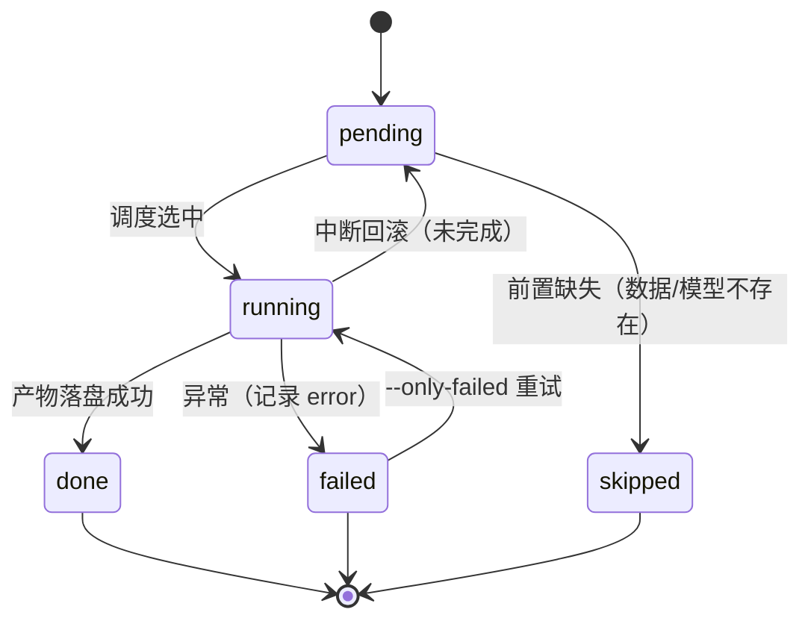
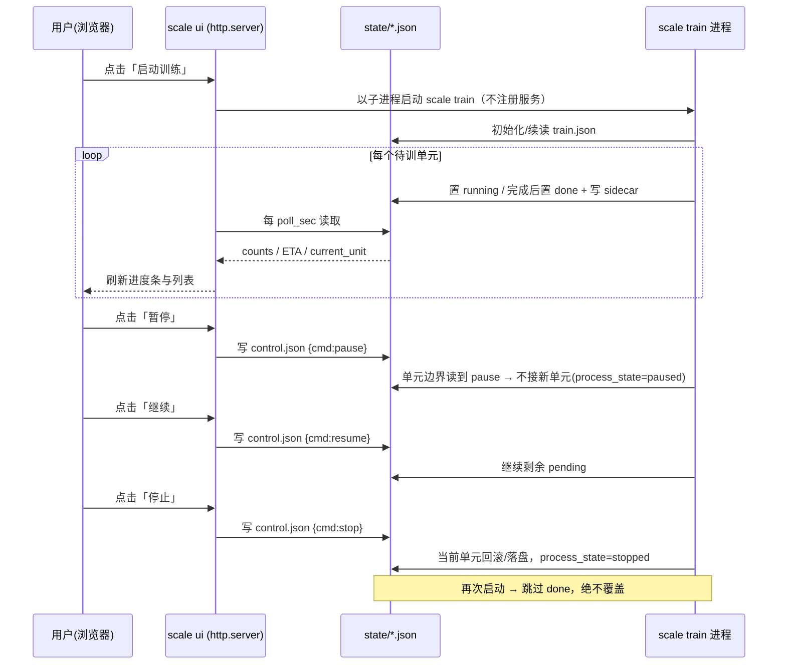

# PRD：大规模训练 / 检测编排 + 本机 UI（增量）

> 版本：v1.0 ｜ 作者：许清楚（Product Manager）｜ 日期：2025
> 模式：简单 PRD（无竞品分析）｜ 类型：**现有工程增量开发**（不得破坏既有 6 条 CLI 契约与 221 项测试）
> 关联文档：`docs/ARCHITECTURE.md`、`docs/PRD.md`

---

## 0. 项目信息

| 项 | 内容 |
|---|---|
| Language | 中文 |
| Programming Language | Python 3.11+（复用 Click / dataclass / stdlib）；**UI 建议复用标准库 `http.server` + 单页 HTML/JS，不引重依赖** |
| 运行环境 | Windows 10/11 优先，PowerShell / Git Bash |
| 工作目录 | `E:\project\stock_ai` |
| 项目名 | `stock_ai`（新增子域，包名建议 `stock_ai.scale`） |
| 增量范围 | 新增「大规模训练/检测编排」与「本机 Web UI」；**不新增第 7 条破坏性契约，只做叠加** |
| 复用点 | `AppConfig`、`DataCache`、`configs/*.yaml`、`SampleBuilder.build_split()`、`TrainerFactory.create()`、`TradingEnv`、`Backtester`、`StockAIError`、pytest |

**原始需求复述（不改语义）**：
> 在本机 Windows 完成一次大规模训练。获取**沪深300成份股最近 20 年日线，无复权**（名单可不完全准确，但需覆盖大部分）。将数据**按（代码 × 日期段）拆分为「每年每代码」为一个训练集/检测集**。随机抽取，比例由实现方定。用**自动化脚本以长期任务形式**训练；**可随时中断并可断点续训**，直到全部完成；检测同理。运行时**可见进度**。提供**简单 UI** 完成全部操作与数据观察。

---

## 1. 产品目标

**一句话**：在既有 6 条 CLI 流水线之上，叠加一层**可复现、可中断、可续跑**的「沪深300 × 年度单元」批量训练与检测编排能力，并提供一个仅本机可访问的轻量 Web UI 来启停任务、观察进度与数据。

| # | 可衡量目标 | 衡量标准 |
|---|---|---|
| G1 | 数据可规模化 | 一次 `scale fetch` 后本地缓存 **≥ 250 只**（目标 ~300）沪深300 成份股、**复权口径 = `none`**、覆盖最近 20 年 |
| G2 | 单元可复现 | 给定同名单 + 同 `random_seed`，两次生成的分组结果 **`split.json` 字节一致（hash 相同）** |
| G3 | 训练可中断续跑 | 任意时刻 `Ctrl+C` / 停止后重启，**已完成单元零重训、零覆盖**，剩余单元自动继续 |
| G4 | 检测可裁决 | 每个检测单元要么产出指标，要么以 `skipped` + 原因落盘；模型选取策略**可配置且被遵守** |
| G5 | 进度可见 | CLI 与 UI 均能读到「总数/完成/失败/剩余/ETA」，状态文件刷新延迟 **< 2s** |
| G6 | 零回归 | 既有 6 条 CLI 行为不变；pytest 保持 **221 passed / 1 skipped**（新增加测试只增不减） |

---

## 2. 目标用户与场景

| 用户 | 场景 |
|---|---|
| Jerry（主用户） | 本机挂一个长期训练任务，白天随时看进度、中断、晚上续跑；用 UI 直接观察哪些单元失败、哪只股票模型最好 |
| 量化研究者 | 用「代码 × 年份」单元做**跨股票、跨时间**的策略稳健性实验 |
| 未来协作者 | 通过 CLI + 文件契约接手编排层，不改动底层 6 条流水线 |

**典型路径**：
```
scale fetch  →  scale units(--seed)  →  scale train  →  scale detect  →  scale status / scale ui
   (数据)          (单元+随机分组)        (长期任务)       (检测编排)        (观察/交互)
```

---

## 3. 用户故事

| # | As a | I want | So that |
|---|---|---|---|
| US1 | 用户 | 一条命令拉取沪深300 最近 20 年**不复权**日线并缓存 | 不必手工维护几百个代码 |
| US2 | 用户 | 让系统把每个（代码, 年份）当独立单元，并**随机 8:2** 分为训练组/检测组，且**结果落盘可复现** | 换机器/重跑得到同一实验 |
| US3 | 用户 | 启动一个长期训练任务，**随时暂停/中断/续跑**，跳过已完成 | 不因关机或误操作丢失数小时进度 |
| US4 | 用户 | 对检测单元自动挑选「同代码最接近年份」的模型做回测 | 无需手工指定上百个模型 |
| US5 | 用户 | 在本机浏览器打开一个简单页面，启停任务、看进度、看单元状态与曲线、看缓存概览 | 不用记命令、一眼看清全局 |
| US6 | 用户 | 确信这次增量**没有破坏**原有 6 条命令与测试 | 继续用旧流程做小实验 |

---

## 4. 需求池（P0 / P1 / P2）

> P0 = Must have（首版验收必备）｜P1 = Should have｜P2 = Nice to have
> 「验收」列均为**可执行、可测量**的判据。

### 4.1 数据与名单

| ID | 优先级 | 需求 | 验收 |
|---|---|---|---|
| D-1 | P0 | 内置静态沪深300 名单文件 `configs/symbols_hs300_full.yaml`，符号字段 `symbols: []`，目标 **≥ 250**（尽量 ~300），支持 CLI/UI 覆盖 | 文件存在且 `len(symbols) ≥ 250` |
| D-2 | P0 | `scale fetch` 拉取名单内代码、区间**最近 20 年**、`adjust=none`，复用 `data fetch` 逻辑与 `DataCache` | 运行后 `data/raw/<symbol>.parquet` 数量 ≥ 250；抽查 1 只 `adjust` 行为为不复权 |
| D-3 | P1 | 数据源可切换 `akshare/tencent/eastmoney/synthetic`；失败单元记录原因、**不中断整批** | 单只失败不影响其余；失败清单可查 |
| D-4 | P2 | 增量刷新（`data refresh` 语义）与缺失校验报告 | 二次运行仅增量更新 |

### 4.2 单元与划分

| ID | 优先级 | 需求 | 验收 |
|---|---|---|---|
| U-1 | P0 | 单元 = **（symbol, year）**，`unit_id = <symbol>_<year>`（如 `600519_2015`）；年份范围可配，默认「最近 20 年」 | 单元清单 `data/scale/units.json` 生成，条数 = 有效(代码×年份)组合 |
| U-2 | P0 | 每个单元区间 = `[YYYY0101, YYYY1231]`；用 `SampleBuilder.build_split()` 在单元窗口上构建样本 | 单元样本 `n_steps > 0`；不足者标 `insufficient` |
| U-3 | P0 | **随机划分**训练/检测，默认比例 **8:2**（可配），**固定随机种子**（默认取 `random_seed`），结果落盘 `data/scale/split.json` | 同种子两次运行 `split.json` sha256 相同；train+detect 单元数 == 总单元数 |
| U-4 | P0 | 划分**只在可用单元**上进行；`insufficient` 单元不进入训练/检测 | 划分集合与 `units.json` 中 `status=available` 集合一致 |
| U-5 | P1 | 比例、年份范围、名单来源均写入 `split.json` 便于复现审计 | 字段齐全，含 `config_hash` |

### 4.3 训练编排（长期任务）

| ID | 优先级 | 需求 | 验收 |
|---|---|---|---|
| T-1 | P0 | `scale train` 作为**长期任务**：对每个训练单元训练独立模型，产出 `models/units/<symbol>_<year>.zip` + sidecar `<symbol>_<year>.json` | 每完成单元两文件存在 |
| T-2 | P0 | **可随时中断**：进程收到停止/中断信号后，优雅结束（当前单元要么完成落盘、要么回滚为 `pending`），状态文件一致 | 中断后 `state` 无 `running` 悬挂；无半成品文件 |
| T-3 | P0 | **可断点续训**：重启后**跳过已完成**，**绝不重复训练或覆盖**已完成产物 | 已完成单元 mtime/`finished_at` 不变；仅运行剩余单元 |
| T-4 | P0 | **暂停/继续**（区别于中断）：暂停后不启动新单元，进程可保持存活或退出由配置决定 | `control=paused` 时不出现新的 `running` 单元 |
| T-5 | P0 | 单元级失败隔离：单单元异常记 `failed` + `error`，**继续后续单元** | 一次失败不终止整批；失败可单独重试 |
| T-6 | P0 | 训练复用 `TrainerFactory.create(TrainConfig, env, preference)` 与 `TradingEnv`，后端 `auto`（SB3 不可用自动回退 NumPy） | 无 SB3 环境仍可完成训练 |
| T-7 | P1 | 支持「只重试失败单元」子命令 `scale train --only-failed` | 仅 `failed` 单元被重跑 |
| T-8 | P2 | 并发（多进程）开关，默认**串行**（Windows 稳定性优先） | 默认 `workers=1`；>1 时进度仍正确 |

### 4.4 检测编排

| ID | 优先级 | 需求 | 验收 |
|---|---|---|---|
| E-1 | P0 | `scale detect`：对每个检测单元加载模型 → 回测 → 产出指标 `reports/units/<symbol>_<year>.json` | 单元产出含关键指标（年化/回撤/夏普等） |
| E-2 | P0 | **模型选取策略可配** `scale.detect.model_policy`，默认 `nearest_past`：同代码训练组中「年份最大且 ≤ 检测年」的模型；无则 `skipped` | 抽查 5 个检测单元，`assigned_model` 与策略一致 |
| E-3 | P0 | 回退链：`nearest_past` → `max_year`（该代码训练组最新年份）→ 仍无则 `status=skipped` 并记 `reason` | 无可用模型的单元 100% 为 `skipped` 且附原因 |
| E-4 | P1 | `model_policy ∈ {nearest_past, nearest, max_year, none}` 全部可配置且可测 | 每种策略有单元级断言 |
| E-5 | P1 | 检测与训练共用同一套状态机/状态文件（独立文件 `detect.json`） | 结构一致、可复用查询 |
| E-6 | P2 | 检测产出汇总排名（按夏普/年化排序的单元榜） | 生成 `reports/units/_ranking.json` |

### 4.5 进度与状态

| ID | 优先级 | 需求 | 验收 |
|---|---|---|---|
| P-1 | P0 | CLI 实时进度：总数 / 完成 / 失败 / 剩余 / ETA，逐单元刷新 | 终端可见且数值单调合理 |
| P-2 | P0 | 状态文件 `data/scale/state/{train,detect}.json` 落盘，含单元级明细 | 文件字段见 §5.6 |
| P-3 | P0 | 进度持久：进程被杀后，已完成进度不丢 | 重启读状态文件正确恢复计数 |
| P-4 | P1 | 结构化日志 `logs/scale/<phase>_<ts>.log`，可追踪单单元耗时 | 日志存在并可解析 |

### 4.6 UI（本机浏览器）

| ID | 优先级 | 需求 | 验收 |
|---|---|---|---|
| UI-1 | P0 | `scale ui` 启动本机 Web 服务，仅监听 `127.0.0.1:<port>`（默认端口可配），无用户系统 | 浏览器 `http://127.0.0.1:<port>` 可打开 |
| UI-2 | P0 | 页面可对训练/检测执行 **启动 / 暂停 / 继续 / 停止** | 四个按钮生效，状态随之变化 |
| UI-3 | P0 | 展示进度总览（计数、ETA、当前单元）与**单元列表及状态**（可筛选/搜索） | 列表状态与状态文件一致 |
| UI-4 | P0 | 展示关键指标与曲线（训练曲线 `curve.png`、回测资金曲线） | 可查看单单元曲线图 |
| UI-5 | P0 | 「数据观察」页：缓存概览（代码数、日期范围、每只行数/缺失） | 数据与 `data/raw` 实际一致 |
| UI-6 | P1 | 允许 UI 触发 `fetch / units / split` 并回显日志尾部 | 触发后状态文件/日志更新 |
| UI-7 | P2 | 手动指定单单元重训/重检测 | 仅目标单元被执行 |
| UI-8 | P0 | **禁止自动重启服务**：UI 不得注册 Windows 服务/计划任务，不得在被杀后自拉起 | 系统无新增服务/计划任务；进程退出即彻底结束 |

### 4.7 约束与非功能

| ID | 优先级 | 需求 | 验收 |
|---|---|---|---|
| N-1 | P0 | **不破坏既有契约**：6 条 CLI（`data/sample/train/backtest/predict/doctor`）与 221 测试不变 | pytest `221 passed / 1 skipped`；各 CLI `--help` 正常 |
| N-2 | P0 | **不引入自动重启服务行为**，进程由用户/脚本显式管理 | 无 service/scheduled task/daemon 自拉起 |
| N-3 | P0 | Windows 优先：路径、编码（UTF-8 控制台）、无 `fork` 依赖 | 在 Windows PowerShell 正常跑通 |
| N-4 | P0 | 复用 `AppConfig` 与 `ConfigLoader.resolve_paths()`；新增配置段放在 `configs/*.yaml` 新键 `scale:` | 配置可被 CLI 覆盖、路径解析为绝对路径 |
| N-5 | P1 | 磁盘纪律：模型/报告按单元分文件，命名稳定；不覆盖已完成单元 | 命名规范见 §5.2 |

---

## 5. 数据与状态模型

### 5.1 单元（Unit）定义

| 项 | 定义 |
|---|---|
| **主键** | `unit_id = <symbol>_<year>`，例：`600519_2015` |
| **区间** | 该单元 = `[2025 动态]`：`year=Y` → `[YYYY0101, YYYY1231]` |
| **年份范围** | 默认「最近 20 个**完整**自然年」= `resolve_year_range(today) = (today.year - 20, today.year - 1)`，**动态取系统时钟、禁止硬编码**；当前（2026-10-10）→ `[2006, 2025]`；`scale.years` 显式配置可覆盖 |
| **量级** | 约 300 代码 × 20 年 ≈ **6000 单元** |
| **单元状态（生成期）** | `available`（样本步数足够）/ `insufficient`（数据不足，剔除）/ `missing`（缓存缺失） |

### 5.2 目录与文件契约（新增，全在既有目录下叠加）

```
configs/
  symbols_hs300_full.yaml        # 新增：完整/近似沪深300 名单
  default.yaml                   # 新增 scale: 配置段（见 §5.7）
data/scale/
  units.json                     # 单元清单
  split.json                     # 随机划分结果（可复现）
  state/
    train.json                   # 训练任务状态
    detect.json                  # 检测任务状态
    control.json                 # 控制指令（pause/resume/stop）
  samples/                       # (P1) 单元样本缓存（可选）
models/units/
  600519_2015.zip                # 单元模型（对齐既有 <algo>_<ts> 命名风格用 "_"）
  600519_2015.json               # sidecar（配置/种子/data_hash/耗时）
reports/units/
  600519_2015.json               # 检测指标（BacktestResult 摘要）
  _ranking.json                  # (P2) 单元榜
logs/scale/
  train_<ts>.log  detect_<ts>.log
```

`sidecar .json` 建议字段：`unit_id / symbol / year / algo / backend / seed / timesteps / data_hash / sample_steps / duration_sec / created_at / model_path`。

### 5.3 划分结果结构（`split.json`）

```json
{
  "schema_version": 1,
  "created_at": "2025-...",
  "random_seed": 42,
  "ratio": { "train": 0.8, "detect": 0.2 },
  "symbols_source": "configs/symbols_hs300_full.yaml",
  "symbols_count": 300,
  "year_range": [2006, 2025],
  "units_total": 6000,
  "units_available": 5988,
  "train_units": ["600519_2006", "..."],
  "detect_units": ["600519_2016", "..."],
  "algorithm": "shuffle(all_available_units, seed) -> slice",
  "config_hash": "sha256:..."
}
```
> 复现要求：`sorted(train_units)+sorted(detect_units)` 的集合等于 `units.json` 中 `available` 集合；同输入两次运行 → 文件 sha256 相同。

### 5.4 检测模型选取策略（`scale.detect.model_policy`）

| 策略 | 规则 | 无匹配时 |
|---|---|---|
| `nearest_past`（**默认**） | 同代码训练组中，取 `train_year ≤ detect_year` 且**最大**者为模型 | 回退 `max_year`；再无 → `skipped` |
| `nearest` | 同代码训练组中 `|train_year - detect_year|` 最小；并列取较小年份 | 无 → `skipped` |
| `max_year` | 同代码训练组中**年份最大**者 | 无 → `skipped` |
| `none` | 不自动选，全部 `skipped`（仅登记） | 全 `skipped` |

> 时间因果优先：默认 `nearest_past` 避免用「未来年份」模型评估「过去年份」检测集造成的**前视**。

### 5.5 任务状态机（单元级）



- **进程级状态**（写入 `control.json`/状态文件顶层）：`idle | running | pause_requested | paused | stop_requested | stopped | finished`
- 中断语义：**进程级 stop** 会先保存，允许当前单元跑完或回滚为 `pending`；**pause** 不接新单元，不改变已完成单元。

### 5.6 状态文件字段（`state/train.json`，`detect.json` 同构）

```json
{
  "schema_version": 1,
  "phase": "train",
  "process_state": "running",
  "pid": 12345,
  "created_at": "...",
  "updated_at": "...",
  "seed": 42,
  "backend": "numpy",
  "config_hash": "sha256:...",
  "total": 4790,
  "counts": { "pending": 110, "running": 1, "done": 4660, "failed": 15, "skipped": 4 },
  "current_unit": "600519_2015",
  "started_at": "...",
  "elapsed_sec": 12345.6,
  "avg_unit_sec": 2.57,
  "eta_sec": 326.0,
  "units": {
    "600519_2015": {
      "status": "done",
      "started_at": "...", "finished_at": "...", "duration_sec": 2.1,
      "model_path": "models/units/600519_2015.zip",
      "assigned_model": null,          // detect 阶段：实际使用的模型 unit_id
      "report_path": null,             // detect 阶段：reports/units/600519_2015.json
      "metrics": null,                 // detect 阶段：{annual_return, max_drawdown, sharpe, ...}
      "seed": 42, "data_hash": "...", "error": null, "reason": null
    }
  }
}
```

### 5.7 控制与中断/续跑协议

| 动作 | 机制 | 不变量 |
|---|---|---|
| 启动 | `scale train`（前台）或 UI 起子进程 | 读 `split.json` 决定待训集合 |
| 暂停 | 写 `control.json {cmd:"pause"}`；编排器**在单元边界**轮询 | 不新开单元；已完成不变 |
| 继续 | `{cmd:"resume"}` | 从剩余 `pending` 接着跑 |
| 停止 | `{cmd:"stop"}` 或向进程发 `KeyboardInterrupt`/终止信号 | 当前单元回滚 `pending` 或完成落盘；无半成品 |
| 续跑 | 再次 `scale train`（无需额外参数） | **跳过 `done`**，绝不覆盖 |
| 崩溃恢复 | 启动时扫描 `units`：`running` 且无有效产物 → 重置 `pending` | 状态与磁盘一致 |

新增配置段（`configs/*.yaml`，可被 CLI 覆盖）：
```yaml
scale:
  years: null                 # null=最近20年；或 [2006, 2025]
  symbols_file: configs/symbols_hs300_full.yaml
  split_ratio: { train: 0.8, detect: 0.2 }
  workers: 1                  # 串行
  poll_sec: 2                 # 控制/状态轮询间隔
  train:
    timesteps: 50000          # 单元级默认
    algo: ppo
    backend: auto
  detect:
    model_policy: nearest_past
    mode: backtest            # backtest | predict | both
```

---

## 6. UI 设计稿

**技术约束**：本机 `http://127.0.0.1:<port>`，无登录、无外网暴露；**建议 stdlib `http.server` + 单页 HTML/JS**，前端只读/写状态文件与调用 CLI，不新增重依赖（如需框架见 §9 待确认）。

### 6.1 页面结构（单页 + 顶部 Tab）

```
┌───────────────────────────────────────────────────────────────────────┐
│  stock_ai · 大规模训练控制台            [127.0.0.1:8765]   ● 进程: running │
├───────────────────────────────────────────────────────────────────────┤
│  [ 概览 ]  [ 单元 ]  [ 检测 ]  [ 数据 ]  [ 日志 ]                        │
├───────────────────────────────────────────────────────────────────────┤
│  概览                                                                   │
│  ┌─ 训练阶段 ───────────────┐  ┌─ 检测阶段 ───────────────┐            │
│  │ 进度 ████████░░ 80%       │  │ 进度 ███░░░░░░ 30%        │            │
│  │ 完成 4660 / 失败 15        │  │ 完成 300 / skipped 12     │            │
│  │ 当前 600519_2015  ETA 5m26s│  │ 当前 000001_2016  ETA 12m │            │
│  └──────────────────────────┘  └──────────────────────────┘            │
│  [ ▶ 启动训练 ] [ ⏸ 暂停 ] [ ⏵ 继续 ] [ ⏹ 停止 ]   （检测同上）        │
│  最近日志：                                                                 │
│  12:03:11  600519_2015 done  2.1s                                        │
│  12:03:13  600519_2016 running ...                                       │
├───────────────────────────────────────────────────────────────────────┤
│  单元页：  [🔍 搜索 代码/年份]  [状态筛选: 全部 ▾]  [阶段: 训练 ▾]        │
│  ┌──────────┬────────┬────────┬──────────┬───────┬──────────┬───────┐  │
│  │ unit_id  │ symbol │ year   │ status   │ 耗时  │ 模型/报告 │ 操作  │  │
│  ├──────────┼────────┼────────┼──────────┼───────┼──────────┼───────┤  │
│  │600519_15 │ 600519 │ 2015   │ ✅ done  │ 2.1s  │ 查看曲线  │ 重训  │  │
│  │600519_16 │ 600519 │ 2016   │ ⏳ run   │  -    │ -        │  -    │  │
│  │000001_16 │ 000001 │ 2016   │ ⏭ skipped│  -    │ 原因…    │  -    │  │
│  └──────────┴────────┴────────┴──────────┴───────┴──────────┴───────┘  │
├───────────────────────────────────────────────────────────────────────┤
│  数据页： 缓存概览： 代码数 300 ｜ 日期范围 2006-01-04 ~ 2025-09-12       │
│  ┌──────┬────────┬──────────┬────────┬─────────┐                       │
│  │symbol│ rows   │ start    │ end    │ 缺失    │                       │
│  └──────┴────────┴──────────┴────────┴─────────┘                       │
└───────────────────────────────────────────────────────────────────────┘
```

### 6.2 关键交互流程（启动训练 → 观察 → 暂停/续跑）



### 6.3 控件清单

| 区域 | 控件 | 行为 |
|---|---|---|
| 顶部 | Tab（概览/单元/检测/数据/日志） | 切换视图 |
| 概览 | 启动/暂停/继续/停止 按钮 ×2（训练/检测） | 写 `control.json` 或拉起进程 |
| 概览 | 进度条 + 计数（总数/完成/失败/剩余）+ ETA + 当前单元 | 读状态文件 |
| 单元 | 搜索框 + 状态下拉 + 阶段下拉 + 表格 + 查看曲线 | 前端过滤；曲线读 `curve.png`/报告 |
| 数据 | 缓存概览表 | 读 `data/raw` + `data/meta.json` |
| 日志 | 日志尾部滚动 | 读 `logs/scale/*.log` |

---

## 7. 验收标准（可测量，端到端）

| # | 场景 | 通过判据 |
|---|---|---|
| AC1 | 数据 | `scale fetch` 后 `data/raw/*.parquet` ≥ 250；抽 1 只确认 `adjust=none`；区间覆盖 ≥ 20 年 |
| AC2 | 单元 | `units.json` 中 `available` 单元数在 5000–6500 之间；`insufficient/missing` 有原因 |
| AC3 | 可复现 | 同种子连跑两次 `scale units`，`split.json` sha256 相同；train:detect ≈ 8:2（按整数取整误差 ≤ 1） |
| AC4 | 训练续跑 | 跑到 ~30% 用停止中断 → 重启 → 已完成单元 `finished_at`/mtime **不变**，最终 `counts.done == total - failed - skipped` |
| AC5 | 无覆盖 | 已完成单元对应 `.zip` 未被二次写入（比对 mtime/sidecar `created_at`） |
| AC6 | 失败隔离 | 注入 1 个必失败单元 → 记 `failed`，整批继续 |
| AC7 | 检测策略 | `model_policy=nearest_past` 下抽 5 个单元，`assigned_model` 符合「同代码 ≤ 检测年 最大年份」；无匹配 → `skipped` + `reason` |
| AC8 | UI 控制 | UI 四按钮均生效；暂停后不再出现新 `running` |
| AC9 | UI 观察 | 浏览器可见进度/单元列表/曲线/数据概览；状态刷新延迟 < 2s |
| AC10 | 无自启 | 无新增 Windows 服务/计划任务；结束进程后不会被自动拉起 |
| AC11 | 零回归 | `pytest` → `221 passed / 1 skipped`；6 条 CLI `--help` 正常 |
| AC12 | Windows | 全流程在 Windows PowerShell 跑通，中文不乱码 |

---

## 8. 待确认问题（需用户/主理人拍板）

| # | 问题 | 我的建议（默认值） | 影响 |
|---|---|---|---|
| Q1 | ~~已裁决~~：「最近 20 年」采用动态公式 `resolve_year_range(today) = (today.year - 20, today.year - 1)`（当前 2026 → `[2006, 2025]`），`scale.years` 可显式覆盖 | 动态公式（已定） | 单元数量与区间 |
| Q2 | 单元内**归一化口径**：每单元自拟合 vs 全局冻结？ | **每单元自拟合**（避免跨单元泄漏），随 sidecar 落盘 | 数据正确性关键 |
| Q3 | 训练/检测比例默认 **8:2** 是否确认？是否需要 val 集？ | 8:2，不单列 val（单元内尾部切 val） | 划分 |
| Q4 | 单元级训练默认超参：`timesteps` / `algo` / `backend`？ | `50k / ppo / auto` | 总时长量级 |
| Q5 | 检测产出口径：`backtest` 指标 / `predict` 信号 / 两者？ | 首版 **backtest**（产出可比较指标） | 检测交付物 |
| Q6 | 模型策略默认 `nearest_past` 是否 OK？ | 是（时间因果优先） | 检测正确性 |
| Q7 | 沪深300 名单：静态近似可接受？是否需**历史成分生效年份**？ | 静态近似（≥250），不追历史成分 | 工作量/精度 |
| Q8 | UI 技术栈：`stdlib http.server` 单页 是否可接受（不引 React）？端口？ | 是；默认 `8765` | 依赖与工作量 |
| Q9 | 并发：默认严格**串行**是否可接受？ | 是（Windows 稳） | 总时长 |
| Q10 | 数据源：`akshare` 为主、失败回退 `tencent/eastmoney`？20 年可得性 | akshare 主源 + 回退 | 数据完整性 |
| Q11 | 「完成」判定：状态文件为准 vs 文件存在为准？ | **状态文件 + 产物文件双重校验** | 续跑可靠性 |
| Q12 | 中断粒度：允许当前单元跑完 vs 立即中断？ | 立即中断并回滚 `pending` | 停机及时性 |

---

## 9. 明确不做（Out of Scope）

- 不做用户系统 / 登录 / 多用户 / 远程访问（仅本机 `127.0.0.1`）。
- 不做自动重启、常驻服务、Windows 服务/计划任务。
- 不修改既有 6 条 CLI 的行为与输出契约。
- 不做历史成分股动态还原（首版用静态近似名单）。
- 不做分布式/多机训练（仅本机串行为主，P2 可选本地多进程）。

---

## 10. CLI / 脚本契约增量（叠加，不破坏）

| 新增命令 | 说明 |
|---|---|
| `python -m stock_ai scale fetch` | 拉取名单数据（复用 data 层） |
| `python -m stock_ai scale units [--seed]` | 生成 `units.json` + `split.json` |
| `python -m stock_ai scale train [--only-failed] [--config]` | 长期训练任务（可中断/续跑） |
| `python -m stock_ai scale detect [--config]` | 检测编排 |
| `python -m stock_ai scale status [--phase train\|detect]` | 打印进度 |
| `python -m stock_ai scale ui [--port 8765] [--no-open]` | 启动本机 UI |
| `run.ps1 scale-...` | 与上述命令一一对应的统一入口（Windows 首选） |

> 所有新入口须复用 `main()` 的 `StockAIError` → 友好提示 + `exit(1)` 约定；新增 `scale` 子组挂在既有 `cli` group 下。
