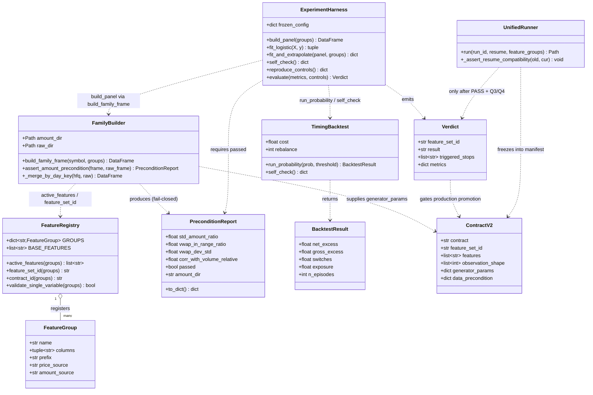
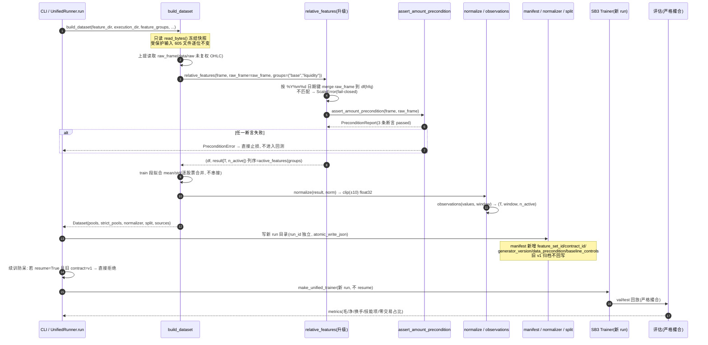
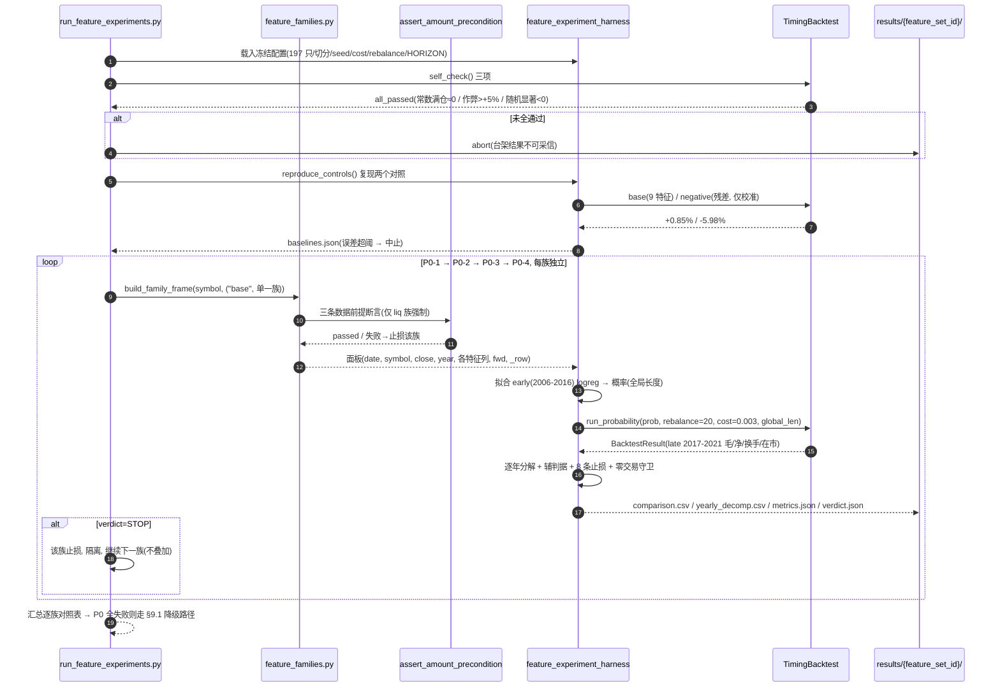
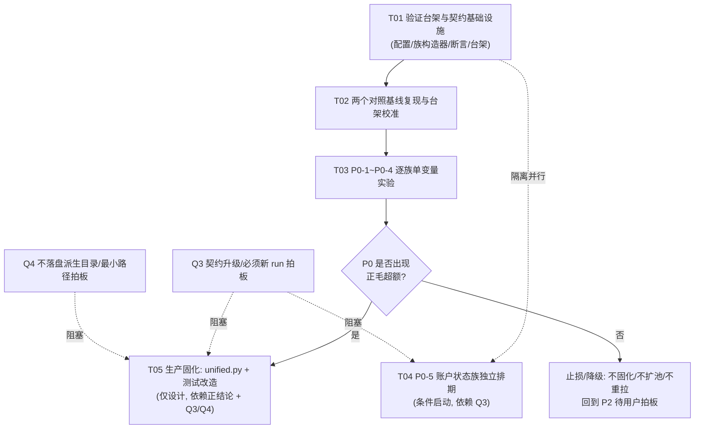

# 特征数据补充方案：系统设计与实施分解（架构）

> **本文定位**：「部分工作流」**第二步**的唯一交付物。只输出**系统设计 + 任务分解 + 实施方案**，不写生产代码、不改 `src/`、不训练、不跑回测、不重拉数据。
> **上游**：`outputs/feature_data_prd.md`（v2，516 行，已修正成交额口径，**只采信 v2**）+ `outputs/improvement_plan.md`（诊断报告 / 全部证伪证据）。
> **核查方式**：本地只读核查（`src/stock_ai/scale/unified.py`、`outputs/timing_backtest.py`、`outputs/diagnose_residual_overfit_vs_regime.py`、`outputs/prepare_v2_training_inputs.py`、`tests/` 全部硬编码点）。
> **语言**：简体中文。**技术栈**：Python 3 + pandas/numpy + Gymnasium + Stable-Baselines3(PPO) 研究型后端，无前端。

---

## 0. 结论速览与硬边界

### 0.1 一句话推荐

> **采用「最小变更路径」，并拆成两个互不污染的落点：P0 验证阶段在 `outputs/` 下新建只读、零落盘的特征族构造模块（完全不碰 `src/`、不碰 605 个受保护输入、不新增任何数据文件）；P0 出正结论且 Q3/Q4 拍板后，才在生产链路改造 `unified.py::relative_features` 及其调用链固化契约。不采用「独立派生目录」。**

### 0.2 本方案必须锁死的六条硬边界（逐条给出处理方式）

| # | 硬事实 / 约束（主理人 §4） | 本方案的处理位置 |
|---|---|---|
| 1 | `data/raw` 的 `amount` 是合成值 `close×volume`（std=0）；**金额型特征一律禁用** | §3.5 数据前提断言（3 条）、§3.3 逐族依赖列锁定、§10 共享约定 |
| 2 | `data/raw_hfq(_v2_train)` 的 `amount` 是**真实成交额**（std≈0.0095、vwap 落在 raw `[low,high]` ≥99.6%），金额分子锁定它 | §1.4 未复权 OHLC 取得方式、§3.3 P0-1 依赖表 |
| 3 | 价格分母必须取 `data/raw` 未复权 OHLC，**绝不能用 `close_hfq`**（26.5~159.4 倍） | §1.4、§3.4 缩放不变性通用约束、§3.3 |
| 4 | `frame` 已含 `amount`；`build_dataset` CA/strict 模式已加载 `raw_frame` → 最小变更可行 | §1.2 路径评估、§1.6 对齐语义影响 |
| 5 | 新增特征必然改 `FEATURES`/`observation_shape` → **必须新 run，绝不 `resume=True` 对 v3/v4** | §2.3 契约升级、§2.6 禁止 resume 防呆 |
| 6 | 缩放不变性硬断言（`atol=1e-12`）+ 因果性硬断言；夹具要同步扩展 `amount`/`raw_frame` | §3.4、§8.2 测试夹具改造 |

### 0.3 严禁列入设计（已实测证伪，来自 PRD §3.4 / 主理人 §三）

市场指数/大盘上下文独立特征列、市场 beta 残差特征、regime 门控、联合量、横截面选股、加大训练量/调参、单靠降换手、用 IC 或 val 单点当判据、用「全部超额」（含零交易 episode）、任何未来日历信息、`data/raw` 的 `amount` 用于金额型特征。

> **⚠️ 阴性对照的边界（务必区分）**：主判据要求「每次同时复现两个对照：现状 9 特征 **+0.85%**、已失败残差特征 **−5.98%**（阴性对照）」。为复现 −5.98%，验证台架必须能构造 `resid_cum_5 / resid_cum_20 / beta_level` 三个残差列——**但这是「已证伪项的复现校准」，仅存在于 `outputs/reproduce_controls.py` 的只读复现脚本中，绝不进入 `FEATURE_GROUPS` 注册表、绝不进入任何 `feature_set`、绝不写入 `FEATURES` 契约、绝不进生产特征集**。见 §7.6。

---

## 1. 实现方案与取舍

### 1.1 两条候选路径定义

| 路径 | 定义 | 数据落盘 | `src/` 改动 | `sources` sha256 集合 |
|---|---|---|---|---|
| **A. 最小变更路径**（推荐） | 特征在**内存里**由 `frame`（hfq 8 列，含真实 `amount`）+ `raw_frame`（`data/raw` 未复权 OHLC）按 `date` 键现场构造；改造 `relative_features()` 及其调用链 | **无新增目录/文件** | P0 验证阶段 **0 处**；固化阶段改 `unified.py` | **不变**（不新增 `[0-9]{6}.parquet` 文件） |
| **B. 独立派生目录路径** | 预计算全部新特征，落盘到 `data/derived_v2/[0-9]{6}.parquet`，`relative_features` 读派生列 | 新增 1 份派生目录（197 只） | 仍需改 `unified.py` | **变化**（新目录纳入 `sources`，新 run 指纹不同） |

### 1.2 逐条评估（回答主理人 §4.2）

| 评估维度 | A 最小变更路径 | B 独立派生目录路径 |
|---|---|---|
| 工程量 | 低：`frame` 已含 `amount`；CA 模式 `raw_frame` 已在内存（`unified.py:263`），只需上提读取顺序并透传 | 高：需生成器 + 确定性保证 + 版本/参数入 manifest + 目录生命周期管理 |
| 受保护输入 605 个文件 | **逐位不变**（全程 `read_bytes()`/`read_parquet` 只读，无写回路径，`unified.py:246-263`） | 逐位不变（但新增 197 个派生文件需纳管） |
| v3/v4 归档可复现 | **不受影响**（旧 run 的 manifest 已冻结自身 `sources`/`feature_dir`/`normalizer`；新 run 用新 `run_id` 隔离到独立输出目录 `unified.py:661,722-724`） | 不受影响，但新 run 自身多一层「派生字节可复现」依赖 |
| `sha256` 集合 | **不变**，旧 run 续训校验的 `sources` 比对语义不变 | 变化，且 `:232-233` 会把新目录下所有 `[0-9]{6}.parquet` 纳入 `sources`，`feature_hash` 全变 |
| 确定性要求 | 无（纯函数，同输入字节→同特征） | **强**：同输入字节必须→同派生字节，生成脚本版本/参数必须入 manifest，否则新 run 自身不可复现（主理人 §4.4） |
| 前视 / 口径审阅 | 集中在一处（`relative_features`），易审 | 分散在生成器 + 读取器，双份口径易漂移 |
| 单变量隔离 | 用 `feature_set_id` 参数切换，天然隔离 | 每族要生成一份目录，隔离靠目录爆炸 |
| 测试改造面 | 集中（`relative_features` 一处） | 生成器 + 读取器都要测 |

### 1.3 推荐：最小变更路径，拆成两个互不污染的落点

**这是本方案最关键的架构决策**：P0 的「策略是否有效」结论走的是 `outputs/timing_backtest.py` 上的**监督式逻辑回归 + 时间外推**离线评估链路（参考 `diagnose_residual_overfit_vs_regime.py`，它自己 `build_panel()` 调 `relative_features`，**根本不调用 `build_dataset`、不训练 PPO**）；而 `src/stock_ai/scale/unified.py` 是**生产训练链路**。两者是两套东西，必须分阶段、分落点：

```
落点 1【实验侧 · 本轮 P0 真正要交付、真正要跑的】
  outputs/ 下新建只读特征族构造模块 feature_families.py
  → 零新增数据文件、零 src 改动、零 sha256 变化、899 项测试一项不动
  → 只读 data/raw_hfq_v2_train（197 只，含真实 amount）+ data/raw（未复权 OHLC）
  → 复用 unified.py::relative_features 的因果/口径约定，但独立实现（不改 src）
  → 供 run_feature_experiments.py 构造面板 → logreg → TimingBacktest 时间外推

落点 2【生产侧 · 仅设计，P0 出正结论 + Q3/Q4 拍板后才实施】
  unified.py::relative_features(frame, *, raw_frame=None, groups=None, context=None)
  + build_dataset 透传已加载的 raw_frame + CONTRACT/FEATURES/manifest/续训校验升级
  → 仍不派生独立目录（路径 A）
```

**推荐理由**：① 严格满足「零新增外部数据源 + 单变量 + 可止损 + 可复现」；② P0 阶段完全不碰 `src/`，因此不触碰 §4.5 的 899 项回归基线，也不触碰 605 个受保护输入；③ 落点 2 复用 `frame` 已有的 `amount` 与 `build_dataset` 已加载的 `raw_frame`，工程量最小；④ 两个落点通过「同一套 `FEATURE_GROUPS` 注册表与公式口径」保证实验结论能 1:1 固化进生产。

### 1.4 未复权 OHLC 如何取得（最小路径的核心）

**实验侧（落点 1）**：`feature_families.build_family_frame(symbol, groups)` 同时只读两份 parquet：
- `data/raw_hfq_v2_train/<symbol>.parquet` → 8 列，取 `amount`（**真实成交额，唯一金额分子**）、`volume`、`open/close/high/low`（后复权，用于比值型）、`close` 派生 `ret`；
- `data/raw/<symbol>.parquet` → 取 `open/high/low/close`（**未复权，唯一价格分母**），用于 `liq_vwap_dev` 与 §3.5 区间断言。

**生产侧（落点 2）**：`build_dataset` 在 CA 模式第 263 行**已有** `raw_frame = pd.read_parquet(BytesIO(execution_content))`；strict 非 CA 模式第 266 行 `_load_execution_bars` 内部也读了 raw（但未返回 frame）。改造只需：
1. 把 `raw_frame` 的读取**上提**到第 251 行 `relative_features` 调用之前；
2. 以可选关键字参数 `raw_frame=raw_frame` 传入；
3. `relative_features` 内部按 `date` 键把 `raw_frame` 的 `close_raw/high_raw/low_raw/open_raw` inner-merge 到 `df`（hfq 排序帧）上，得到同长同序的未复权价列。

> **绝不**用 `close_hfq` 当金额特征的价格分母；**绝不**用 `data/raw` 的 `amount`（该列在 raw_frame 里存在但是合成值，必须在构造器里显式忽略，并通过 §3.5 断言挡住误用）。

### 1.5 对 `sources` / sha256 / manifest / 605 输入 / v3-v4 归档的影响

| 对象 | 影响 | 依据 |
|---|---|---|
| 605 个受保护输入（`data/raw`、`data/raw_hfq`、`data/corporate_actions`） | **逐位不变**。`build_dataset` 全程 `read_bytes()` / `pd.read_parquet(BytesIO(...))` 只读，全代码无写回（主理人 §4.4 已复核） | `unified.py:246-263` |
| `sources` 的 sha256 集合 | **不变**（路径 A 不新增 `[0-9]{6}.parquet` 文件） | `unified.py:232-233, 297-300` |
| 旧 v3/v4 run | **不受影响**：旧 manifest 已冻结自身 `sources`/`feature_dir`/`normalizer`；新 run 用**新 `run_id`**，输出经 `atomic_write_json` 写到新 run 目录，与旧归档隔离 | `unified.py:661, 722-724` |
| 新 run manifest | 需新增字段（§2.4），但这是**新 run 自己的**文件，不回写旧归档 | `unified.py:677-697` |
| CA 账本冻结 | `corporate_actions_sha256` / `require_coverage` / 「v2 禁止丢日或回退」语义**不动** | `unified.py:280, 301-317` |
| 结论 | 受保护输入字节不变 → sha256 不变 → 旧 run 可复现、归档不受影响 | 主理人 §4.4 |

### 1.6 是否会影响 `build_dataset` 的现有对齐语义（明确结论）

**不会改变现有对齐语义，只新增「按 date 补列」**：

- `_load_execution_bars()` 的 inner join、`keep = df.date.dt.strftime("%Y%m%d").isin(real.dates)` 过滤（`:281-284`）、`_slice_bars()`（`:367-384`）、v2 的 `feature_days == execution_days` 严格校验（`:279`）**全部保持原样**；
- `relative_features` 返回契约仍为 `(df, result)`，`df` 的行数/顺序/索引不变，`result` 仅**列数**随 `groups` 变化（这是预期的契约升级，不是对齐变化）；
- merge 采用 **`%Y%m%d` 8 位字符串键**（与 `ExecutionBars.dates`、`split.json` 一致，见 `unified.py:184`），merge 前统一 `pd.to_datetime(...).dt.strftime("%Y%m%d")`；**严禁**混用 `20060104` 与 `2006-01-04`（历史出过 merge bug，见 §10）；
- 训练池 197 只已由 `prepare_v2_training_inputs.py:76` 保证 `set(hfq.date)==set(raw.date)`、由 `unified.py:279` 保证 episode 区间日期集合相等 → merge 不丢行；**若出现任何不匹配，fail-closed 抛 `ScaleError`，绝不 bfill / 回退 / 静默丢日**（与 v2 语义一致）；
- 顺序调整的**唯一副作用**：`raw_frame` 在 `relative_features` 之前读入，但它是同一份只读字节，不改变任何快照/指纹。

### 1.7 为什么**不推荐**独立派生目录路径（路径 B）

1. `unified.py:232-233` 会把 `cache_dir` 下所有匹配 `[0-9]{6}.parquet` 的文件纳入 `sources`，非 6 位文件名被**静默忽略** → 命名约束脆弱；
2. 派生必须**确定性生成**（同输入字节→同派生字节），并把生成脚本版本/参数记入 manifest，否则新 run 自身不可复现（主理人 §4.4）——这是路径 A 完全不需要的额外负担；
3. 新目录使 `sources` 的 sha256 集合整体变化，反而让「旧 run 可复现」的论证绕一层；
4. 多一份数据、多一个生成环节、多一套测试，而 `relative_features` **照样要改**，收益不抵成本；
5. 单变量实验需要逐族切换，派生目录会退化成「一族一目录」的目录爆炸，隔离性反而差于 `feature_set_id` 参数切换。

### 1.8 明确不混淆、不误改

`src/stock_ai/samples/features.py` 是**另一套旧 CLI 特征工程**，与 `scale/unified.py` 链路独立。本方案**所有改动都不涉及它**；`outputs/` 实验脚本 `from stock_ai.scale.unified import FEATURES, relative_features` 引用的是 `scale/unified` 链路，不是 `samples/features`。文件清单（§5）中列入「不改」区。

---

## 2. 特征契约设计

### 2.1 分组与命名规范

- **基线 9 特征名冻结不动**（`return_1, open_relative, high_relative, low_relative, ma5_relative, ma20_relative, momentum_5, volatility_20, volume_relative`）——保证默认调用向后兼容（§2.6、§8）。
- 新特征命名：``{族前缀}_{语义}[_{窗口}]``，全小写下划线，前缀表：

| 前缀 | 族 | 编号 |
|---|---|---|
| `liq_` | 成交额 / 流动性 | P0-1 |
| `od_` | 隔夜 / 日内收益分解 | P0-2 |
| `cdl_` | K 线形态 | P0-3 |
| `vol_` | 波动率结构 | P0-4 |
| `acct_` | 账户状态（运行时） | P0-5 |
| `inst_` / `cal_` / `ca_` | A股制度 / 日历 / 公司行为 | P1（本轮不实现，仅预留前缀） |

### 2.2 `FEATURE_GROUPS` 注册表与动态 `FEATURES`

```
BASE_FEATURES = (9 个原名, 冻结)
FEATURE_GROUPS: dict[str, tuple[str, ...]] = {
    "base":        BASE_FEATURES,
    "liquidity":   (liq_*, ...),
    "overnight":   (od_*, ...),
    "candlestick": (cdl_*, ...),
    "volatility":  (vol_*, ...),
    "account":     (acct_*, ...),   # P0-5，运行时注入，非落盘族
}
def active_features(groups) -> list[str]:
    # 按注册表声明序拼接，去重；groups 默认 ("base",) → 严格等于 BASE_FEATURES
```

**单变量原则直接编码进契约**：一次 `feature_set` 只允许 `("base", <单一族>)`，绝不允许两个新族同时出现（§7.4 隔离）。

### 2.3 `CONTRACT` 版本升级方案

- 主版本：`CONTRACT = "unified-relative-v1"` → **`"unified-relative-v2"`**（大类升级：特征构造入口签名、列数、normalizer 维度都变）。
- 细粒度：新增 **`FEATURE_SET_ID`**（如 `v2-base`、`v2-liquidity`、`v2-overnight`、`v2-candlestick`、`v2-volatility`、`v2-account`），由 `active_features(groups)` 确定性生成。
- 续训/回放校验用的 **`CONTRACT_ID = f"{CONTRACT}+{FEATURE_SET_ID}"`**，写入 manifest 与 normalizer 元数据。**任一元素变化 → 新 run**（Σ 见 §2.6）。

> **为何按族分版而非单一 v2**：逐族单变量实验要求每个族有独立、可隔离、不可混淆的标识；若全部共用一个 `v2`，不同族的 `observation_shape` / `normalizer` 差异会被同一 contract 掩盖，极易发生「拿 A 族冻结 normalizer 续训 B 族」的静默错误。`feature_set_id` 让隔离天然成立。

### 2.4 manifest 需要新增的字段（新 run 专属，不回写旧归档）

| 字段 | 类型 | 内容 / 目的 |
|---|---|---|
| `contract` | str | `unified-relative-v2` |
| `feature_set_id` | str | `v2-liquidity` 等，标识本次单变量实验的族 |
| `contract_id` | str | `unified-relative-v2+v2-liquidity`，续训/回放比对键 |
| `feature_groups` | list[str] | `["base","liquidity"]`，必须为「base + 至多 1 个新族」 |
| `features` | list[str] | `active_features(groups)`（列名有序，冻结） |
| `observation_shape` | list[int] | `[window, len(features)]` |
| `generator_version` | str | 特征族构造脚本版本 / 内容 sha256（确定性复现依据） |
| `generator_params` | dict | 窗口、`min_periods`、`gap` 阈值 `c`、`HORIZON=20`、logreg 超参、`cost/rebalance/seed` 快照 |
| `data_precondition` | dict | §3.5 三条断言的**实际数值 + pass/fail + 使用的 amount 目录**（PRD §2.1⑦） |
| `amount_source` | str | 固定 `data/raw_hfq_v2_train`（或 `data/raw_hfq`）的真实 `amount`；显式声明**禁用** `data/raw` 的 `amount` |
| `price_denominator_source` | str | 固定 `data/raw` 未复权 OHLC；显式声明**禁用** `close_hfq` |
| `raw_frame_dir` / `raw_frame_sha256` | str | 若启用跨目录族，记录未复权价来源与指纹（可复用 `sources[].execution_sha256`，不新增目录） |
| `baseline_controls` | dict | 本次同时复现的两个对照：`base=+0.85%`、`negative=-5.98%`（含实测值与误差） |
| `self_check` | dict | `TimingBacktest.self_check()` 三项结果与 `all_passed` |
| `stop_conditions` | list | §4.4 八条止损的逐条判定结果 |

### 2.5 `normalizer` 冻结语义与 `observation_shape`

- 冻结语义**不变**：mean/std 只用 **train 段**拟合（`unified.py:286-295`，逐股票合并、绝不串接股票计算指标/窗口），`clip(±10)`，`warmup` 允许前一切分但不参与该切分动作。
- 维度随 `features` 变化：`mean/std` 形状 `(len(features),)`，`NormalizerState.columns = list(features)`。
- `normalize(values, norm)` 当前硬编码 `norm.columns != FEATURES`（`unified.py:111`），改造为**按 `norm.columns` 自身长度与 `values.shape[1]` 校验**，解除对全局 `FEATURES` 的耦合（默认 `groups=("base",)` 时行为逐位不变）。
- `observations(values, window)` **不改**（与列数无关，`unified.py:118-120`）。
- `observation_shape = [window, len(active_features(groups))]`；P0-1~P0-4 各不同，P0-5 亦不同。

### 2.6 旧模型兼容与「禁止 resume」显式防呆

- **兼容**：`relative_features(frame)` 的**默认 `groups=("base",)` 返回严格等于现状 9 特征**（逐位不变）→ 旧 v1 run 的回放路径、旧测试、旧 `diagnose_*` 脚本全部保持可用；旧归档不动、不覆盖 `data/raw_hfq_v2_train/`。
- **禁止 resume（三层防呆）**：
  1. `UnifiedRunner.run` 续训分支在现有 `:704` 比对 `contract/window/ranges/features/sources/env_config/seed` 基础上，**新增**比对 `feature_set_id / contract_id / generator_version / data_precondition / observation_shape / raw_frame_sha256`；任一不一致 → `续训拒绝：契约升级必须新 run`。
  2. 入口级显式拦截：`resume=True` 且旧 manifest `contract` 以 `unified-relative-v1` 开头、而当前 `CONTRACT` 为 `v2` → **直接抛错**，不进入 `build_dataset`、不写任何状态/模型（`unified.py:612-639` preflight 之前）。
  3. CLI / 实验脚本层：Q3 拍板前，实验编排脚本**不提供**任何 `--resume` 参数；所有实验用新 `feature_set_id` + 新 `run_id`，产物写入独立子目录。
- 结论：新增特征**必然**改 `FEATURES`/`observation_shape` → **必须开新 run，绝不对 v3/v4 旧 run 传 `resume=True`**（`unified.py:698-720`）。

---

## 3. 接口与数据结构

### 3.1 关键函数签名与返回契约（伪签名，不写实现体）

```
# ---- 实验侧（落点 1，outputs/，本轮交付）----
feature_families.build_family_frame(symbol: str, groups: tuple[str,...],
                                    *, amount_dir=RAW_HFQ_V2_TRAIN,
                                    raw_dir=RAW) -> pd.DataFrame
    # 返回：以 %Y%m%d 日期键对齐的单只股票面板，列 = date, symbol, close(hfq),
    #       close_raw, high_raw, low_raw, volume, amount(真实),
    #       *active_features(groups)  → 每个特征一列，列名即注册表名
    # 前置：内部强制调用 assert_amount_precondition()，失败抛 PreconditionError
    # 只读：两个受保护目录，不写回、不落盘、不缓存

feature_families.assert_amount_precondition(frame, raw_frame) -> PreconditionReport
    # §3.5 三条断言，返回实测数值 + passed；任一不满足 → 抛出，直接止损

feature_families.active_features(groups) -> list[str]
feature_families.FEATURE_GROUPS -> dict[str, tuple[str,...]]
feature_families.CONTRACT_V2 / FEATURE_SET_ID(groups) / CONTRACT_ID(groups)

# ---- 生产侧（落点 2，src/，仅设计）----
unified.relative_features(frame, *, raw_frame=None, groups=("base",),
                          context=None) -> tuple[pd.DataFrame, np.ndarray]
    # 保持返回 (df, result) 不变；result 列序 = active_features(groups) 声明序
    # raw_frame=None 时：只允许 groups=("base",)；若 groups 含跨目录族而
    #   raw_frame 缺失 → 抛 ScaleError（fail-closed，绝不静默降级/填充常数）
    # context：预留给 P0-5 运行时账户状态注入（账户族不走 frame）

unified.normalize(values, norm) -> np.ndarray      # 解除全局 FEATURES 硬编码
unified.observations(values, window) -> np.ndarray # 不变
unified.build_dataset(..., feature_groups=("base",), ...) -> Dataset
    # 透传 raw_frame 给 relative_features；其余对齐语义不动（§1.6）

# ---- 验证台架（outputs/，本轮交付）----
feature_experiment_harness.build_panel(groups) -> pd.DataFrame   # 复用 diagnose_* 口径
feature_experiment_harness.fit_and_extrapolate(panel, groups) -> dict
    # 拟合 early(2006-2016) → 评估 late(2017-2021)，rebalance=20，摩擦 0.3%
feature_experiment_harness.evaluate(metrics, controls) -> Verdict
    # 主判据 + 辅判据 + 8 条止损 + 三项自检 + 三条数据断言 → PASS/STOP
```

### 3.2 数据结构与关系（Mermaid classDiagram）



### 3.3 逐族特征输入输出表（可照此实现，字段名 + 公式口径）

> 通用：`ret_1 = close.pct_change(fill_method=None).fillna(0)`；所有 `rolling(W, min_periods=…)` 只用 `[t−W+1, t]`；`ε=1e-12`；`zscore_W(x)` 为逐股票滚动 z-score；`pct_rank_W(x)` 为逐股票滚动分位（0~1）；`high==low` 显式兜底。所有列**无量纲**。

**P0-1 成交额 / 流动性族 `liq_`（PRD §2.1）**

| 字段名 | 公式 / 口径 | 依赖列 | 因果窗口 | 备注 |
|---|---|---|---|---|
| `liq_amihud_z20` | `zscore_20( abs(ret_1) / amount_hfq )` | frame: `amount, close` | 20 | 绝对值跨股票不可比，**必须**取滚动 z-score |
| `liq_amt_rank250` | `pct_rank_250(amount_hfq)` | frame: `amount` | 250 | 0~1 |
| `liq_amt_logratio` | `log( amount_hfq / rolling_median_250(amount_hfq) )` | frame: `amount` | 250 | 无量纲对数比 |
| `liq_vwap_dev` | `close_raw / (amount_hfq / volume) − 1` | frame: `amount, volume`；**raw_frame: `close`** | 当日 | **价格分母必须未复权**；`vwap=amount/volume` |
| `liq_vwap_dev_ma5` | `rolling_mean_5(liq_vwap_dev)` | 同上 | 5 | |
| `liq_pv_div20` | `rolling_corr(ret_1, Δlog(amount_hfq), 20)` | frame: `amount, close` | 20 | 量价背离 |

> ⚠️ `data/raw` 的合成 `amount` 一旦误用 → `vwap ≡ close_raw`、`liq_vwap_dev ≡ 0`（常数假特征），由 §3.5 断言①挡住。绝不使用 `close_hfq` 作分母。

**P0-2 隔夜 / 日内收益分解 `od_`（PRD §2.2，全 hfq）**

| 字段名 | 公式 / 口径 | 依赖列 | 因果窗口 |
|---|---|---|---|
| `od_overnight` | `open_t / close_{t−1} − 1` | hfq `open, close` | 当日 + T−1 |
| `od_intraday` | `close_t / open_t − 1` | hfq `open, close` | 当日 |
| `od_overnight_ma5` / `od_intraday_ma5` | 各自 5 日均值 | — | 5 |
| `od_overnight_vol20` / `od_intraday_vol20` | 各自 20 日 std | — | 20 |
| `od_abs_diff` | `abs(od_overnight) − abs(od_intraday)` | — | 当日 |
| `od_overnight_share20` | `Σ_abso / (Σ_abso + Σ_absi + ε)` over 20 | — | 20 |

> **一致性自检（断言，不是特征列）**：`(1+od_overnight)(1+od_intraday) − 1 == return_1`，`|diff| < 1e-9`；不满足即构造器报错。现有 `open_relative = open/close − 1` 是**同日**口径，本族是**跨日隔夜**，不重复。

**P0-3 K 线形态族 `cdl_`（PRD §2.3，全 hfq）**

| 字段名 | 公式 / 口径 | 依赖列 | 备注 |
|---|---|---|---|
| `cdl_upper_shadow` | `(high − max(open,close)) / close` | hfq OHLC | |
| `cdl_lower_shadow` | `(min(open,close) − low) / close` | hfq OHLC | |
| `cdl_close_location` | `(close − low)/(high − low)` | hfq OHLC | `high==low` → `0.5` 且置 `cdl_oneword=1` |
| `cdl_body` | `(close − open) / close` | hfq OHLC | |
| `cdl_bar_range` | `(high − low) / close` | hfq OHLC | |
| `cdl_upper_shadow_ma5` / `cdl_lower_shadow_ma5` / `cdl_close_location_ma5` | 各自 5 日均值 | — | |
| `cdl_oneword` | `1{high == low}` | hfq OHLC | 一字板标记 |

> `cdl_gap` 与 `od_overnight` 同源，**不重复列**（只在 P0-2 出现一次），避免共线。与现有 `high_relative/low_relative`（相对收盘偏离）不重复：本族是影线相对实体/全幅的结构。

**P0-4 波动率结构族 `vol_`（PRD §2.4，全 hfq，窗口 20）**

| 字段名 | 公式 / 口径 | 备注 |
|---|---|---|
| `vol_parkinson20` | `sqrt( mean( (ln(H/L))² ) / (4·ln2) )` | 负值不适用 |
| `vol_gk20` | `sqrt( max( mean(0.5·ln(H/L)² − (2ln2−1)·ln(C/O)²), 0 ) )` | 偶发负值 clamp 0 |
| `vol_downside_ratio20` | `sqrt(mean(min(ret,0)²)) / (sqrt(mean(max(ret,0)²)) + ε)` | 上下行半方差 |
| `vol_gap_freq20` | `mean( abs(od_overnight) > 1.5·vol_parkinson20 )` over 20 | `c=1.5` 入 `generator_params` |
| `vol_path_ratio20` | `vol_parkinson20 / (volatility_20 + ε)` | 日内路径波动 vs 收盘波动 |

**P0-5 账户状态族 `acct_`（PRD §2.5，运行时注入，**非落盘族**，独立排期）**

| 字段名 | 公式 / 口径 | 来源 |
|---|---|---|
| `acct_position_flag` | `1{持仓}` | env `state` |
| `acct_unrealized_pnl` | `close_hfq_T / entry_price_hfq − 1` | env `state`（hfq 同源，避免除权假亏损） |
| `acct_holding_days_norm` | `holding_days / 250` | env `state` |
| `acct_cash_ratio` / `acct_position_ratio` | 已有 `info`（`unified.py:409`） | env `info` |
| `acct_blocked_buy_5` | 最近 5 日「现金不足」阻断买入次数 | env 可记录 |

> **定性**：纯信息缺失修复，**不期待毛超额转正**；因触发契约升级（观测来自环境运行时而非 `frame`）**独立排期、单独对照**，绝不与 P0-1~P0-4 混在同一实验（PRD §3.1）。

### 3.4 保持「缩放不变性」的通用构造约束（重点）

`tests/test_unified.py:49-57` 的硬断言 `assert_allclose(first, scaled, atol=1e-12)` 要求「整只股票 OHLCV 缩放 100 倍后输出逐位相等」。由此推出**所有新特征必须遵守**：

1. **只产出无量纲相对量**：比值、比率、滚动分位、滚动 z-score、相关系数、0/1 标记、归一化计数。**绝对价格 / 绝对金额 / 绝对成交量一律不得直接进观测**（否则被 `clip(±10)` 截断并主导梯度）。
2. **金额与价格同量纲、缩放自洽**：`amount = vwap × volume`，其中 `vwap` 与未复权价同尺度。若测试把 `open/high/low/close × s`、`volume × s`，则 **`amount` 必须 `× s²`**（vwap ×s、volume ×s），从而 `vwap = amount/volume × s`、`close_raw/vwap` 保持不变 → `liq_vwap_dev` 不变。**`amount × s`（只随价格缩放）会让 `vwap` 不变而 `close_raw × s`，破坏不变性**——这是夹具扩展最容易踩的坑。
3. **跨目录比值两边同步缩放**：`liq_vwap_dev` 的分子 `close_raw` 来自 `raw_frame`，分母 `vwap` 来自 `frame`；夹具必须**同时**扩展并同步缩放 `frame` 与 `raw_frame`，否则跨目录比值不成立。
4. **滚动统计天然缩放不变**：`pct_rank_W`、`zscore_W`、相关系数、比值型在「整体乘常数」下不变（前提是按 (2)(3) 自洽构造）；`rolling_mean/std` 只用于构造比值，不直接输出绝对量。
5. **因果性**：单只股票序列内一次性滚动计算，再按年份切 episode；**绝不串接股票**计算窗口/分位数（`unified.py:289`）；只用 `T` 及以前；无 `bfill`、无 `shift(-)`（`shift(-HORIZON)` 仅用于构造监督标签 `fwd`，**不进特征**）；`min_periods` 兜底（单只最少 21 行）；窗口内 `fillna(0)`。
6. **一字板 / 零分母**：`high==low`、`volume=0`、`rolling_std=0` 显式兜底（置 0/0.5/1.0），不得产生 NaN/Inf（`relative_features` 末尾 `np.isfinite` 校验会拒绝）。

### 3.5 数据前提断言（PRD §2.1⑦）落地位置

按产品经理建议，**放在特征生成时（构造器内），而非回测阶段**，并额外提供 P0-1 落地前可独立单跑的 CLI：

```
① std( amount / (volume × close_raw) ) > 1e-3          # 挡合成值（std=0）
② 占比( vwap = amount/volume ∈ [low_raw, high_raw] ) > 0.99   # 挡口径错配
③ vwap != close_raw 占比显著>0 且 std(vwap_dev)>0
   且 corr(vwap_dev, volume_relative) 显著 < 1          # 挡常数/共线假特征
```

- 使用的目录**显式锁定** `data/raw_hfq_v2_train`（197 只，sha256 与 `data/raw_hfq` 逐位相同）的 `amount`；`data/raw` 的 `amount` 显式禁用。
- 任一断言不满足 → 抛 `PreconditionError`，**判定该 amount 目录不可用、该特征族不可构造、直接止损，不进入回测**（PRD §4.4 第 8 条）。
- 断言结果（实测数值 + passed + 目录名）写入 `data_precondition`，进 manifest（§2.4）与实验 `metrics.json`（§7.5）。
- 独立 CLI：`outputs/verify_amount_precondition.py`，**P0-1 落地前第一件事**先跑它。

---

## 4. 调用流程（Mermaid 时序图）

### 4.1 生产链路：从 `build_dataset` → 特征构造 → 断言 → normalize → manifest 冻结 → 新 run（对应主理人 §5.4）

> 这是「P0 出正结论 + Q3/Q4 拍板后」的固化流程；本轮只设计不实施（T05）。



### 4.2 实验链路：P0 逐族单变量验证（本轮真正执行的流程）



### 4.3 任务依赖图（Mermaid graph）



---

## 5. 文件清单（相对 `E:\project\stock_ai\`）

### 5.1 新增（P0 验证阶段，`outputs/` 下，本轮交付设计、工程师据此实现）

| 路径 | 职责 |
|---|---|
| `outputs/feature_families.py` | **只读特征族构造器**：`FEATURE_GROUPS` 注册表、`active_features/feature_set_id/contract_id`、`build_family_frame(symbol, groups)`（按 `%Y%m%d` merge hfq+raw）、`assert_amount_precondition()` 三条断言。零落盘、零写回、零新增数据文件 |
| `outputs/verify_amount_precondition.py` | P0-1 落地前**独立单跑**的金额口径守卫 CLI；输出三条断言实测值，任一失败 `exit!=0` 并打印「直接止损」 |
| `outputs/feature_experiment_harness.py` | **可复用逐族增量验证台架**：`build_panel`、`fit_logistic`、`fit_and_extrapolate`（70/30 时间外推）、`self_check`、`reproduce_controls`、`evaluate`（8 条止损） |
| `outputs/reproduce_controls.py` | 两个对照基线复现（base `+0.85%` / 阴性 `−5.98%`）。**残差列仅在此脚本内构造，绝不进注册表/契约** |
| `outputs/run_feature_experiments.py` | 编排：P0-1→P0-2→P0-3→P0-4 顺序、族间隔离、verdict 汇总；不提供任何 `--resume` |
| `outputs/feature_experiments.yaml` | **冻结参数**：197 只目录、`SPLITS`、70/30 切点、`seed=20261020`、`cost=0.003`、`rebalance=20`、`HORIZON=20`、logreg 超参、止损阈值、断言阈值 |
| `outputs/feature_experiment_results/baselines.json` | 两个对照复现值 + 误差 |
| `outputs/feature_experiment_results/{feature_set_id}/comparison.csv` | 逐族对照表（现状/候选/阴性 同段并列） |
| `outputs/feature_experiment_results/{feature_set_id}/yearly_decomp.csv` | 逐年毛超额分解（识别过拟合） |
| `outputs/feature_experiment_results/{feature_set_id}/metrics.json` | 毛/净/换手/摩擦/在市/技能项/零交易占比/自检/数据断言 |
| `outputs/feature_experiment_results/{feature_set_id}/verdict.json` | `PASS` / `STOP` + 触发的止损条款编号 |
| `outputs/feature_data_plan.md` | **本文档** |

### 5.2 修改（**仅 T05 生产固化阶段，本轮不改**）

| 路径 | 职责 / 改动 |
|---|---|
| `src/stock_ai/scale/unified.py` | `CONTRACT`→v2、`FEATURE_GROUPS`、`relative_features` 新签名、`normalize` 解耦、`build_dataset` 透传 `raw_frame` + `feature_groups`、manifest 新字段、续训校验扩展、禁止 resume 防呆 |
| `tests/test_unified.py` | 夹具 8 列 + 缩放自洽 + `raw_frame`；缩放/因果断言扩展；契约版本/禁止 resume 新用例 |
| `tests/test_scale_replay.py` | `:851` `(4,9)` 魔法数显式化；`:434-441` manifest 动态化；`:818` 期望观测适配 |
| `tests/test_corporate_action_env.py` | `:479-480` 期望观测适配 `raw_frame` |
| `tests/test_feature_families.py`（新增） | 因果性、缩放不变性、数据前提断言、逐族列完整性、`od_decomp_check` 一致性 |
| `tests/test_feature_contract.py`（新增） | `feature_set_id`/`contract_id` 校验、observation_shape、禁止 resume 防呆、单变量约束 |

### 5.3 判断为「不受影响」但需登记（不要误改）

| 路径 | 判断 |
|---|---|
| `tests/test_excess_reward.py:51`、`tests/test_execution_env.py:61` | `make_obs(n, window=3, n_features=9)` 是**纯全零 obs 张量局部夹具**，与 `unified.FEATURES` 无耦合；可保留 9，建议改名 `obs_dim` 或加注释说明「与特征契约无关」，避免后续误读 |
| `tests/test_qa_verification.py:33` | `n_features=4` 独立夹具，不受影响 |
| `src/stock_ai/samples/features.py` | **另一套旧 CLI 特征工程，与 scale/unified 链路独立，明确不改** |
| `data/raw*` / `data/raw_hfq*` / `data/raw_hfq_v2_train` / `data/corporate_actions` | **605 个受保护输入，逐位不变** |
| `outputs/timing_backtest.py` | 台架**不改**，只调用（`self_check` / `run_probability`） |
| `outputs/diagnose_residual_overfit_vs_regime.py` | 时间外推口径**参考实现**，只读复用其口径，不改 |

---

## 6. 有序任务列表（T01~T05，按依赖排序）

> 遵循「先搭可复用的逐族增量验证台架 → 复现两个对照基线 → 再逐族跑单变量实验」的强制顺序；任务按功能模块分组（不按单文件拆），T01 为基础设施。

| Task | 名称 | 源文件（≥3） | 依赖 | 优先级 | 验收标准 |
|---|---|---|---|---|---|
| **T01** | 验证台架与契约基础设施 | `outputs/feature_experiments.yaml`、`outputs/feature_families.py`、`outputs/verify_amount_precondition.py`、`outputs/feature_experiment_harness.py` | — | **P0** | ① 三条数据前提断言在 `data/raw_hfq_v2_train` 全通过、在 `data/raw` 断言①失败（能挡合成 amount）；② `active_features(("base",))` 逐位等于现状 9 特征；③ 每个族列名/列数/公式与 §3.3 表一致；④ 冻结配置含 197 只/切分/seed/摩擦/rebalance/HORIZON；⑤ 全程只读、零落盘、605 输入 sha256 不变 |
| **T02** | 两个对照基线复现与台架校准 | `outputs/reproduce_controls.py`、`outputs/feature_experiment_results/baselines.json`、`outputs/feature_experiment_results/self_check.json` | T01 | **P0** | ① `TimingBacktest.self_check()` 三项 `all_passed`（常数满仓 \|gross\|<1e-9、作弊 >+5%、随机显著<0）；② base 时间外推毛超额复现 **≈ +0.85%**、阴性对照 **≈ −5.98%**（误差阈值写入 yaml，超阈即中止）；③ 确认 `2006-2016 → 2017-2021`、`rebalance=20`、摩擦 0.3% 与参考实现逐位一致；④ 阴性残差列不进注册表 |
| **T03** | P0-1~P0-4 逐族单变量实验 | `outputs/run_feature_experiments.py`、`…/comparison.csv`、`…/yearly_decomp.csv`、`…/metrics.json`、`…/verdict.json` | T02 | **P0** | ① 严格按 P0-1→P0-2→P0-3→P0-4 顺序，每次 `groups=("base", 单一族)`，绝不叠加两族；② 每族独立 `feature_set_id` 子目录、独立 `metrics.json`、独立 verdict；③ 每族同时报告现状 9 特征同段数值；④ 8 条止损自动判定、任一命中即 `STOP` 并隔离后继续下一族；⑤ 输出逐年分解；⑥ P0-1 先跑 `verify_amount_precondition.py` |
| **T04** | P0-5 账户状态族独立排期 | `outputs/run_account_state_experiment.py`、`outputs/account_state_contract.md`、`outputs/feature_experiment_results/v2-account/*` | T01（+ **Q3** 拍板） | **P1（条件）** | ① 与 P0-1~P0-4 **完全隔离**，不混入同一对照；② 明确标注「纯信息缺失修复，不期待毛超额转正」；③ 契约升级设计（观测来自 env 运行时）、新 run、禁止 resume；④ 单独 verdict |
| **T05** | 生产固化（`src/` + 测试改造） | `src/stock_ai/scale/unified.py`、`tests/test_unified.py`、`tests/test_scale_replay.py`、`tests/test_corporate_action_env.py`、`tests/test_feature_families.py`、`tests/test_feature_contract.py` | T03 出**正毛超额** + **Q3/Q4** 拍板 | **P1（冻结，本轮仅设计）** | ① 默认 `groups=("base",)` 行为逐位不变；② 899 项回归 **0 failures / 0 errors / 1 skipped** 保持；③ 新 run manifest 含 §2.4 全部字段；④ 对 v3/v4 旧 run 传 `resume=True` 必然抛「续训拒绝」；⑤ 旧归档与 605 输入逐位不变 |

**族间隔离方式**：每个族 = 唯一 `feature_set_id` = 唯一结果子目录 + 唯一 `comparison.csv`/`metrics.json`/`verdict.json`；编排脚本一次只实例化一个族，`FEATURE_GROUPS` 校验 `validate_single_variable(groups)` 拒绝「base + ≥2 新族」；每族跑完先写 verdict、判止损，再进入下一族；任何族的中间概率数组、normalizer、面板都**不跨族复用**（避免 §1.9「加特征后变化很大但方向是负的」式的污染归因）。P0-5 因契约升级单独编排，不与前四族共享目录。

---

## 7. 验证台架设计

### 7.1 架构与复用

- **唯一度量口径**：`outputs/timing_backtest.py::TimingBacktest`（**不改**），严格因果（T 收盘信号 → T+1 生效，`days[k]=ret[k+1]×pos[k]`）。
- **时间外推口径逐位复用** `outputs/diagnose_residual_overfit_vs_regime.py:203-229`：`train_years=range(2006,2022)`、`cut=int(16*0.7)=11` → **拟合 2006-2016 / 评估 2017-2021**；`rebalance=20`、`cost=0.003`、`HORIZON=20`、`fwd=close.shift(-20)/close−1`、`|fwd|<1.0`、`y=1{fwd>0}`、`fit_logistic(epochs=250, lr=0.05, l2=1e-3)`、`Z=clip((X−mean)/std,−10,10)`、`prob=sigmoid(Zw+b)`；`TimingBacktest(sub, rebalance=20, global_len=len(data))` + `run_probability(prob)` 用 `_row` 全局索引（`timing_backtest.py:153-177`）。
- **单变量实现**：`groups` 是实验里**唯一可变项**；`build_panel(groups)` 只按 `active_features(groups)` 取列，其余全冻结。

### 7.2 主判据 / 自检 / 对照 / 辅判据 / 止损 → 自动化

| 项 | 自动化实现 | 阈值 / 期望 |
|---|---|---|
| **三项自检** | 每次实验编排开头调 `TimingBacktest.self_check()`，`all_passed` 才继续 | 常数满仓 \|gross\|<1e-9；作弊 >+0.05；随机 **<0**（显著为负，不是≈0） |
| **两个对照**（每次必跑） | `reproduce_controls()` 用同一 `build_panel`/`fit_and_extrapolate`，`groups=("base",)` 与阴性专用列 | base **+0.85%**、阴性 **−5.98%**；与 yaml 容差比对，超阈 `abort` |
| **主判据（唯一决定有效性）** | `late 评估段 gross_excess` | `> 0` **且** `> 现状基线 +0.85%`；建议多切点/多窗口复核，避免单点运气 |
| **辅判据（缺一不可，同时报告）** | `evaluate()` 汇总 | 净超额、年换手（>1.5×base 且净<0 → 拟合噪声）、摩擦拖累（毛<摩擦→无效）、在市占比、择时技能项 >0、零交易占比 ≤5%、三条数据前提断言、台架自检 |
| **逐年分解** | 对 `late` 逐年 `gross_excess` 写 `yearly_decomp.csv` | 正超额集中在个别年份 → 过拟合（§1.16） |
| **8 条止损**（PRD §4.4） | `STOP_RULES` 列表逐条判定，命中即 `verdict=STOP` | ①外推 ≤0 或 ≤+0.85% ②毛正但换手>1.5×且净<0 ③逐年集中个别年 ④仅 val/test 单点为正 ⑤技能项≤0 或零交易>5% ⑥即使 IC 稳定毛超额不达标 ⑦2006-2007 段不作依据 ⑧数据前提断言任一不通过（**直接止损，不进回测**） |
| **退化守卫** | 只看 `mean_excess_return_traded`；`DEGENERATE_ZERO_TRADE_FRACTION=0.05` | 零交易占比 >5% → 无效（不用「全部超额」） |
| **IC / 监督学习** | 仅写诊断字段，**不参与 `evaluate` 判定** | 绝不作验收判据 |

### 7.3 单变量冻结清单（写入 `feature_experiments.yaml`，任何一项变动即中止）

197 只训练池目录 `data/raw_hfq_v2_train`｜`SPLITS={train:2006-2021,val:2022-2023,test:2024-2025}`｜70/30 切点｜`seed=20261020`（含 logreg 确定性）｜`cost=0.003`、`rebalance=20`｜`HORIZON=20`、阈值 0.5｜`normalizer` 拟合段=early、clip ±10｜`min_len=40`｜摩擦口径与 `global_len`/`_row` 对齐语义。**P0 阶段绝对不扩池、不重拉数据、不调训练超参。**

### 7.4 族间隔离

见 §6 末。补充：编排脚本对每族使用**独立进程/独立随机状态**，不复用上一族的概率数组；`comparison.csv` 每族都重新计算现状 9 特征同段值（不缓存跨族），确保「变化」只来自特征集。

### 7.5 中间产物

`outputs/feature_experiment_results/{feature_set_id}/` 下：`comparison.csv`（现状 / 本族 / 阴性对照，列含 gross/net/switches/exposure/技能项/零交易占比）、`yearly_decomp.csv`（逐年毛超额）、`metrics.json`（全量辅判据 + 自检 + 数据断言实测值）、`verdict.json`（PASS/STOP + 触发条款编号）；全局 `baselines.json`、`self_check.json`、`summary.csv`（逐族汇总）。

### 7.6 阴性对照的边界（再次强调）

`reproduce_controls.py` 为复现 −5.98% 会构造 `resid_cum_5 / resid_cum_20 / beta_level`（参考 `diagnose_residual_overfit_vs_regime.py:61-91, 121-132` 的 `rolling_beta` + `resid_ret`）。**这些列只在该脚本的局部 DataFrame 中出现，不注册进 `FEATURE_GROUPS`、不写入任何 `feature_set_id`、不进 `FEATURES`、不进生产链路**；代码注释与 `baselines.json` 均标注「已证伪项复现校准，禁止作为候选特征」。这是同时满足「主判据要求复现两个对照」与「严禁把市场 beta 残差列入设计」的唯一正确做法。

---

## 8. 测试改造清单

> 回归基线：现有 pytest **899 项，0 failures / 0 errors / 1 skipped**。P0 验证阶段（T01~T04）**不碰 `src/` 与 `tests/`**，基线一项不动；以下全部属于 T05 固化阶段。

### 8.1 §4.5 硬编码逐条处置

| 位置 | 现状 | 处置 |
|---|---|---|
| `tests/test_unified.py:49-57` `test_relative_features_causal_and_scale_invariant` | 硬断言：① OHLCV ×100 输出 `assert_allclose(atol=1e-12)` 相等；② 改第 30 行后前 30 行 `assert_array_equal` 不变 | **保留并扩展**：夹具加 `amount`/`adj_factor` 与 `raw_frame`，缩放按 §3.4(2)(3) 自洽（`amount × s²`、raw_frame 同步缩放）；新增「尾部改 `amount`/`raw_frame` 后前 30 行不变」的因果断言 |
| `tests/test_unified.py:25-31` `frame()` 夹具 | 只造 5 列 OHLCV；缩放只作用 5 列 | 扩为 8 列（`amount` 必须是真实成交额模拟：`amount=vwap×volume`，`vwap∈[low,high]` 且 `vwap≠close`，否则触发断言①失败）；新增 `raw_frame()` 夹具（未复权 OHLC，独立缩放） |
| `tests/test_scale_replay.py:851` `w.model.obs_shape=(4,9)` | 「故意错误 shape → 期望 ReplayError」 | FEATURES 变化后 `(4,9)` 仍会触发 ReplayError，但属**碰巧通过的假通过**；改为 `(4, len(unified.FEATURES))` 或 `(window, len(FEATURES)+1)`，显式表达「形状不匹配」意图 |
| `tests/test_scale_replay.py:434-441` | `len(unified.FEATURES)` 动态构造 normalizer/manifest，但 `observation_shape:[3,len(FEATURES)]` 写死 window=3 | 已随 FEATURES 自适应；确认 `w.norm` 的 `linspace` 长度、`manifest.features`、`observation_shape` 三者一致；`strict_workspace` 夹具的 `w.hfq` 需补 `amount` 列（若默认 groups=base 可不补，但为跨族测试建议补） |
| `tests/test_scale_replay.py:818` / `:1419` / `:539-560` / `:753-775` | `relative_features(w.hfq)` 构造期望观测 | 默认 `groups=("base",)` 返回 9 列 → 仍逐位通过；跨族用例需显式传 `groups` 与 `raw_frame` |
| `tests/test_corporate_action_env.py:479-480` | `unified.relative_features(expected_feature)` 构造 `expected_obs` | 默认 base 仍通过；CA v2 用例需补 `raw_frame` 与 `feature_groups`，并确认 `data.normalizer.columns` 与 `active_features` 一致 |
| `tests/test_excess_reward.py:51` / `tests/test_execution_env.py:61` | 局部 `make_obs(n, window=3, n_features=9)` | **不受影响**（纯零张量夹具，与 FEATURES 无耦合）；建议改名/加注释避免误读，不强制改 |
| `tests/test_qa_verification.py:33` | `n_features=4` 独立夹具 | 不受影响 |
| `tests/test_unified.py:134` | `manifest['observation_shape']==[3,len(FEATURES)]` | 用 `len()` 动态，自动适配 ✓ |

### 8.2 新增单元测试

| 文件 | 用例 |
|---|---|
| `tests/test_feature_families.py` | ① 逐族列名/列数/顺序与 §3.3 表一致；② `od_decomp_check`：`(1+od_overnight)(1+od_intraday)−1 == return_1`（<1e-9）；③ **缩放不变性**：frame+raw_frame 同步自洽缩放 100 倍后所有族输出 `assert_allclose(atol=1e-12)`；④ **因果性**：改第 30 行之后（含 `amount`/`raw_frame`）前 30 行不变；⑤ **数据前提断言**：`data/raw_hfq` 类数据 3 条通过、`data/raw` 合成 amount 断言①失败并抛错；⑥ `vwap_dev` 标准差 >0 且不与 `volume_relative` 共线；⑦ 一字板 `high==low` 兜底无 NaN/Inf |
| `tests/test_feature_contract.py` | ① `CONTRACT_V2`/`feature_set_id`/`contract_id` 确定性；② `observation_shape=[window,len(active_features)]`；③ `normalize` 按 `norm.columns` 解耦校验；④ `validate_single_variable` 拒绝「base+≥2 新族」；⑤ **禁止 resume 防呆**：旧 v1 manifest + `resume=True` 必抛「续训拒绝：契约升级必须新 run」；⑥ 续训比对含 `generator_version/data_precondition/raw_frame_sha256`；⑦ 默认 `groups=("base",)` 输出与现状 9 特征逐位相等 |

### 8.3 回归验收

T05 完成后重跑全量 pytest，必须维持 **899 项 / 0 failures / 0 errors / 1 skipped**（新增用例另计，不得使既有用例失败）。

---

## 9. 风险与待明确事项

### 9.1 「P0 全部失败」的止损与降级路径

1. T03 四族全部 `verdict=STOP` → **不进入 T05 生产固化**：不改 `src/`、不升级 `CONTRACT`、不动 605 输入、不新增数据文件；
2. 输出结论：「在**零新增外部数据源**约束下，8 个可派生族中经时间外推检验未产生可执行正毛超额」，附逐族对照表、逐年分解、触发的止损条款；
3. **不擅自启动任何 P2**：不扩池（Q2 在 P0 阶段已否）、不重拉换手率（Q1 否）、不补历史成分股/基本面/资金流（Q5 暂不做）；
4. 降级可选项（**需用户拍板**）：把 P0-5 账户状态族作为「纯信息缺失修复」单独交付（消除无效动作、降换手/摩擦，**不承诺 alpha**），但这仍需 Q3 拍板且独立排期；
5. 向用户回呈 PRD §5 的 Q1/Q5 重新决策；在此之前**维持现状 9 特征基线 +0.85% 与 v3/v4 归档不动**。

### 9.2 哪些 Q 会**阻塞架构落地**（PRD §5 Q1~Q10）

| Q | 是否阻塞本方案落地 | 说明 |
|---|---|---|
| **Q3** 契约升级 / 必须新 run、旧 run 不能续训 | **是（阻塞 T04、T05）** | 所有新增特征（尤其 P0-5）的必然结果；不拍板则 T04/T05 不能启动 |
| **Q4** 独立特征目录 + 新 manifest | **是（需按本方案重述后拍板）** | 本方案推荐**最小路径、不落盘派生目录**（§1.3），但仍需确认「不新增目录、只升级 `CONTRACT`+`feature_set_id`+新 `run_id`」这一变体被接受；原 Q4 的「新增独立特征目录」措辞与推荐路径不一致，需主理人/用户确认口径 |
| **Q9** 主判据 = 时间外推毛超额 > +0.85% 及 8 条止损 | **是（阻塞 T01~T03 验收口径）** | 决定整个验证台架的 `evaluate()` 实现；不确认则无法判定 PASS/STOP |
| **Q10** 摩擦 0.3% / `rebalance=20` | **是（阻塞 T01~T03 可比性）** | 与历史结论可比性的前提 |
| Q1 重拉换手率 / Q2 扩池 | 否（本轮已按 PRD 定案为「否 / 冻结 197 只」） | 仅 P2 才涉及 |
| Q5 历史成分股 | 否 | P2 / 组合化前置 |
| Q6 `ex_date ≤ T` / Q7 公历财报窗口 / Q8 非 ST 近似 | 否（P1 才涉及） | 仅当 P0 出正结论并启动 P1 时才需拍板 |

> **注意**：Q3/Q4/Q9/Q10 是「**拍板确认**」而非「需要新数据」，不阻塞 T01/T02（台架与对照复现可先按 PRD 定案实现并跑），但阻塞 T04/T05 与最终 PASS/STOP 的正式采信。

### 9.3 其他风险登记

- **成交额口径（最高）**：`data/raw` 合成 amount 误用 → `vwap_dev≡0` 常数假特征；由 §3.5 断言 + `amount_source` manifest 字段双重锁定。
- **缩放不变性夹具自洽**：`amount × s²` 与 `raw_frame` 同步缩放是最易错处（§3.4）；夹具写错会造成「测试假通过/假失败」。
- **`raw_frame` 透传顺序**：`build_dataset` 需把第 263 行读取上提到第 251 行之前；顺序改动不得触碰快照指纹（§1.6）。
- **`test_scale_replay.py:851` 假通过**：`(4,9)` 在 FEATURES 变化后仍触发 ReplayError 但语义失效，需显式化。
- **阴性对照越界**：残差列若被误注册进 `FEATURE_GROUPS` 即违反「严禁列入设计」，靠 §7.6 边界 + 代码注释 + code review 守住。
- 幸存者偏差（2006 年在册仅 60 只）、2006-2007 数字不作依据、停牌是「缺行」、单只最少 21 行需 `min_periods` 兜底、ST/新股限制为既有近似、个人差别化股息税未建模——均沿用 PRD 登记，不扩大。

---

## 10. 共享知识 / 跨文件约定（Engineer 必读）

| 约定 | 内容 |
|---|---|
| **命名** | `{族前缀}_{语义}[_{窗口}]`，小写下划线；基线 9 名冻结；`feature_set_id = v2-{族}`；`contract_id = unified-relative-v2+{feature_set_id}` |
| **量纲** | 所有新特征**无量纲**；绝对价格/金额/成交量禁止直接进观测；金额分子锁定 `data/raw_hfq_v2_train`（=`data/raw_hfq` 逐位副本）真实 `amount`；价格分母锁定 `data/raw` 未复权 OHLC；**禁用 `close_hfq`、禁用 `data/raw` 的 `amount`** |
| **日期键** | 统一 `%Y%m%d` 8 位字符串（与 `ExecutionBars.dates` / `split.json` 一致）；merge 前 `pd.to_datetime(...).dt.strftime("%Y%m%d")`；**严禁 `20060104` 与 `2006-01-04` 混用**（历史出过 merge bug） |
| **因果** | 单只股票序列内一次性滚动 → 再按年切 episode；绝不串接股票算窗口/分位；只用 `T` 及以前；无 bfill、无 `shift(-)` 进特征；`min_periods` 兜底；窗口内 `fillna(0)`；`np.isfinite` 校验 |
| **缩放自洽** | 价格类 ×s、`volume` ×s、`amount` ×`s²`；`frame` 与 `raw_frame` 同步缩放；所有族输出在整体缩放下 `atol=1e-12` 相等 |
| **主判据数值** | 现状 9 特征 **+0.85%**、阴性残差 **−5.98%**（复现容差写入 yaml）；门槛 `gross_excess > 0 且 > +0.85%`；拟合 **2006-2016** → 评估 **2017-2021**；`rebalance=20`、摩擦 **0.3%** |
| **台架自检** | 常数满仓 \|gross\|<1e-9；作弊信号 >+5%；**随机信号显著 <0（不是 ≈0）**；`all_passed` 才可采信 |
| **退化守卫** | `DEGENERATE_ZERO_TRADE_FRACTION = 0.05`；只看 `mean_excess_return_traded`；零交易占比 >5% → 无效；**不用「全部超额」** |
| **三条数据前提断言** | `std(amount/(volume·close_raw)) > 1e-3`；`vwap∈[low_raw,high_raw]` 占比 >0.99；`vwap_dev` std>0 且不与 `volume_relative` 共线；失败即止损 |
| **8 条止损** | PRD §4.4，逐条自动判定，命中即 `STOP` |
| **单变量冻结** | 197 只 / 切分 / seed / 摩擦 / normalizer 口径 / HORIZON / 阈值；只变 `groups` |
| **契约** | 默认 `groups=("base",)` 逐位兼容 v1；新增族 → 新 `CONTRACT_ID` → **新 run**；**绝不 `resume=True` 对 v3/v4**；旧归档与 605 输入逐位不变 |
| **禁止** | 市场指数独立列 / beta 残差 / regime 门控 / 联合量 / 横截面 / 调参重训 / 单靠降换手 / IC 或 val 单点判据 / 全部超额 / 未来日历 / `data/raw` 的 amount |
| **不改** | `src/stock_ai/samples/features.py`（独立旧 CLI）、`outputs/timing_backtest.py`（只调用）、605 个受保护输入 |

---

## 附录 A：证据索引（本方案引用的只读核查）

| 结论 | 依据 |
|---|---|
| `frame` 8 列全读入、`relative_features(frame)` 唯一入口、9 特征 / `CONTRACT` / `normalize` / `observations` | `src/stock_ai/scale/unified.py:26-29, 75-120, 248-251` |
| CA 模式已把 `data/raw` 的 `raw_frame` 读入内存、v2 严格日期对齐「禁止丢日或回退」 | `unified.py:246-285`（尤其 `:263`、`:279`） |
| `sources` sha256 / CA 账本冻结 / 逐文件快照 | `unified.py:232-233, 297-317` |
| 续训校验比对 `contract/window/ranges/features/sources/env_config/seed` + normalizer | `unified.py:698-720` |
| manifest / normalizer / split 用 `atomic_write_json` 写新 run 目录 | `unified.py:661, 677-697, 722-724` |
| `TimingBacktest` 三项自检、`run_probability` 全局/子集数组对齐、随机信号显著为负 | `outputs/timing_backtest.py:33-51, 153-217` |
| 时间外推 70/30 参考实现（2006-2016 → 2017-2021、`rebalance=20`、`fit_logistic`） | `outputs/diagnose_residual_overfit_vs_regime.py:203-229` |
| 197 只训练池构造 / 受保护输入不得修改 / fail-closed 三类排除 | `outputs/prepare_v2_training_inputs.py:64-112` |
| 缩放不变性 + 因果性硬断言、夹具只造 OHLCV 5 列 | `tests/test_unified.py:25-57` |
| 测试硬编码点全集 | `tests/test_scale_replay.py:434-441, 818, 851, 1419`；`test_corporate_action_env.py:479-480`；`test_excess_reward.py:51`；`test_execution_env.py:61`；`test_qa_verification.py:33` |
| 全部数据口径与证伪结论 | `outputs/feature_data_prd.md`（v2）、`outputs/improvement_plan.md` |

---

**交接给工程师**：按 §6 的 T01 → T02 → T03 顺序落地；**T01 第一件事**是 `verify_amount_precondition.py` 锁定 `data/raw_hfq_v2_train` 的真实 `amount` 并跑通三条断言；T03 每族严格单变量、独立 `feature_set_id`、先判止损再进下一族。**T04/T05 在 Q3/Q4/Q9/Q10 拍板与 P0 正结论之前不启动**；P0 全失败按 §9.1 降级，不擅自扩池/重拉/固化。
